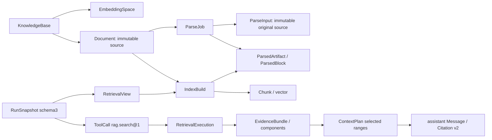

# ADR-003：RAG 检索增强与 MinerU 接入实施方案

| 字段 | 内容 |
| --- | --- |
| 编号 | 003 |
| 状态 | 已接受；工程主体已交付并完成开发检查；P0真实计数及完整效果／性能验收未退出，尚不标整份方案“已实施” |
| 文档版本／项目版本 | 1.3／v0.3，sesrag_v0.3；保留v1.2确认的固定路由／九格式／无解析回退；补充实际落地差异和证据 |
| 日期 | 初版2026-10-29；修订2026-10-30（Asia/Shanghai） |
| 适用范围 | 本机Docker Compose；txt/md本地，doc/docx/pdf/xls/xlsx/ppt/pptx通过MinerU；知识范围、向量检索／重排／增强、只读工具及工作台 |
| 依据 | [PRD-003](../prd/003-SesRAG-RAG检索增强与MinerU接入-PRD.md)、[官方调研依据](../prd/003-SesRAG-RAG与MinerU-调研依据.md) |
| 方案代码基点 | `58d9d1d4207fc61d043cbf3271308f8d14d71005`为实施前基线；交付包版本已升级为0.3.0；本次修改未自动提交 |
| 前序约束 | [统一术语](../../CONTEXT.md)、[通用执行规范](../项目开发和修改的通用执行规范.md)、[正式接口文档](../接口文档.md) |
| 配置准备依据 | `docs/secret/准备的配置信息.md`，仅本地读取服务／模型信息；密钥值不复制、不作为运行时配置真源 |
| 实施结果 | [PR-003实施结果简要说明](../pr/003-SesRAG-RAG检索增强与MinerU接入-PR.md)；实际检查与未完成项见§15，不替代后续实施结果调研或正式TEST-003 |

## 1. 决策摘要与实施边界

保留 FastAPI／Vue、PostgreSQL 权威任务队列与 Event Journal、Redis 通知和 Docker Compose。向量数据库继续采用 **PostgreSQL + pgvector**，新链路在数据库内做精确 cosine 排序，不引入 Milvus、ANN、混合检索或通用 Agent 框架。

以最小 KnowledgeBase 约束文档范围和 EmbeddingSpace。以 ParseJob 保存异步解析过程，以 IndexBuild 保存不可变构建及 Chunk；发布只切换 active 指针，不再删除仍被历史事实引用的旧批次。新协议 Run 创建时冻结 RetrievalView 和完整非 Secret RAG 配置，受控调用只读工具 `rag.search@1`，再把实际证据交给既有 ContextPlan 与生成流程。

解析按`format_router_v1`固定：txt/md仅本地结构解析；doc/docx/pdf/xls/xlsx/ppt/pptx原件只走MinerU精准API，逐次授权外发，失败不切本地或转换格式。Markdown／JSON是云端结果，归一化后与本地文本共用切片。删除txt/md→DOCX桥接、可选增强和双路线回退对象；保留任务租约、检查点、有效代写回及原子发布。

本次已确认的v1.2在原待实施方案内取代v1.1解析范围及路由决策，旧“PDF不在本轮／三格式可选MinerU／本地回退”均不再有效；不新建平行方案。txt/md独立可用，办公格式必须满足MinerU前提；服务不可用造成办公真实验收受限，不能称为可选增强不影响交付。其余检索／模型／会话设计保持：Embedding显式1024维，rerank为百炼原生协议。

本次任务只交付方案和必要文档导航。后续实施覆盖 PRD 的全部 P0/P1，包含受影响代码的单元／契约／集成验证；正式 TEST-003 环境、测试点、测试用例及分类验收脚本后续独立组织，**不修改或扩展** `tests/sesrag-persistent-session-workspace-test/`，不把上一轮正式套件作为本轮门禁。

### 1.1 目标与退出条件

| 目标 | 实施完成时的可观察结果 |
| --- | --- |
| 正确入库 | txt/md无MinerU仍可入库；七种办公格式原件云端、逐次授权，确定失败／无有效文本／超时结束；不支持格式拒绝；失败／取消保护旧active。 |
| 检索闭环 | 同空间 query Embedding→数据库内 dense 候选→可选真实 rerank→Top-K→邻近拼接→ContextPlan→回答及真实范围引用。 |
| 恢复与冻结 | 上游身份、阶段检查点、租约代数可恢复；Run 自动重试和显式重试／重生成不漂移语料与检索策略。 |
| 契约明确 | 旧v1/v2不塞新字段；v1 DOCX新上传／重建要求升级，历史可读；v3表达固定路线及可靠原页／幻灯片／工作表或缺失位置。 |
| 可交付 | 本轮独立验证证据、配置导入和运行说明齐全；真实凭据、模型限制或网络未满足时准确列受限，不以 Mock 报通过。 |

### 1.2 明确排除的范围

不实施跨库联合检索、任意 URL／网页／目录采集、HTML、独立图片多模态向量、模型自主工具循环、MCP／工具市场、文档原地覆盖和用户硬删除、完整 Document Version 审核发布治理、生产 RBAC／SLO。PPT／Excel按九格式白名单仅提取文本结构，不计算公式或编辑文件。不新增无实现的功能入口。知识库停用只阻止新操作，不等同删除历史事实或安全撤权。

本轮不提供本地办公解析／本地PDF页数探测／Office转换、自托管MinerU、输入DOCX桥接或解析回退；不引入pypdf、Office应用或PDF viewer。PDF已通过MinerU纳入，其本地替代、完整阅读高亮留后续。

### 1.3 方案选择与取舍

| 选择 | 本轮决定及理由 | 未采用路线 |
| --- | --- | --- |
| 向量库 | pgvector 精确 SQL，复用当前依赖和事务，先验证过滤、空间、排序和身份。 | Milvus／ANN 增加部署和召回条件，本轮没有必要。 |
| 解析 | txt/md本地；七种办公格式原件MinerU、逐次外发确认，单Job／有界轮询／失败结束，无公网callback。 | 不转DOCX／PDF、不换轻量API、不本地回退；服务是办公格式必要依赖，不承诺长期可用。 |
| 编排 | 既有 Worker 加可恢复的短阶段任务；领域 Port 隔离 Parser／Embedding／rerank／VectorStore。 | 不引入 LangChain／LlamaIndex／新 MQ，不把厂商 SDK 扩散到领域层。 |
| 证据和配置 | 不可变批次、配置版本和检索视图，引用中对象受保留约束。 | 不在 Worker 每次重试时查询“当前默认模型／最新文档”；不靠复制正文假装恢复完整来源。 |

## 2. 代码基线及确定的演进点

| 当前文件／核心实现 | 现状与不足 | 本方案改动方向 |
| --- | --- | --- |
| `backend/application/documents.py`、`backend/api/routes/documents.py` | v1 仅 txt/md/docx、10 MiB；上传即建 index_document Task。 | v1仅txt/md写入保留、DOCX写入升级；v3九格式及幂等／授权／ParseJob／IndexBuild。 |
| `backend/infrastructure/rag/parsers.py`、`parser_process.py`、`chunker.py` | 本地行／段落位置和字符窗口，无可选云端／回退。 | txt/md本地结构提取；办公原件验证与MinerU独立链路，失败不回退，Markdown结果共用结构归一化。 |
| `backend/db/models.py::EmbeddingType/ChunkModel`、`vector_validation.py` | `Vector(384)`、固定维度；无显式空间。 | 向量列改无 typmod 的 vector，空间／维度约束另建；旧校验保留默认 384，新校验显式传空间。 |
| `backend/infrastructure/rag/pgvector_store.py::search_chunks/replace` | 当前Python取active向量后cosine排序，replace会删除旧Chunk。 | 改数据库内精确检索、保留被引用批次和受控候选发布；不以计划SQL能力冒充当前实现。 |
| `backend/workers/handlers/index_handler.py` | 单次执行串行计算、事务外候选、短事务发布已具备租约保护。 | 旧任务兼容，新 IndexBuild 任务分阶段检查点并保留原保护；不把远端等待套成一个旧 60 秒步骤。 |
| `backend/infrastructure/queue/postgres_queue.py`、`backend/workers/runtime.py` | Task 仅 run/index_document，claim 增加 attempt，达到 max_attempts 停止；结算只识别 Run／Document。 | 扩展索引与诊断目标、正常让出等待、错误重试计数及结算适配，保持旧 Run 的 attempt 语义。 |
| `session_runs.py::new_snapshot`、`session_execution.py::process_session_run` | schema2 冻结配置，但检索时查当时 active，无语料视图；直接调用向量库。 | 抽出通用会话创建／执行能力，新 schema3 通过 rag.search 和冻结视图执行；不复制另一套聊天业务。 |
| `journal.py`、`run_handler.py`、`task_execution.py` | 有严格 v1/v2 事件、schema 分流和终态事务；部分条件写死 `==2`。 | 显式按 1/2/3 分派，更新取消／预算／终态处理，不用默认 else 把 schema3 当 schema1。 |
| `contracts/*_v1.json`、`*_v2.json`、前端类型生成器 | 旧严格契约只支持 line/paragraph 证据，生成器只登记 v1/v2。 | 追加新版本，不改写旧事件和引用；生成器支持 v3 及跨版本有名引用。 |
| 前端 documents/run/thread store、`DocumentUploader.vue`、`render.ts` | 旧文档 UI、v2 会话请求／事件解析；Markdown 清洗未完整禁止远端图片加载。 | 独立知识范围／配置／诊断组件，v3 事实恢复与证据查看；所有 Markdown 禁止自动加载外部资产。 |

已存在文件的具体变动见 §11；以下新对象、路径、方法和配置均是**计划新增／修改**，不是当前已存在的实现。

## 3. 技术选型、模型协议与启用门槛

### 3.1 已准备配置如何使用

配置准备文档中的生成模型为 `gpt-6.1-sol`，使用其已准备的生成 base URL；本轮不替它新增厂商专用协议，也不把该名称认定为官方直连。生成凭据继续通过受信 ModelProfile alias 注入。Embedding／rerank 的 workspace 服务域从受控配置导入，不把具体 workspace 域或任何密钥复制进公共示例。

该生成配置仍须满足ADR-002的ModelProfile可用性及目标网关token预算校准，不因名称相似就断言现有cl100k_base计数适用。未满足时可用明确的Mock生成Profile完成工程链路，真实生成限制单列，不能改称该网关已通过联调。

| 能力 | 锁定的实现路线 | 关键参数／返回校验 |
| --- | --- | --- |
| Embedding | `httpx.AsyncClient` 调用百炼 OpenAI-compatible `/compatible-mode/v1/embeddings`；model=`qwen3.7-text-embedding`；dimensions=1024；encoding_format=`float`。 | 本轮每请求最多 16 条，低于官方该模型 20 条限制；按 `data[].index` 恢复输入顺序，index 必须无重复且完整；向量数／维度／有限值／非零范数全校验。不使用服务默认维度猜测。 |
| rerank | 百炼原生 `POST /api/v1/services/rerank/text-rerank/text-rerank`，model=`qwen3.7-text-rerank`。 | `input={query,documents}`，`parameters.top_n=候选总数`；`output.results[].index/relevance_score` 映射原候选。本轮不传未冻结的 instruct，不请求服务替本地返回片段原文。 |
| MinerU | 固定 `https://mineru.net/api/v4`；精准 API，model_version 默认显式 `vlm`，OCR/table/formula/language 逐项记录。 | 单文件 files[0]，data_id=parse_job_id；校验 HTTP 与业务 code，保存 batch_id；下载输出使用独立安全客户端。 |
| Mock | 明确的本机工程 Profile 和假适配，不与真实空间共享身份。 | 只证明协议、故障和事务，不作为真实模型／解析效果证据。 |

Embedding base 的最后 `/v1` 是兼容路径的一部分；**rerank 不在该 base 后追加 `/reranks`**。导入项分别提供 `embedding_base_url` 和 `rerank_endpoint`，rerank 地址必须由受信百炼 workspace origin 与上述固定原生路径校验产生；拒绝任意用户 URL。阿里云文档已列出 qwen3.7 两型号，Embedding 1024 维在模型表与通用参数中一致；其他维度表述存在差异，本轮不依赖这些可选值。来源及输入限额以调研附件 §9 为据。

MinerU原生受理doc/docx/pdf/xls/xlsx/ppt/pptx；txt/md不提交。vlm为显式初始模型，官方非HTML也可pipeline；P0逐格式固定真实可用选项及输出，不在失败时自动换模型。PDF文字／受控扫描文字、表格、幻灯片分别验收；不承诺OCR／公式完全保真，官方支持不是项目已验证。

§5 的 query/document 是领域用途标记：本轮兼容 Embedding 请求两者均为普通文本，不发送官方兼容协议未声明的 `input_type` 或 `text_type`；空间描述明确 `purpose_mapping=identity_v1`，不偷偷添加前缀。以后采用原生 DashScope 的 `parameters.text_type` 时属于新适配／空间版本，不能改变已有空间含义。

### 3.2 配置版本、输入计数及外部确认

所有 Profile 采用“数据库不可变版本 + 显式非 Secret JSON 导入 + 运行时受信 Secret alias”。同 ID/version 内容相同可重复导入，不同内容拒绝，变化须增版本；普通停用只影响新选择，安全禁用 `blocked` 会阻止正在运行的外部调用并留下错误事实。导入后不是自动可用，能力探测和计数校准结果作为可用性元数据单列。MinerU另存逐格式supported_format_status及协议fixture修订；一个格式尚不可用不使其他已验证格式失效，但该格式仍是本轮待验收项，不能静默缩小产品白名单。

`qwen3.7` 的模型别名不是不可变权重摘要。Profile 必须保存受控 `deployment_revision`、请求协议版本、输入模板／input_type 策略和计数版本。操作者在服务更新后显式增版并重建新空间；不能保证上游未通知的同名模型完全确定，真实结果须记录执行日期／请求 ID／usage。

本轮默认采用 `bounded_utf8_v1` 的保守本地输入配额：Embedding 单条 ≤8192 UTF-8 字节；rerank query ≤2048 字节、每候选用于重排的前缀 ≤4096 字节，且 `query_bytes × N + Σdocument_bytes ≤65536`。这是自有字节上限，**不冒充 Qwen 精确 token 数**。重排前按原候选顺序等额缩减各候选前缀，UTF-8／字符边界对齐，保留截取区间；不足最小非空输入时明确 `RERANK_INPUT_BUDGET_EXCEEDED`，不分批重排后混排不同请求的分数。

P0 必须锁定可复查的模型专用 tokenizer／官方计数能力，或取得明确的字节配额上界适用依据并以真实 usage 校准；只有已证实的计数策略才可标记 `counter_status=verified`，否则真实 Profile 保持 `invalid: INPUT_COUNTER_UNVERIFIED`，先实现本机链路并如实报告外部验收受限。不得拿生成模型 tiktoken 编码替代这两类模型，也不得把有限样本校准宣称为任意输入严格上界。超限请求不能靠上游静默截断获得“成功”；计数依赖和边界负例是 P0 退出证据的一部分。

以上为启用门槛。工程实施时已对获准公开／合成办公样本和两类模型进行真实协议取证，七格式产物已固定安全统计；模型计数门槛仍未满足。真实调用范围及限制见§15／PR-003，不把少量成功调用认定为校准或完整效果验收。

### 3.3 新依赖与运行条件

继续使用HTTPX、SQLAlchemy、pgvector、Alembic、Pydantic、Vue/Pinia、DOMPurify；现有python-docx只保留旧代码／历史兼容所需，不作为新办公路线或回退。新增cryptography AES-GCM保护私有签名状态；锁定markdown-it-py用于本地md及MinerU返回Markdown的结构归一化，不执行HTML／脚本或抓资源。

格式安全验证新增轻量只读olefile及defusedxml并锁定依赖版本：前者有界检查doc/xls/ppt的OLE目录／类型／已知危险标记，后者安全检查OOXML元数据；仅验证容器，不提取办公正文、不计算／执行宏、不转换文件。PDF只检查格式／字节等基础边界，密码／复杂内容限制可由上游明确报错，不承诺无解析器能提前识别全部加密或页数情况。不新增pypdf、LibreOffice／Microsoft Office、转换器或自托管解析大模型。模型tokenizer若P0确认需要再锁离线资产；不隐式下载模型。

## 4. 核心对象、字段和关系约束

### 4.1 数据设计统一规则

沿用 String(36) UUID、UTC 时间、SHA256 小写 64 位 hash。Profile 版本用正整数；可变状态与不可变配置分开。秘密值和 capability URL 不进入普通 JSON 字段。每个资源先从持久 owner 关联校验，外部传入 owner／批次／终态一律不可信。

新增 ORM 放 `backend/db/rag_models.py`，由统一 metadata 注册；不复制 Base。引用既有对象用受约束外键，JSON 只放有界版本化配置，不用 JSON 代替关键关系外键。

| 核心对象／表 | 主要职责和字段设计 | 关系、身份与边界 |
| --- | --- | --- |
| KnowledgeBase／`knowledge_bases` | knowledge_base_id、owner_id、name、enabled、is_default、embedding_space_id、created_at/updated_at。 | `UNIQUE(owner_id,name)`，修剪后 1～80 字符，大小写按精确字符串；每 owner 唯一默认库。库与空间绑定不可修改；无用户删除／移动接口。 |
| EmbeddingSpace／`embedding_spaces` | space_id、descriptor_hash、provider/deployment_revision、model、dimension、normalization、metric=cosine、query/document input_type／模板版本。 | hash 基于全部影响向量语义的描述；同维度不足以相等。维度 1～2000；`UNIQUE(space_id,dimension)` 供 Chunk 复合 FK。凭据 alias 不构成空间语义。 |
| EmbeddingProfile／`embedding_profiles` | profile_id/version 复合 PK、space_id、adapter kind、无凭据 base_url、model、dimensions、input_limits、counter_version、config_ref、selection_status／security_status。 | 配置不可改；空间 FK；alias 只接受固定允许列表。生成 ModelProfile 不决定此对象。 |
| RerankProfile／`rerank_profiles` | profile_id/version、model/revision、adapter、endpoint、输入配额／计数策略、超时、score_kind、config_ref、选择／安全状态。 | 重排无向量空间；所有 score 标记本次请求身份，不能跨请求拼分。模型输入截取策略版本也冻结。 |
| ParserProfile／`parser_profiles` | profile_id/version、parser_kind=local/mineru、允许源格式、模型／支持选项、output_protocol、预算、options_hash、选择／安全状态。 | 一个Job冻结一个Profile及format_router_v1，不含转换器／fallback；Profile允许格式必须与固定路线匹配，Key仅受信alias。 |
| RetrievalProfile／`retrieval_profiles` | profile_id/version、candidate_k/top_k、rerank profile/version 或 null、failure_policy、neighbor_radius、max_enhanced_chars、过滤策略版本。 | 默认 20/5、重排关闭、失败 fail、半径 1、16000 字符；完整参数范围遵守 PRD，不允许部分默认值漂移。 |
| Document（修改） | 在既有字段上增加 knowledge_base_id、tags_json、latest_index_batch_id、metadata_version；保留 active_index_batch_id。 | document_id全局主键、knowledge_base_id外键，owner／归属不可改；active/latest通过document_id＋batch复合FK指向本Document。最新构建和当前可用性分离。源hash／文件不可改；标签最多20个、每个修剪后1～40字符、去重／区分大小写，不接受嵌套任意元数据。 |
| ParseJob／`parse_jobs` | parse_job_id、document_id/source_hash、parser_kind、routing_policy_version、parser_snapshot/hash、state/stage、artifact_id、上游batch/task/data_id、submission_nonce、remote_outcome、poll_count、parse_deadline、cancel_requested_at、安全错误。 | 单一路线、一个逻辑远端工作，至多一个成功产物；检查点归Job，Task.attempt仅物理执行。failed/cancelled不可复活，签名URL不进普通JSON。 |
| ParseInput（纯值对象，不建表） | document_id、source_hash、extension、size、受信SourceRef。 | 只引用不可变原源；不存在ParseAttempt／ParserInputArtifact表或转换hash，办公上传原字节，txt/md不外发。 |
| ParsedArtifact／`parsed_artifacts` | artifact_id、parse_job_id、source_hash、parser_hash、protocol、规范text/hash、manifest_hash、text_length、来源映射及定位质量。 | 同Job成功产物唯一；无转换输入或不同路线混拼，映射缺失不伪造原位置。 |
| ParsedBlock／`parsed_blocks` | block_id、artifact_id、seq、kind、text、offset、heading_path、locations_json、provider_locations_json、unsupported_features。 | 原源line／paragraph／table_cell／page／slide／sheet_range只在可靠时保存；否则规范block身份或缺失。Word派生page仅私有诊断，不能冒充原源page。 |
| IndexBuild／`index_builds` | index_batch_id、document_id、knowledge_base_id、artifact_id／parse_job_id、embedding profile/version/space_id、chunker_snapshot、provenance、state/stage、manifest_hash、chunk_count、task_id、published_at、安全错误、cancel_requested_at。 | batch为PK，另有`UNIQUE(document_id,index_batch_id)`和同空间复合唯一键；同文档非终态候选部分唯一。provenance=new/legacy_verified/legacy_unknown；unknown仅迁移例外。active是Document指针，不通过改旧成功批次正文切换。 |
| Chunk（修改） | 既有身份／seq／文本／offset／locations，加 space_id、dimension、content_hash、block_segments_json、legacy_unverified；embedding 改可变维数 vector。 | `(document_id,index_batch_id)` 始终 FK 到构建；可信批次另校验与构建同 space，`(space_id,dimension)` FK；`vector_dims(embedding)=dimension`。只有迁移的未知来源旧 Chunk 可 space_id=null/legacy_unverified=true，不参加新检索；新／已确认 Chunk 非空空间、非零向量。同批次 seq 唯一，发布后正文／向量不可更新。 |
| RetrievalView／`retrieval_views`、`retrieval_view_items` | view_id、owner_id、knowledge_base_id、space_id、规范化过滤、manifest_hash、scope_revision、created_at；items 保存 document_id/index_batch_id。 | items 复合 FK 到同库／空间的批次，拒绝混用；创建后只读。新 Run 保存 view_id；不是在每次查询时重新展开 active。 |
| RetrievalExecution／`retrieval_executions` | execution_id、view_id、冻结配置、origin=run/diagnostic、run_id/task_id/generation、query_hash、状态、阶段统计、候选身份／分数／去除原因、安全错误。 | Run 执行与 Task/generation 一致；diagnostic 的 run_id 为 null，不造聊天事实。诊断查询仅在私有有界输入载荷保存，默认日志只 hash。 |
| ToolCall／`tool_calls` | call_id、run_id/task_id/generation、tool_name/version、binding_hash、execution_id、state、开始／结束、安全错误。 | `UNIQUE(task_id,generation,tool_name)`；仅 rag.search@1。不能从浏览器指定状态／执行者；工具终态不是 Run 终态。 |
| EvidenceBundle／`evidence_bundles`、`evidence_components` | bundle_id、execution_id、锚点 chunk IDs、排序和两种分数；components 保存 chunk_id、原文本／实际拼接区间、hash、序号及可靠位置。 | 不跨 document/batch；每个 component 有 Chunk FK；片段区间和去重映射可重建正文。dense／rerank 分数分字段，不覆盖。 |
| ContextEvidence／`context_evidence_ranges` | plan_id、bundle_id、component_id、实际选择的 start/end_offset、selected_hash、source label。 | 外键关联既有 ContextPlan 与新证据；只记录真正进入模型的范围。Message 的新 citation 引用这些记录，历史保留不依赖扫描 JSON 猜测。 |
| Citation关联／`message_citation_links` | message_id、context_evidence_id、label，`UNIQUE(message_id,label,context_evidence_id)`。 | 对Message及ContextEvidence的FK保护真实引用，最终回答事务内与citations_json安全投影一起写；不是第二份正文／引用内容真源。 |
| 旧证据保护／`legacy_evidence_refs` | source_message_id或source_plan_id、原document/batch/chunk身份、resolved_chunk_id、availability。 | 来源二选一；只有确实匹配的现存Chunk才写保护FK；缺失项保持unavailable，不创建新的Bundle／位置或补造文本。 |
| RagOperation／`rag_operations` | operation_id、owner_id、scope、idempotency_key、request_hash、结果资源ID、storage_reservation_json、created_at。 | `(owner_id,scope,key)`唯一；文件hash、库、授权选项和规范化body参与指纹；独立于SessionOperation。storage_reservation只放有限字节数／到期／状态，不放路径和Secret。 |

Thread／Branch／Message 的事实及路径语义不变；`Thread.conversation_version` 仍为 1/2，表示既有会话布局，**不拿它表示 Run schema3**。Run 的 execution_schema_version 扩至 1/2/3，新增 nullable retrieval_view_id；Message 新增 citation_schema_version，旧记录=1，新结果=2。ContextPlan 新增 schema_version=2/3，用版本化证据选择表达；schema2 的旧计划与引用 JSON 不重写。

### 4.2 配置、事实和派生对象关系



视图、Bundle、ContextEvidence 的关系通过外键保护被引用 Chunk。原始文本／产物是私有数据；安全摘要可展示，完整源不暴露为静态 URL。新身份由服务端生成，不接受客户端直接绑定任意批次。

ParseJob.artifact_id须指向本Job同源且完整成功的唯一产物，以复合FK、UNIQUE(parse_job_id)及完成事务保证。IndexBuild manifest包含source_hash、parser_kind、routing_policy_version、parser_hash／输出协议及artifact_hash，不记录虚构转换或回退。复用旧成功Job时Build引用该Job，不将产物改挂新Job；终态后迟到结果不得覆盖。

### 4.3 锁、冻结和引用保护

统一写入顺序为 Task（若有）→Run（若有）→Thread→Branch→KnowledgeBase→Document→IndexBuild→ParseJob／关联事实；同类多行按 ID 排序。新资源插入无需锁不存在的 Task。改变 active、文档标签、归属／启停和创建视图都先锁 KnowledgeBase；创建视图在同一短事务读取过滤后的 active 集合、写 items、RunSnapshot 和输入操作结果。这样并发发布只能位于视图冻结之前或之后，不能混读一份半完成集合。

GC 同样取得 KnowledgeBase→IndexBuild 锁并复查 FK／引用，不反向等待 Task。所有远端调用、文件解包与 Embedding 都在数据库事务外；Worker 每次持久写回仍验证 task_id+worker_id+generation、租约、总截止及取消，flush 和后续锁等待后再次验证原授权时间。普通查询可短事务读取已冻结视图；视图 hash 不匹配立即失败，不按 active 补齐。

## 5. Port、模块职责及固定输入输出

`backend/domain/rag.py` 定义纯 dataclass／枚举；`backend/domain/ports/rag.py` 定义新协议。已有 `ports/__init__.py` 仅保留／兼容导出旧 DTO，不用重排通用接口破坏旧调用。应用服务负责业务、授权和事务，基础设施只实现能力。

| 能力接口（计划签名） | 输入／输出与职责 |
| --- | --- |
| `ParseGateway.submit(job: ParseSubmission) -> RemoteParseHandle` | 有源标识／hash／冻结选项，不返回 ORM；handle 有安全 batch/data_id 与受保护 URL 状态引用。提交未知抛专门错误。 |
| `ParseGateway.upload(source: SourceRef, handle: RemoteParseHandle) -> UploadReceipt` | 向已校验的原签名URL发送同一源字节，返回传输确认；不创建新batch，不携带API Bearer，不把未知应答当确定失败重提。 |
| `ParseGateway.poll(handle: RemoteParseHandle) -> ParseObservation` | 返回已知远端状态、可选真实进度和结果下载 capability；不宣布本地索引成功。 |
| `ArtifactFetcher.fetch(capability: DownloadCapability, limits: ArtifactLimits) -> ValidatedPackage` | 在受限网络／解压预算内取得验证包，不把私有URL交给前端；与不联网的Normalizer分离。 |
| `ArtifactNormalizer.normalize(source: SourceRef, package: ValidatedPackage, protocol: str) -> NormalizedArtifact` | 只消费验包结果，产出块、规范文本、位置和 hash，不自行联网。 |
| `Chunker.split(artifact: NormalizedArtifact, policy: ChunkPolicy, counter: InputCounter) -> tuple[ChunkDraftV2,...]` | 有界、纯算法；返回来源范围和序号，不落库、不调用模型。 |
| `EmbeddingPortV2.embed(texts: tuple[str,...], purpose: query/document, profile: FrozenEmbeddingProfile) -> tuple[Vector,...]` | 同空间、明确用途、按输入顺序；HTTP Adapter 后统一校验。 |
| `VectorSearchPort.search(scope: FrozenScope, vector: Vector, limit: int) -> tuple[DenseHit,...]` | scope 包含可信视图／owner／空间；数据库内过滤排序；不接收任意 SQL，不自行读当前默认库。 |
| `RerankPort.rank(query: str, candidates: tuple[RerankInput,...], profile: FrozenRerankProfile) -> tuple[RankedHit,...]` | 返回原候选身份和重排分数，不制造新证据；不负责邻近拼接和生成。 |
| `EvidenceAssembler.assemble(hits: tuple[RankedHit,...], neighbors: tuple[ChunkRecord,...], policy: EnhancementPolicy) -> tuple[EvidenceBundle,...]` | 纯区间合并和有界增强；来源 hash／区间完整；ContextPlan 之后仍可能裁剪。 |
| `RetrievalService.search(request: SearchRequest, scope: FrozenScope, context: ExecutionContext) -> RetrievalResult` | 编排 query Embedding→dense→rerank→增强，结果是 ok/empty/degraded，错误显式抛出；被工具和诊断共用。 |
| `ToolRegistry.resolve(name='rag.search', version=1) -> ToolDefinition` | 仅服务端固定注册；Binding 是 Snapshot 的值对象；不存在动态上传工具或任意执行入口。 |

`ExecutionContext` 对 Run 包含 TaskLease、run_id、generation、deadline；诊断也持有专属任务授权。所有对象的方法名称按本表贯穿实施阶段；新增代码中不另造同义的 SearchPipeline／RetrievalManager 真源。

新增`SourceValidator.validate(source: SourceRef, limits: InputLimits) -> ParseInput`做格式／内容容器安全验证，不联网／不转换。`LocalTextParser.parse(input: ParseInput, profile: FrozenParserProfile) -> NormalizedArtifact`仅接受txt/md。ParseGateway只接受七种办公原件；应用层parse_jobs按格式路由，Adapter不能异常时返回本地结果。

## 6. 入库、异步状态、恢复和发布

### 6.0 固定路由与受理边界

固定白名单为.txt/.md/.doc/.docx/.pdf/.xls/.xlsx/.ppt/.pptx，各≤10MiB。`format_router_v1`把txt/md绑定local，其余七种绑定mineru；客户端不能指定parse.mode或换路线。txt/md无需MinerU Key／加密Key／host列表／健康，不外发、不生成桥接输入。

| 情况 | 行为与事实 | 不允许的行为 |
| --- | --- | --- |
| txt/md合法源 | 固定local，Job保存本地Profile及产物。 | 查询MinerU作为前提、转DOCX或隐式外发。 |
| 办公文件未逐次授权 | 422 CLOUD_CONSENT_REQUIRED，无新Job／远端提交。 | 沿用上次授权、改本地凑成功。 |
| 已知MinerU关闭／缺Key／host／加密配置／支持协议 | 受理前409 MINERU_*_UNAVAILABLE或MINERU_DISABLED，安全说明原因；无远端任务。 | 阻断txt/md／历史读取、自动读docs/secret补Key。 |
| 办公授权且前提满足 | 原件经精准API，同batch有界轮询／恢复，安全归一化。 | 换轻量API／模型、格式转换或本地回退。 |
| 远端明确失败、认证／额度错误、空白／不安全／不支持结果、解析时限到 | Job／Build失败，停止后续入库，保护active。 | 把失败当无内容成功、自动换路线。 |
| 无远端身份且可能已受理 | failed + MINERU_SUBMISSION_UNKNOWN + remote_outcome=unknown_may_continue。 | 自动重新申请batch、宣称远端停止／未计费。 |
| 取消／总截止／失租／存储不足 | 取消、超时失败或等待有效代恢复；保护旧active。 | 失租写回、终态后发布或隐式重提。 |

解析不存在fallback；rerank显式dense_fallback仍是独立检索策略。MinerU缺失不使整个API／Worker无法启动，但办公新入库依赖它，不能用txt/md可用推导全部格式可用。

### 6.1 登记、验证和幂等

v3上传要求Idempotency-Key、库／tags及一个文件；parse可省略，路线由源推导。办公上传／新建重建请求每次须cloud_consent=true和consent_version=mineru-office-outbound-v1；确认完整原文件，可能包括图片、元数据及隐藏内容。授权绑定owner、操作键和源hash，不可跨文件／新操作复用；同操作重放无需再建任务，不扩大授权范围；先按owner和幂等指纹查已存在结果，能力当前不可用不应阻止读取同一操作已完成的结果。只有创建新Job才执行当前能力受理校验，仍活动任务的后续外发须实时安全校验。

源均≤10MiB、空字节拒绝，txt/md严格UTF-8并拒绝伪装二进制。源容器验证在有界子进程最多30秒／Linux512MiB；OOXML docx/xlsx/pptx检查ZIP及必需类型／成员，展开≤40MiB、条目≤10000；拒绝已识别宏／可执行嵌入和危险包结构。doc/xls/ppt用有界只读OLE验证对应容器类型及已知加密／危险标记，不调用Office、执行宏或提取正文；扩展名不代替容器类型。PDF只做格式／字节／MIME等基础验证，不本地计页／OCR；本地无法可靠确定的密码／损坏内容，由上游明确失败，不能宣称已全面检测。上传原件无需本地完全渲染，外发确认据此说明风险；私有存储不暴露路径。新路线纯空白或无有效文本不能发布；旧v1 txt/md纯空白兼容不冒充新路线成功。

指纹含owner、源hash、格式／固定路由版本、库、tags、ParserProfile及本次同意记录。相同键同内容返原Document/Build，异内容409；无同键同字节可建独立Document，不跨owner去重。同文档活动候选同配置复用，异配置INDEX_BUILD_BUSY；登记同事务创建Job、Build和Task。

成功解析复用要求同owner、源hash、固定route、Profile／output_protocol hash及完整产物hash一致。新Build可引用旧成功Job，不改产物所属Job；旧本地DOCX不当作新MinerU产物。办公每个新重建请求仍明确逐次授权，即使可复用已物化产物也不扩大到其他源。取消复用成功Job的新Build仅取消新Task／Build，不改旧Job。失败或未知Job不自动复活，人工新操作的新幂等键／授权及未知成本确认单列。

### 6.2 单ParseJob状态与云端检查点

| state／stage | 行为及后继 |
| --- | --- |
| queued / preparing | 校验源、固定route及Profile。txt/md转local_parsing；办公确认能力后转submitting。 |
| running / local_parsing | 仅txt/md本地结构提取，成功物化产物，失败即失败。 |
| running / submitting | 先持久化nonce和提交意图，再申请上传URL；受信响应中的batch／capability保存后进入uploading。 |
| running / uploading | PUT原字节、不带API Bearer；上游自动提交。丢失应答且batch已知先查状态，仅确定waiting-file且原URL有效才重传相同字节，不新建batch。 |
| waiting / remote_waiting、remote_running、remote_converting | 保存上游状态、可选进度及next_poll_at；正常让出，进度未知为null，不按轮询计Task失败。 |
| running / downloading、validating、normalizing | 下载验包后按冻结协议处理Markdown／JSON；无有效文本或不安全／整体协议不支持均失败。 |
| failed / submission_unknown | 提交可能已受理但无身份，不自动重提；保留unknown_may_continue，Build／Task结束失败，不继续解析或发布。 |
| succeeded / completed | 该Job完整唯一产物持久化，固定parser_kind=local/mineru；后续切片／向量化与发布仍独立。 |
| failed / stopped 或 cancelled / stopped | 确定失败／截止／取消；保留远端已知或可能继续事实，不宣称云端已撤销。 |

Job state为queued/running/waiting/succeeded/failed/cancelled；submission_unknown是failed下的stage及错误分类，不再引入双路线ParseAttempt。物理恢复沿Task/generation校验，不重置上游身份。submitting重启且无受信响应时进入未知终止，data_id不冒充上游幂等保证；有batch则只恢复该工作。终态不可被迟到响应改写；文件隔离清理。新cloud重提需新Job、新幂等键和逐次同意；前次未知时另须acknowledge_duplicate_cost=true。

签名URL／上传下载状态AES-GCM私有存储，DB只留状态引用／安全身份；Key仅运行时注入。解密失败、URL过期且无法通过原batch获得结果、认证／配额或协议失败均终止，不转本地或新batch。成功／失败与远端outcome分开，清理临时文件不意味着远端停止计费。

### 6.3 Task 调度：正常等待不等于失败重试

保留旧 `run`／`index_document`，新增 `index_build` 和 `retrieval_diagnostic` 两类。Task 新增 index_batch_id、retrieval_execution_id、failure_count、cancel_requested_at；CHECK 按 kind 约束唯一目标：run 仅 run_id；legacy index_document 仅 document_id；index_build 仅 index_batch_id；diagnostic 仅 retrieval_execution_id。TaskLease DTO 同步新增可空目标，handler 通过受信 FK 解析 Document，不伪造 run_id。

新增 Task 状态 `waiting_external`。index_build 每次领取仅处理一个有界阶段或一小批向量；正常阶段完成／远端待处理时，在有效租约事务保存检查点并设 waiting_external、available_at，清空租约。此状态也用于本地批量阶段的协作式让出，本地检查点 next_available 可为当前时间，不伪称正在云端解析。调度器到时间转 queued；claim 仍增加 generation 和 attempt，**attempt 是物理执行次数，不等于失败次数**。对新任务仅 failure_count 达 max_attempts 才停止错误重试；正常 yield 不增加 failure_count，旧 run/index_document 继续原 attempt 上限，不悄悄变更历史执行语义。

新Task状态与其Build／诊断业务状态分别投影，数据库CHECK禁止旧run/index_document进入waiting_external。旧v1重建响应需要Task state时，将正常等待投影queued、实际leased/running投影原状态；取消按原终态cancelled投影，不把waiting_external塞进旧严格枚举。

Task级可恢复故障增加failure_count，退避2/4/8…秒至多60秒、默认最多3次，连续失租计入、成功阶段不清零。对已知batch的安全GET等请求最多3次尝试且受parse_deadline限制；远端明确解析失败、认证／额度／无文本和协议错误不进入一般Task重试。非幂等提交应答不明直接未知终止，不盲重提。数据库／调度恢复可在有效代继续同Job，不能借新Task.attempt重做外部提交。

IndexBuild任务总截止1800秒；MinerU解析截止为min(parse_started_at+300秒, task_deadline)，不预留本地回退预算。poll间隔5秒、最多60次；连接5秒、API/poll30秒、上传／下载120秒，实际均取剩余解析预算；到期Job／Build失败。txt/md单次解析30秒，切片／Embedding受Task总截止。诊断120秒，聊天Run保持原冻结预算；控制面／Worker停机保护不变。

取消 API 在有效范围内设置 Build／ParseJob 和 Task 的 cancel_requested_at；queued／waiting_external 可由控制事务结算 cancelled，已 leased/running 先确认取消，再由当前 Worker 或到期回收结算。失租／截止不会使已有远端工作撤销；迟到私有文件仅成为无引用候选，由清理处理。队列 failure/cancel/reclaim 分流显式处理每种 kind，不能沿用“document.status=failed”误伤仍可用的 active。

### 6.4 文本结构、云端输出和可靠来源

本地只处理txt/md：txt按行／空行形成块；md用锁定CommonMark及显式表格扩展提取heading/paragraph/list/code/table，保留原行范围。HTML作为不可信数据，不执行或下载资源。办公原件无本地正文提取或格式转换；旧DOCX parser不被新Job调用。

MinerU返回的full.md／默认JSON须由`mineru_cloud_v4_office_text_v1`的明确识别规则及逐格式fixture处理。已登记Markdown-only输出可以本地解析成标题／段落／表格块；JSON用于可证结构／位置。只有Profile声明可选的未知辅助JSON可忽略并标记位置缺失，必需文件缺失、整体协议不支持、文本为空或不安全结果仍失败；不任意找一个md文件猜成成功，不强套开源docvortex协议。这是同一云端结果归一化，不是解析失败后回退本地办公解析。选用协议须以P0/P3真实产物确认，否则该能力保持不可用。

| 源格式 | 路线与结构验收 | 来源位置边界 |
| --- | --- | --- |
| txt | 本地行／段落，正文不丢失。 | 原源1基行及0基右端不含字符范围。 |
| md | 本地标题／列表／代码／表格，外链不抓取。 | 原行／区间和规范块映射。 |
| doc | 原OLE文件直传MinerU，正文／标题／表格。 | 可靠段落／表格才标原源；云端排版页属派生。 |
| docx | 原OOXML直传，同样核对正文／结构。 | 不用旧本地parser兜底；不凭云端页号声称Word固定原页。 |
| pdf | 原PDF直传，分别有文本型及受控扫描文字样本。 | 确认page_idx含义和基数后映射原PDF页；bbox仅有明确坐标系统时可用，完整高亮不实施。 |
| xls | 原OLE工作簿直传，表头／单元格文本及返回值。 | sheet名／range须可证，不能按Markdown行猜原行号或计算公式。 |
| xlsx | 原OOXML工作簿直传，同样核对表格。 | 无可靠坐标则规范块／表格身份，不伪造A1位置。 |
| ppt | 原OLE演示直传，标题／正文／表格及可见文本。 | 原slide序号仅可靠时展示，不把服务分页当原幻灯片号。 |
| pptx | 原OOXML演示直传，同样核对文本结构。 | 与ppt同边界，每格式独立真实验证。 |

规范文本按块阅读顺序连接，offset均为规范文本0基右端不含区间，不冒充源字节区间；拆分／表头派生前缀保留block_source_map。公开Location采用严格版本联合：line、paragraph、table_cell、page（仅PDF原页）、slide（仅可证原slide）、sheet_range（可证原工作表／单元格范围）、block。原源位置须origin=source且quality=verified；无可靠原位置可返回origin=normalized、kind=block及block_only，或空位置并标unavailable。Word派生page/bbox留provider_locations私有诊断。不能用任意输出序号替代原页／表格坐标，引用始终可追溯不可变批次／Chunk／上下文。

Location v2各分支字段由契约明确：line用line_number及start/end_char，paragraph用paragraph_number及字符范围；page用1基page_number（仅PDF），slide用1基slide_number；sheet_range用真实sheet_name及可证原始A1范围，table_cell只有可证table/row/column才标原源。归一化block分支使用block_id及其文本区间，不能贴原文件坐标标签。上游0基页号须显式转换并留协议版本；无依据时不输出该分支，PDF bbox默认仅私有诊断，不实现公开高亮契约。

structure_v1按选定产物标题／段落／表格／公式文本累积，目标800字符、overlap最多120；长块按句／字符前进并满足Embedding预算。重复表头只有明确映射的派生前缀，character_v1保留旧兼容。不执行Excel公式／宏，不重新计算或刷新数据，不承诺完整排版或任意OCR质量；无有效文本即失败。发布后文本／块／映射不可变，不合并不同Job输出。

### 6.5 候选暂存、发布和历史保留

IndexBuild状态queued/building/waiting/succeeded/failed/cancelled，stage为parse/chunk/embed/publish/completed；parse按local或mineru投影，无fallback阶段。Job submission_unknown投影Build failed及安全错误，禁止继续切片。候选按批次和有效代checkpoint；未引用临时文件按batch/generation/nonce命名，不覆盖新代。

发布短事务重新锁定并校验授权、Document／库／space 一致、全部 Chunk 数与 manifest/hash、非零向量和取消，随后把 Build 标 succeeded、Document.active 切换、latest 指针／错误更新、Task succeeded 一次提交。失败／取消不改变 active。新上传／重建／发布都使用同一个 IndexBuild 应用服务；旧 `PgVectorStore.replace` 改为受控候选写入适配，禁止按 document_id 删除旧批次。

Document 的新投影包含 `availability=none/ready/reindex_required`、active_batch 和 latest_build。旧 v1 status 仍投影 uploaded/indexing/indexed/failed，indexed 只表示有可用 active，最新错误另保留；取消且无 active 的旧视图用 failed 和 `INDEX_CANCELLED`，不往旧枚举塞 cancelled。v3 显示完整真实构建状态。

## 7. 检索、工具、上下文与恢复

### 7.1 冻结视图和 query

新 Run 创建在已有 Thread／Branch 事务内完成授权、归档／busy／expected_version、SessionOperation 幂等和冻结。RAG enabled=false 时 Snapshot 只记录关闭，不创建 view 或 ToolCall，不访问 Embedding／向量库／rerank。enabled=true 时必须提供启用库和 Profile，按规范过滤冻结当前可用批次。

过滤仅支持 document_ids、extensions、tags_all。不同字段 AND，文档／类型集合 OR，全部标签满足；文档／类型缺省无限制，显式空集合为空范围；tags_all 为空不限制。非法／越权 ID 拒绝，不忽略。视图 items 最多 1000 个文档，超过返回 `RETRIEVAL_SCOPE_TOO_LARGE`，不截断范围；单构建最多 50000 Chunk，达到上限构建失败且旧 active 不变。

冻结后检索只访问 view items 的 batch，标签／新文档／active 切换不重新求值。KB 普通停用不使旧 view 失效；实时 owner 校验、权限撤销或 Profile security blocked 仍优先。缺失批次或 manifest 不一致失败 `RETRIEVAL_VIEW_UNAVAILABLE`。合法空视图直接返回 empty，不请求外部模型。

query 为该 Run 锚定的 user Message 原文，不拼接整段历史或自动改写；超过查询限制明确 `RETRIEVAL_QUERY_TOO_LONG`，不静默截断。显式 retry/regenerate 来源 schema3 时沿用旧 RAG 配置和 view，允许既有规则下更换生成 ModelProfile，但不改变 RAG；使用最新知识需发送新消息。来源 schema1/2 没有可信 view 时，新 v3 显式重试／重生成拒绝 `LEGACY_RETRIEVAL_VIEW_UNAVAILABLE`，提示新输入；旧协议操作按兼容路径执行，不伪造过去的视图。

### 7.2 PostgreSQL 精确向量检索

`chunks.embedding` 改为 PostgreSQL `vector`（不设固定 typmod），SQLite 仅保留算法／映射测试 JSON。用 composite FK／CHECK 保证 space 与 dimension；所有新写向量严格校验 expected dimension、float32 有限范围、非零范数。不同模型同维度也不可混查。

新qwen1024空间固定 `normalization=l2_float32_v1`：先在float64累积验证范数，再L2归一化／转float32并重新检查有限／非零；query与document一致。旧确认空间保持其实际归一化规则，不为了复用新代码重写历史向量。不同归一化策略进入space描述，不能只改标签。

实际查询使用已物化的受限集合，再排序，防止混维比较；例如下面的语义 SQL（列名与 §4 一致，参数只能由应用服务生成）：

```sql
WITH scoped AS MATERIALIZED (
  SELECT c.*
  FROM chunks c
  JOIN retrieval_view_items vi
    ON vi.document_id = c.document_id AND vi.index_batch_id = c.index_batch_id
  JOIN retrieval_views v ON v.view_id = vi.view_id
  WHERE v.view_id = :view_id AND v.owner_id = :owner_id
    AND v.space_id = :space_id AND c.space_id = :space_id
    AND c.dimension = :dimension
)
SELECT chunk_id, document_id, index_batch_id, seq,
       1 - (embedding <=> CAST(:query_vector AS vector)) AS dense_score
FROM scoped
ORDER BY embedding <=> CAST(:query_vector AS vector), document_id, seq, chunk_id
LIMIT :candidate_k;
```

生产新查询不使用 `Document.active_index_batch_id` 代替 view，也不把所有向量拉到 Python。参数通过驱动绑定，不把查询文本／过滤值插入 SQL。`candidate_k=20`、`top_k=5`，范围 top_k 1～20、candidate_k 在 top_k～100；不足 K 返回实际数。dense_score 是 1-cosine_distance，保留 metric；与 rerank 的 relevance_score 不同量纲。

### 7.3 rerank、邻近增强和最终引用

Rerank开启时，在完整受限候选集合内一次请求，`top_n=N`后校验每个index只出现一次、覆盖N个候选、relevance_score为有限且在[0,1]内；返回缺项／重复／越界全部视为协议错误，不以本地补分掩盖。本轮instruct默认不发送，与§3锁定的请求一致；若后续Profile显式增版采用受信instruct，须计数校准并记录，不能由文档／客户端注入或在原版配置中隐式补入。按重排分数降序、原dense rank、Chunk ID稳定排序后取Top-K。关闭时不发请求。失败默认传播；冻结为dense_fallback时仅重排服务／协议／输入预算失败可降级为原dense排序，并记录原因；授权、视图、Embedding和向量库错误绝不降级为空成功。

对每个命中读取同文档同批次 seq±radius（0～2，默认 1），校验所有组件位于同 artifact；按规范文本区间排序合并，重叠只取一次。多个命中窗口相交时合并为一个 Bundle，记录所有锚点及最高排名，不重复堆叠；增强总文本 ≤16000 字符，总组件 ≤100，达到预算按命中优先顺序截取并记录 omitted 原因。跨文档／批次永不合并。

ContextPlan schema3继续使用生成模型的TokenCounter，先检查mandatory问题／system／输出预留，再加入历史和Bundle。当前工程保守地按整Bundle选择／丢弃，并记录实际选入组件范围与hash；不提供Bundle内部分裁剪，无预算的证据不得进入Citation。部分裁剪的预算利用率优化留后续，但不能损害实际范围身份。引用标签S1…按选入内容生成，未知引用标记不转成新来源事实。Message的结构化Citation v2引用ContextEvidence，不依据模型编造文档／页码。计划不保存完整Prompt，片段查看通过受权接口从固定范围重建。

### 7.4 ToolCall、RetrievalExecution 和 Run 终态

工具定义固定为 `rag.search@1`，ToolBinding 值对象包含 RetrievalProfile／Embedding／Rerank 版本、view_id、预算及 failure_policy，并冻结在 Snapshot3。工具输入只允许 query 和服务端生成 scope，不开放执行代码、任意 host、owner 或 SQL。每 Task/generation 最多一个逻辑 ToolCall，重试网络沿用 call_id；新 generation 可有新调用，旧代改为 interrupted，不能覆盖新代结果。

状态：ToolCall queued/running/succeeded/failed/cancelled/interrupted；RetrievalExecution queued/running/succeeded/failed/cancelled/interrupted，另有 `result_mode=ok/empty/degraded`；off 是 Run 配置状态，没有虚构成功 ToolCall。工具事实、阶段计时、候选身份、去除原因和 Bundle 在 PostgreSQL；Event 只发布安全摘要。工具完成与其事件同事务，ContextPlan 和回答继续独立步骤，最终 assistant Message／Citation 引用关系／Run+Task succeeded／message.completed／run.succeeded 同事务提交。

Run的rag_summary另有执行进度not_started/running/completed/failed/cancelled；尚未执行时result_mode=null。mandatory上下文预算失败时，工具保持not_started并记录未执行原因，不伪造empty／off／成功调用；Run仍按真实预算错误结算。配置关闭时enabled=false、mode=off，与已开启但尚未调用区分。

每 Run 常规事件硬上限沿用冻结执行预算；新增工具事件每次调用最多 10 条，阶段只记录 embed/dense/rerank/assemble 的开始或完成摘要，不逐 Chunk 追加。错误和取消保留终态事件预留。所有代际写入复用有效执行者检查，不允许诊断 API 或前端直接完成 Run。

### 7.5 检索诊断

`POST /api/v3/retrieval-executions` 在受权范围冻结 view 和配置，创建 origin=diagnostic 的 execution 及 `retrieval_diagnostic` Task，返回 202；不创建 Thread/Message/Run，不访问生成模型。诊断 query 放私有有界输入文件，任务仅引用其安全 key，结果由同 RetrievalService 生成。GET 轮询状态／有界结果，cancel 操作仅影响该诊断任务。

诊断显示预生成的检索增强计划，不生成会话历史或实际ContextPlan。当前不提供生成ModelProfile选择和无历史预算预览入口；可选预览扩展留后续明确需求，不发布半成品字段。真实Run的预算去除原因从该Run的ContextPlan读取，不能拿诊断估计替代。

## 8. 接口、契约版本和旧入口处理

### 8.1 版本策略：新增、保留、适配和不再支持的内容

产品 0.3.0、HTTP v3、RunSnapshot/Event schema3、Evidence/Citation v2 是不同版本轴。新 v3 HTTP 用既有 Thread/Branch/Message/Run/Task 存储和应用服务，不建立平行聊天链路。旧 v1/v2 JSON Schema 文件不原地加入新字段、不扩大枚举、不重写历史 Event；适配代码明确分派 1/2/3。

| 对象／入口 | 本轮处理 | 明确边界 |
| --- | --- | --- |
| v1/v2 历史消息／Run／Event／ContextPlan | 保留原始事实和原版本解码；v3 读接口显式联合旧版本。 | 不伪造 tool、view、页码或已删除正文；旧 Citation v1 与新 Citation v2 不互相强转。 |
| v2 Thread 创建／列表／改名／归档、Branch 创建／列表、Models 列表 | 路径与请求响应保持，作为新工作台共享元数据能力。 | conversation_version 仍 1/2；这里不输出 schema3 Run 或新引用，不新增一套 v3 元数据 CRUD。 |
| v2 Thread 详情、创建消息 | 原路径保留，只服务尚无 schema3 Run 的 Thread；Thread 首次 v3 消息后旧详情／写入返回 409 `CLIENT_UPGRADE_REQUIRED`。 | 不删掉 schema3 消息后伪装完整历史，不把 schema3 Run 报成 schema2。v3 详情可读取该 Thread 的全部历史。 |
| v1 Thread 写入／读取 | 延续前序 conversation_version 隔离；有 v2 布局的 Thread 保持原升级拒绝。 | v3 写入使用现有原子升级到布局 2，不把布局版本写成 3。 |
| v1/v2 Run 详情／Context／events/SSE／retry/regenerate | 源 Run schema1/2 按既有规则保留；访问 schema3 返回 409 CLIENT_UPGRADE_REQUIRED。 | 不对 Event seq 做过滤投影、不跳过工具事件制造游标空洞；旧 Run 不因在新 Thread 中就失去自身历史读取。 |
| v2 Run cancel | 原路径可复用统一取消逻辑，响应仍是旧的 run_id/status。 | 可取消 schema3 的事实，不输出新字段；不是新增另一套终态推断。v1 对不兼容 Run 仍拒绝。 |
| v1 文档上传／列表／index | 保留路径；txt/md上传／重建仍本地，兼容适配保留旧错误时点和字符切片，发布同样登记IndexBuild／space／Chunk hash和指针。DOCX上传／重建返回409 DOCUMENT_WRITE_UPGRADE_REQUIRED；其他新办公格式仍不在v1受理范围。 | DOCX改用v3并逐次授权，不能旧请求隐式外发或长期本地解析。列表／历史读保留原三格式兼容视图，不输出新parser字段，旧DOCX／引用仍可读；不声称原无游标列表已新增分页。 |
| legacy Run 的旧向量检索 | 专用兼容适配按其冻结的 384 维模型身份查询可信 legacy 批次；也采用数据库距离查询。 | 绝不读取新 1024 空间，来源未知时报 `LEGACY_RAG_SPACE_UNAVAILABLE`；旧自动重试没有 view 语义，不能声称达到 schema3 冻结目标。 |
| 旧 `.env` RAG 配置 | 保留给 legacy 解码／兼容 Profile 导入；schema3 新能力以数据库 Profile 和新受信 alias 为准。 | `MODEL_API_KEY` 不自动兼作百炼／MinerU Key；不运行时双写两套默认参数。 |

不废弃既有历史事实或路径，但明确收紧v1 DOCX新上传／重建；旧客户端在升级后的资源上收到可诊断的版本冲突，是明确支持边界，而非静默截断适配。新前端总是用 v3 Thread detail 和 v3 Run 读协议，旧页面／外部调用可继续操作未升级范围。升级检查与首次 v3 消息持有同一 Thread／Branch 锁，防止旧新写入竞争；archive 和取消始终保持可用。

### 8.2 计划新增的 HTTP 接口

以下路径在当前仓库均不存在，属于**新增的新版本入口**。底层复用 §5 用例；不是把表中的既有 v2 路由误当尚未存在。接口实施时同步正式 `docs/接口文档.md`，本 ADR 只是决策基线，不提前声称接口可调用。

| 方法／新路径 | 请求与响应要点 |
| --- | --- |
| POST/GET `/api/v3/knowledge-bases` | 创建 name/embedding_profile_id+version；列表分页。服务器推导 space；幂等创建返回 201/重放 200。 |
| GET/PATCH `/api/v3/knowledge-bases/{kb_id}` | 详情及统计；只允许 name/enabled，空间修改 422；无 delete。 |
| GET `/api/v3/rag/profiles` | 安全可选 Embedding／Rerank／Retrieval／parser 配置身份、范围及 availability；无 URL、Key、alias。 |
| POST/GET `/api/v3/documents` | 九格式单文件multipart+库/tags/parse；服务端固定路由，办公逐次外发确认；202及资源身份，列表按库有界分页。 |
| GET/PATCH `/api/v3/documents/{id}` | 完整 active/latest／解析定位质量；PATCH 只允许 tags。 |
| POST `/api/v3/documents/{id}/index-builds` | 固定格式路线、ParserProfile及切片配置，办公每次授权／必要未知成本确认；202或相同活动请求复用200；不沿用上次授权。 |
| GET `/api/v3/index-builds/{batch_id}` | Build+ParseJob 安全进度，无能力URL和原始响应。 |
| POST `/api/v3/index-builds/{batch_id}/cancel` | 202 表示取消请求已保存，尚未确认时返回 cancelling；已终态 200，不修改既有结果。 |
| GET `/api/v3/documents/{id}/chunks` | 必须指定受权可用 batch、cursor/limit；返回片段和来源，不能任意访问正在构建的候选正文。 |
| POST `/api/v3/retrieval-executions` | query、库、Profile／允许覆盖值和过滤；202 新诊断任务，幂等重放 200。 |
| GET `/api/v3/retrieval-executions/{execution_id}` | 状态／阶段与候选／结果分页；Run 执行记录也可在归属校验后读取。 |
| POST `/api/v3/retrieval-executions/{execution_id}/cancel` | 仅取消诊断 task；对 Run 内工具返回409，需取消整个 Run。 |
| GET `/api/v3/evidence-bundles/{bundle_id}` | 校验 owner／引用来源，按组件和字符分页重建 snippet；上限每页 4000 字符，返回原范围／位置。 |
| GET `/api/v3/threads/{thread_id}` | 与原 v2 相同的 Branch／分页读取，消息引用与 Run 摘要以显式版本联合表达。 |
| POST `/api/v3/threads/{thread_id}/messages` | 原 branch_id/content/expected_version/model selection，加 rag 配置；201、同键重放 200；创建 schema3 Run。 |
| GET `/api/v3/runs/{run_id}`、`/{run_id}/context` | 可读 schema1/2/3；旧事实按 legacy 分支，不填新 view；新 Run 输出安全 snapshot／view 摘要与计划范围。 |
| GET `/api/v3/runs/{run_id}/events`、`/{run_id}/events/stream` | 联合 schema1/2/3；分页／after_seq／Last-Event-ID 规则沿用；不改 Event 原始 seq。 |
| POST `/api/v3/runs/{run_id}/cancel`、`/retry`、`/regenerate` | 取消复用统一应用服务；显式操作基于 schema3 旧 view 创建新 schema3 Run，原幂等、busy 和归档规则不变。 |

列表 cursor 为服务端有界分页身份，默认 50、最大 200；Chunk 正文默认页最多 20 条并受 64000 字符总量限制。mutating 创建／重建／诊断／消息／重试／重生成要求 Idempotency-Key；PATCH、cancel 是自然幂等，不伪造成功完成。Build／ParseJob 的取消响应可用单独 `operation_status=cancelling` 表达受理过程；持久业务 state 保持原非终态，到 Worker／控制事务确认才为 cancelled，不把响应标记当作已清理或远端已取消。

历史Citation v1通过v3文档Chunk读取按原document/batch/chunk查现存内容，不创建伪Bundle；若批次仅为legacy_unknown但有当前owner的旧引用，可按历史证据读取，明确space_status=unverified，不因此纳入检索。不存在的旧片段返回 `LEGACY_EVIDENCE_UNAVAILABLE` 及安全位置缺失说明，不用新active文本替换。新Citation v2则经Bundle／ContextEvidence读取固定实际区间。该历史读取例外不是候选预览或未知空间检索入口。

v3消息rag形状固定为`{"enabled":false}`或`{"enabled":true,"knowledge_base_id":"uuid","retrieval_profile_id":"id","retrieval_profile_version":1,"overrides":{"top_k":5,"rerank_enabled":false,"neighbor_radius":1},"filters":{"extensions":[".md"],"tags_all":[]}}`。缺省rag关闭，前端显式发送；document_ids缺省不限制，显式空集合为空范围。extensions只允许九格式白名单.txt/.md/.doc/.docx/.pdf/.xls/.xlsx/.ppt/.pptx；其他拒绝。overrides仅top_k/rerank_enabled/neighbor_radius；Profile控制candidate_k/failure_policy；合法Top-K不大于候选数。

上传／重建的parse与会话rag独立。txt/md可省略parse或传空对象，允许绑定格式匹配的parser_profile_id/version；拒绝云端授权／mode／fallback等歧义字段。办公形状为`{"parser_profile_id":"mineru-office","parser_profile_version":1,"cloud_consent":true,"consent_version":"mineru-office-outbound-v1"}`，同意绑定当前操作及原源；profile可由服务端受信默认补齐，consent不可默认。路线只由服务器推导；不接受mode、failure_policy、converter或任意URL。未知提交的新重建另有acknowledge_duplicate_cost=true；后台返回真实parser／状态，不由授权勾选宣布成功。

### 8.3 计划修改的既有接口实现

**修改实现并明确兼容边界**：`backend/api/routes/documents.py`经兼容应用适配处理v1过滤投影，`legacy_rag.py`／`pgvector_store.py`共享可信空间、不可变批次及引用保护，不将旧登记错误时点强改成v3；`routes/v2/threads.py`加升级边界校验；`routes/v2/runs.py`和v1 runs路由在发送流前检测协议支持，cancel复用；`session_threads.py`／`session_runs.py`分离事实读取与版本投影；health保留原必需PG／Redis／Worker就绪规则。MinerU办公能力／可选rerank不可用不使txt/md及聊天API全局不就绪，通过profiles availability展示，不往旧health Schema塞字段。

v1与v3的文档受理白名单分开校验：共享验证器不能令旧v1意外接受PDF等新办公类型。v1 DOCX上传／index在创建新源／Job／Task及任何外发前返回升级错误；已有owner历史读不受此写限制。新错误仍使用既有安全code/message形状，并同步错误契约／白名单及回归测试。

旧 Message/Run 创建端点不接受 rag 新字段；不把 `POST /api/v2/threads/{id}/messages` 误描述为新增，也不让它隐式创建 schema3。根 README 只链接接口文档，不复制接口表。

### 8.4 契约文件、快照与事件

新增 `contracts/knowledge_base_v3.json`、`rag_profile_v3.json`、`document_v3.json`、`index_build_v3.json`、`retrieval_v3.json`、`tool_v1.json`、`evidence_v2.json`、`citation_v2.json`、`message_v3.json`、`run_v3.json`、`run_event_v3.json`、`context_plan_v3.json`、`api_responses_v3.json`。v3 Thread detail 的定义放 api_responses_v3，并引用原 ThreadSummary／Branch，不新增冗余 Thread CRUD 契约。

document_v3/index_build_v3严格定义ParseRequest／ParseOutcome：固定parser_kind、routing_policy_version、Profile版本／hash、Job state/stage、artifact_id或null、remote_outcome及安全error。无requested_mode／fallback Profile／local_fallback／ParseAttemptSummary。Job成功必须有合法完整产物；未知以failed和专门stage／code投影，不伪装空成功。Capability URL／raw响应不在公共分支。

| 契约 | 关键设计 |
| --- | --- |
| Snapshot3（服务端私有） | schema_version=3，原 owner/thread/branch/input_anchor、冻结生成 Profile/context/execution，加 tool binding、Profile 全部非 Secret 参数、view_id/manifest_hash；关闭 RAG 无伪造 view；只保存 alias，不保存值和签名 URL。 |
| Run v3 | 原 run_id/status/Task/模型摘要，加 execution_schema_version=1/2/3、rag_summary；旧 snapshot 以原安全摘要分支返回，无新 view 证明；新的安全摘要不输出 endpoint/config_ref。 |
| Message v3 | body 事实不变；citation_schema_version=1/2，citations 按该值严格对应 Citation 数组，不依据字段名猜版本；引用旧 Message 不改库内 JSON。 |
| Evidence v2／Citation v2 | schema_version=2、bundle/context、document/batch/Chunk组件、规范范围/hash、可靠line/paragraph/table_cell/page/slide/sheet_range或规范block／缺失、dense/rerank分数。位置联合含origin及quality，page仅已证原PDF，Word派生页不冒充原源；只引用ContextPlan实际范围。 |
| 工具输入／输出 | tool_v1 定义 rag.search@1；输入 query+受信范围，输出 mode/count/bundle_ids/trace_id 及安全错误；字段严格，无任意参数透传。 |
| Event v3 | 顶层显式联合原 v1、v2 和新 schema3；新分支仍带 task_id/attempt/generation，seq 全 Run 单调。历史原事件不包装成新事件。 |
| 新工具事件 | tool.started、tool.stage、tool.completed、tool.failed、tool.cancelled；含 call_id/execution_id/tool_version/stage，结束带 mode/数量／安全错误，不带原文／URL。 |
| 新 context／retrieval 事件 | context.planned/compacted 和 retrieval.completed 在 schema3 分支使用新安全计数／Bundle 摘要；答案 delta、取消及终态语义保持原行为，以 schema3 独立校验。 |

新 Schema 全部 additionalProperties=false（包含嵌套），数组／文本有界；Snapshot 用对应 Pydantic 私有模型独立校验。前端生成器扩至 v1/v2/v3，跨版本类型用明确别名导入，避免新 EvidenceV2 与既有 RunV2 的同名碰撞；`check:api` 必须覆盖三代且不重写旧协议含义。

### 8.5 稳定错误分类

HTTP即时校验错误使用现有 `{code,message}` 安全形式；后台失败保存同类code，由资源GET投影，不把后台失败伪装成HTTP新创建失败。统一映射如下，不能回传原始上游异常、SQL、Key或签名URL：

| 类别／代表code | 即时HTTP／后台行为 | 重试与用户处理 |
| --- | --- | --- |
| RESOURCE_NOT_FOUND（各资源专用码） | 404，缺失与跨owner同口径 | 不泄漏另一owner的存在性。 |
| INVALID_RAG_PARAMETER／RETRIEVAL_QUERY_TOO_LONG／RERANK_INPUT_BUDGET_EXCEEDED | 422；后台则failed，显式重排fallback除外 | 调整输入／受支持参数；query不静默截断。 |
| DOCUMENT_TOO_LARGE／UNSUPPORTED_DOCUMENT_TYPE／DOCUMENT_MIME_MISMATCH | 413／415 | 请求拒绝，不创建可用候选。 |
| IDEMPOTENCY_CONFLICT／INDEX_BUILD_BUSY／CLIENT_UPGRADE_REQUIRED／DOCUMENT_WRITE_UPGRADE_REQUIRED | 409 | 同键重放原结果；v1 DOCX写入需新入口及授权，不能隐式外发。 |
| CLOUD_CONSENT_REQUIRED／INVALID_PARSE_SELECTION | 422 | 办公未逐次授权或格式／Profile不匹配拒绝；无外发、不建Job，不提供解析回退。 |
| MINERU_DISABLED／MINERU_CREDENTIAL_UNAVAILABLE／MINERU_PROFILE_UNAVAILABLE | 已知不可用时即时409；登记后失效则后台failed | 不影响txt/md／历史读取；办公能力不可用，不换本地或读secret自动补配置。 |
| PROFILE_UNAVAILABLE／INPUT_COUNTER_UNVERIFIED（Embedding／rerank） | 409或依赖不可用 | 两类模型的原门槛保持，不因为parser能local就忽略。 |
| MINERU_SUBMISSION_UNKNOWN | Job／Build failed，remote_outcome=unknown_may_continue；未确认的新重提409 | 不自动重新提交；新Job／键／逐次同意及重复成本确认，旧失败不复活。 |
| MINERU_AUTH_FAILED／MINERU_QUOTA_EXHAUSTED／MINERU_TEMPORARY_UNAVAILABLE／MINERU_PARSE_FAILED／MINERU_ATTEMPT_TIMEOUT | 后台failed，不切换路线 | auth／额度／远端明确失败不盲重试；安全GET等临时请求有界重试，同工作超时失败。 |
| MODEL_CREDENTIAL_UNAVAILABLE／EMBEDDING_TEMPORARY_UNAVAILABLE／RERANK_TEMPORARY_UNAVAILABLE | 模型依赖任务有界retry或failed；只允许配置的rerank degraded | 不转empty，不绕过模型故障。 |
| MINERU_OUTPUT_UNSUPPORTED／MINERU_EMPTY_OUTPUT／ARTIFACT_UNSAFE | 后台failed，隔离无效输出 | 无有效文本／整体不支持／危险结果不发布；无输入Bridge或本地兜底。 |
| SOURCE_UNSAFE／INVALID_EMBEDDING／RERANK_PROTOCOL_INVALID | 原源不安全停止；向量错误failed；rerank仅允许冻结的dense fallback | 不绕过源安全，不补向量／候选身份。 |
| RETRIEVAL_VIEW_UNAVAILABLE／LEGACY_RAG_SPACE_UNAVAILABLE／LEGACY_RETRIEVAL_VIEW_UNAVAILABLE | 即时409或后台failed | 新输入／明确重建／确认来源，不能自动改用当前active。 |
| RAG_STORAGE_EXHAUSTED／RAG_TMP_EXHAUSTED | 即时507或后台failed | 清理无引用对象／增加空间，旧active继续保护。 |
| TASK_DEADLINE_EXCEEDED／INDEX_CANCELLED | 后台failed／cancelled，终态唯一 | 本地停止，不宣称远端已停止。 |

安全禁用立即停止对应后续外发；办公MinerU被禁用时Job／Build明确失败，不转local。模型security blocked不允许dense_fallback；源安全、用户取消或总截止也不能降级绕过。已上传文件／远端任务是否继续如实保留，人工新cloud操作仍需授权。txt/md本地不因MinerU禁用受影响。

## 9. 安全、配置、容量和清理

### 9.1 出站及文件处理

模型／MinerU API origin 从受信导入配置校验，HTTPS 默认 443，无 userinfo/query/fragment；MinerU API Token 仅允许 API origin。签名上传／下载允许 host 由部署允许列表明确配置，在 P0 用真实返回域确认，不允许 `*` 或由每次响应动态自动加入。逐跳校验解析 IP 均为公网，拒绝私网／回环／link-local／metadata，禁止隐式环境代理；DNS 解析与连接须绑定已校验地址、TLS SNI／证书仍校验原 host，防止仅预检查 DNS 后重绑定绕过。受控假服务只在显式测试模式允许本机隔离网段，真实配置不能开启该例外。

URL 301/302/307/308 最多 3 跳，每跳重新验证，跨 origin 不转发 Authorization；签名 URL 的 query 不进入日志。结果 ZIP 下载流式限 100 MiB、解压总量 256 MiB、单成员 64 MiB、条目 10000、压缩比 100、路径长度 240；拒绝绝对路径、盘符、`..`、符号链接、大小写／Unicode 归一化后重复路径及嵌套归档。JSON 32 MiB／深度 64、规范总文本 32 MiB、单块 1 MiB；超限明确错误，不能部分发布。解压和归一化在有界子进程最多60秒且不超过parse_deadline剩余、Linux512MiB地址空间，容器资源再限制；Windows 无 RLIMIT 的差异单列，但正式本机验收走 Linux 容器。

不渲染原始远程 HTML，DOMPurify 后再限制链接协议、禁止 img/svg/object/iframe 及 CSS 外链；不自动访问 Markdown 外部资产。Prompt 中将证据放在数据边界，工具授权不来源于文档指令；默认日志只关联安全身份／计数／错误码。

### 9.2 计划新增／调整的运行配置

以下名称在实施时同步 `.env.example` 注释、README 和 Runbook；示例只有空占位，不从准备文档自动生成含密钥文件。

| 配置／来源 | 必填／默认 | 用途、安全边界 |
| --- | --- | --- |
| `MINERU_ENABLED` | 否，false | 允许云端解析的服务端总开关；与每次授权同时满足。 |
| `MINERU_API_KEY` | 办公真实解析必填，无默认；txt/md不要求 | 受信alias；缺失使办公能力unavailable，受理前拒绝／运行中失效则失败，不使API/Worker无法启动。 |
| `MINERU_STATE_ENCRYPTION_KEY` | 办公真实解析必填，32字节base64；txt/md不要求 | 保护私有URL状态；API/Worker一致，不覆盖旧Key；恢复解密失败结束Job，不输出原文、不转本地。 |
| `MINERU_STORAGE_HOST_ALLOWLIST` | 真正调用时必填，空默认；local不要求 | 精确已核实域，缺失不尝试上传；不放开全CDN；本地解析不探测该网络。 |
| `RAG_EMBEDDING_API_KEY`／`RAG_RERANK_API_KEY` | 对应真实 Profile 必填 | 分别受信 alias；即使当前两个值相同也分别配置，不能默认复制生成 Key。 |
| `RAG_ARTIFACT_DIR`／`RAG_TMP_DIR` | `/data/rag-artifacts`／`/data/rag-tmp` | 规范产物／加密状态与短期下载／解包分离，API/Worker 私有共享卷；不得公开静态挂载。 |
| `RAG_STORAGE_BUDGET_BYTES` | 10 GiB | 本项目 source+产物+候选的软预算，预留 512 MiB 后拒绝新构建；不删除引用中数据腾空间。 |
| `RAG_TMP_BUDGET_BYTES` | 1 GiB，最低384MiB | 累计临时软预算，至少容纳一个384MiB执行槽，不足在配置加载时明确拒绝；配合每任务限额与全局预留检查，磁盘不足明确失败。 |
| `RAG_PIPELINE_CONCURRENCY` | 1，允许 1～4 | 每 Worker 文档／诊断处理并发上限；远端等待释放槽位，不靠并发绕过额度。 |
| `RAG_BOOTSTRAP_CONFIG` | 空库可用内置Mock模板；有旧数据时显式提供 | 只读、非Secret导入文件路径，供分段迁移初始化每owner默认库；migrate不读Key、不自动扫描`docs/secret`。已完成初始化的数据库不反复覆盖Profile。 |
| 非 Secret `rag-profiles.example.json` | 显式导入，非运行时第二真源 | parser 选项、默认库空间、模型协议／计数、20/5、重排失败策略、半径及所有上限；变更增版。 |
| legacy MODEL_*／VECTOR_DIMENSION | 保留旧默认／384 | 只服务原冻结协议及受控迁移；Settings 只对 legacy 部分验证 384，不阻挡新 Profile 的 1024。 |

Task总截止1800、cloud最多300秒／poll5、local单次30秒、源10MiB、OOXML展开40MiB／条目10000、向量16条、candidate20/top5、neighbor1／16000写入版本化Profile。Job冻结格式路由，无转换预算或本地回退预留；安全总开关收紧即阻断办公外发并明确失败，不切路线。Settings采用能力级校验，缺MinerU配置不阻止txt/md／聊天启动。

磁盘总预算是本应用软配额，不等于宿主文件系统硬隔离。容量检查在项目级PostgreSQL advisory lock下协调，结合已登记用量和实际剩余空间，并为本次写入预留上限；预留记录使用 `rag_operations` 的有界内部storage_reservation元数据，完成／失败后释放，恢复时按有效Task重新确认，不能无界重复预留。该预留采用独立短事务，不同时持有Task／库／构建业务行锁，避免与§4.3形成反向锁依赖。真实写入仍须处理ENOSPC／权限错误；共享磁盘被其他程序占用时明确失败并保护active，不能声称应用预算能控制其他程序。用于模型输入的字节限制与磁盘字节预算分别记录。

### 9.3 保留和 GC

保留源、active及view／ContextPlan／Citation引用批次／产物和必要位置映射，长期增长／10GiB限制不变。无引用失败候选和私有state按24小时规则清理、保留Job错误／hash摘要；原始ZIP／展开目录完成即删，诊断7天及410规则不变。没有桥接输入／双路线未选产物；清理不改变远端unknown_may_continue，也不删除原源或引用中事实。

维护命令落地为`python -m backend.tools.cleanup_rag_artifacts`，默认dry run；`--apply`只处理无引用且超过保留期对象。实际采用Task→库→文档→构建锁、事务内FK复查及原子元数据删除，不新增独立`gc_state`，不改写业务终态。批次至少保留24小时，独立诊断保留7天；`rag_gc_records`保存带owner摘要的30天安全墓碑，清理后410，超期404。私有文件仅在专用目录按年龄和活动引用检查后单层删除；事务已完成而文件删除中断时，下次重扫，不先删除仍受引用保护的正文。ParseJob错误、hash及未知提交摘要长期保留，防止清理抹去重复成本确认依据。source、active/latest、Run视图和历史引用不在删除候选；禁止全局prune或任意宿主递归删除。报告输出`protected/would_delete/delete`动作及usage／bytes；执行错误非零退出，不将失败伪装清理完成。

## 10. 迁移、兼容导入与部署安全回滚

### 10.1 迁移顺序

| 迁移文件（新增） | 内容与校验 |
| --- | --- |
| `0007_rag_catalog_and_profiles.py` | 新建库／空间／Profile／操作表和暂可空的 Document 归属字段。停写期间在此版本执行受信配置导入和每owner默认库初始化，默认库绑定显式选定的真实或Mock空间；不给旧向量猜模型。 |
| `0008_rag_builds_and_vectors.py` | 默认库先就绪再填归属FK；新ParseJob／ParsedArtifact／Block／Build，单路线检查点和唯一产物约束，无ParseAttempt／ParserInputArtifact表。旧batch补legacy Build，只保存已知事实；未知空间迁移例外、缺Chunk审计不变。 |
| `0009_rag_views_tools_and_evidence.py` | view/items、execution、ToolCall、Bundle/component、ContextEvidence、GC元数据／records等；旧引用仅对真实存在且身份吻合的Chunk建保护关联，丢失项记legacy unavailable，不改原Message／Event。 |
| `0010_rag_task_and_run_protocol.py` | Task kind／目标／等待／failure_count、Run schema3/view FK、Message citation version／ContextPlan schema version；兼容 pending Task 识别与队列约束。 |

不修改0001～0006历史定义。迁移先检查悬空指针、重复活动任务、混合空间来源和非法向量并输出安全预检；可修复的显式处理，不能猜测合并。升级前停API写入、停止Worker领取并排空已领取任务，备份数据库与source卷；迁移不调用外部服务，不自动重索引。**不在已有数据上一次裸跑 upgrade head**：先到0007，显式导入Profile并为每owner建好默认库，再到head；缺配置在0008前安全停止。空库由受控初始化命令种入明确版本的Mock配置／默认库，也不依赖猜测。根Compose的migrate命令改用新 `backend.tools.upgrade_rag_schema` 包装这一分段过程：非空旧库缺受信导入文件时拒绝自动继续，Runbook给出维护操作。遗留任务还须满足下述格式升级边界及可信legacy空间；新入库只创建index_build。

切换前单独清点旧`index_document`的DOCX任务：已领取的在旧版本受控排空，未领取的显式取消并保留原任务／错误事实；无法排空时停止切换，不能迁移后自动外发。新版本旧handler对残留DOCX防御性结束为DOCUMENT_WRITE_UPGRADE_REQUIRED，既不继续本地解析也不补云端授权；由用户改v3新建重建请求逐次同意。旧active不被结算误清。只有txt/md旧任务按原兼容规则和可信空间继续；新入库均index_build。

包装命令在空部署只初始化内置明确版本的Mock配置及OWNER_ID默认库，非空库读`RAG_BOOTSTRAP_CONFIG`；到0007的导入只操作该版本已存在的catalog表，不用最终ORM查询尚未迁移的Build／Task字段。migrate容器只注入DATABASE_URL、OWNER_ID和非Secret文件挂载，不需要MinerU／模型Key。Document active/latest采用同Document／batch复合FK：先flush候选身份再更新指针，不依赖延迟校验。旧未知批次保留身份但availability=reindex_required，不能仅凭active非空投影ready。

### 10.2 旧空间确认与 Profile 导入

`sync_rag_profiles` 显式导入非Secret配置；`confirm_legacy_rag_space` 接受operator提供的模型／修订／地址身份和可复核证据，仅能把未知旧批次确认到**该库已绑定的同一个空间**。必须全库一致；确认以一次受控事务填Build／Chunk space及已确认来源，不能改变原文本／向量或库绑定。若与库空间不符／来源混杂，不能确认；保持reindex_required，将不可变源重新入库到新知识库。新写Chunk强制非空空间，migration_only的legacy_unverified例外由CHECK、构建来源校验触发器和应用写入白名单共同限制；新API不能制造该例外。确认不会重新计算历史向量或声称验证模型效果；Mock也须记录明确算法版本，不因384维就推断是Mock。

空部署可以没有 legacy 可用库，直接导入真实／Mock 独立空间创建新库。旧 v1 上传依赖可用 legacy 默认库，未配置时返回 `LEGACY_RAG_SPACE_UNAVAILABLE`，不把它悄悄切到 1024；新 UI 使用 v3 明确选择库。`MOCK_PROVIDER` 不能覆盖新 Profile 或改变新空间。

### 10.3 部署回滚边界（与解析失败处理无关）

本节只定义版本部署回滚，不是办公解析回退。纯结构升级且无新 schema3／多维向量／新事实时，可在隔离预检通过后逐级 downgrade；一旦存在 schema3 或非384向量，自动 downgrade 明确拒绝 `RAG_DOWNGRADE_DATA_PRESENT`。不得把向量裁成384或删除新事实来让降级通过。生产式本机回退采用停写、恢复升级前数据库与匹配卷快照、回滚镜像；明确升级后新增事实不能自动带回旧版本，需要保留安全备份并单独处理。

数据库与私有卷要作为一致备份集合，加密状态 Key 通过原安全渠道保存；仅数据库恢复不能声称恢复了全部 source／产物。旧镜像不得在已升级数据库上自动运行并重写数据。Runbook 写出 PowerShell/Linux 的备份、预检、迁移、Profile 导入、启用与恢复命令，验证在专属隔离库完成，不向当前开发库执行探针。

## 11. 项目文件与目录变动清单

阶段代码 P0～P8 见 §12。表内路径均是实施时的明确职责分配；新增目录内的 `__init__.py` 仅包注册，同阶段补齐。允许实现时做同职责小范围拆分，但必须同步此清单和模块 README，不创建无说明的平行模块。

表内同一行的纯文件名沿用该行首个完整文件路径的目录，例如`backend/application/retrieval.py`后的`retrieval_views.py`即`backend/application/retrieval_views.py`；跨目录的文件写出完整仓库相对路径，根目录文件用./前缀明确定位，不能按前一模块目录拼接。

### 11.1 计划新增文件

| 路径 | 用途／主要职责 | 使用阶段 |
| --- | --- | --- |
| `backend/domain/rag.py`、`backend/domain/ports/rag.py` | §4 值对象／状态与 §5 纯协议，隔离 ORM／厂商；显式区别 legacy。 | P1 起全链路 |
| `backend/db/rag_models.py` | 新持久实体／外键／唯一约束，统一 metadata 注册。 | P1 |
| `migrations/versions/0007_rag_catalog_and_profiles.py`、`0008_rag_builds_and_vectors.py`、`0009_rag_views_tools_and_evidence.py`、`0010_rag_task_and_run_protocol.py` | §10 四阶段迁移与有损降级拒绝。 | P1/P2 |
| `backend/application/knowledge_bases.py`、`rag_profiles.py`、`rag_operations.py` | 库管理／空间绑定、受控配置及操作幂等。 | P1/P2 |
| `backend/application/parse_jobs.py`、`index_builds.py` | 解析业务状态、提交未知／取消及候选检查点／发布事务。 | P2/P3/P4 |
| `backend/application/retrieval.py`、`retrieval_views.py`、`evidence_assembly.py` | 固定检索编排、语料冻结和纯邻近区间合并。 | P4/P5 |
| `backend/application/rag_tools.py`、`rag_run_execution.py`、`rag_gc.py` | 固定工具注册与执行、新 schema3 Run RAG 接线、引用保护清理用例。 | P5/P6 |
| `backend/infrastructure/rag/repository.py`、`profile_repository.py`、`artifact_store.py` | SQL 关系读取／写入、Profile 存取、私有 hash 产物／加密 capability；应用层控制事务。 | P1～P4 |
| `backend/infrastructure/rag/mineru_client.py`、`mineru_outputs.py`、`download_safety.py` | 精准 API、已识别输出适配、DNS／重定向／受限下载与验包。 | P0 协议证据，P3 实施 |
| `backend/infrastructure/rag/local_structure.py`、`office_validation.py`、`source_mapping.py` | txt/md及返回Markdown结构提取、办公原件有界容器验证、块到可靠原位置／缺失映射；不做输入转换或原件本地兜底。 | P2本地／输入，P3输出 |
| `backend/infrastructure/rag/normalizer.py`、`structured_chunker.py`、`input_counter.py` | 两路线规范化、选中产物结构切片、模型专用计数，不要求云端才能切片。 | P0/P2/P3/P4 |
| `backend/infrastructure/providers/rag_registry.py`、`bailian_embedding.py`、`bailian_rerank.py` | 冻结 Profile 组装、两种独立 HTTP 协议及响应验证；不改写生成 Adapter。 | P0/P4/P5 |
| `backend/workers/handlers/index_build_handler.py`、`retrieval_diagnostic_handler.py` | 可让出的构建阶段和独立诊断任务编排。 | P2～P5 |
| `backend/api/routes/v3/knowledge_bases.py`、`documents.py`、`retrieval.py`、`profiles.py`、`threads.py`、`runs.py` | §8 新版路由适配，业务仅转交应用服务。 | P2/P5/P6 |
| `backend/api/schemas/v3/knowledge_bases.py`、`documents.py`、`retrieval.py`、`profiles.py`、`threads.py`、`runs.py`、`context.py` | 与新 JSON Schema 对应的严格请求／安全投影；不直接返回 ORM／Snapshot。 | P1 起 |
| `contracts/knowledge_base_v3.json`、`rag_profile_v3.json`、`document_v3.json`、`index_build_v3.json`、`retrieval_v3.json`、`tool_v1.json` | 新资源与工具契约，范围／容量／错误形状。 | P1 |
| `contracts/evidence_v2.json`、`citation_v2.json`、`message_v3.json`、`run_v3.json`、`run_event_v3.json`、`context_plan_v3.json`、`api_responses_v3.json` | 新证据和会话／事件联合，严格保留旧分支。 | P1/P6 |
| `backend/tools/sync_rag_profiles.py`、`confirm_legacy_rag_space.py`、`upgrade_rag_schema.py`、`rag_gc.py`、`check_rag_providers.py` | 受信导入、旧空间确认、分段迁移包装、dry-run清理、显式真实能力／输入校准探针；探针不在服务启动自动运行。 | P0/P1/P8 |
| `docker/rag-profiles.example.json` | 不含 Key／真实 workspace URL 的导入模板，明确 example 不代表已启用。 | P1/P8 |
| `frontend/src/types/api-v3.ts` | 从新契约生成的类型，禁止手写。 | P1/P7 |
| `frontend/src/api/v3/documents.ts`、`knowledge-bases.ts`、`rag-profiles.ts`、`retrieval.ts`、`threads.ts`、`runs.ts` | 新版调用和分页，复用统一 HTTP client。 | P7 |
| `frontend/src/stores/knowledge-base.ts`、`retrieval.ts` | 知识范围／配置／诊断事实，带 epoch，切换时取消观察并隔离迟到响应。 | P7 |
| `frontend/src/components/KnowledgeBasePanel.vue`、`RetrievalSettings.vue`、`IndexBuildDetails.vue`、`RetrievalInspector.vue`、`EvidenceViewer.vue` | 最小库管理、RAG 选择、阶段观察、诊断、固定证据范围查看。 | P7 |
| `tests/unit/test_rag_profiles_v3.py`、`test_rag_migrations_v3.py`、`test_rag_chunking_v3.py`、`test_rag_input_limits_v3.py`、`test_rag_evidence_v3.py`、`test_rag_parser_selection_v3.py`、`test_rag_office_inputs_v3.py` | 对象／迁移、切片计数、九格式路由及容器／安全输入、两种文本独立、办公授权及来源缺失；无桥接测试。 | P0～P6 |
| `tests/api/test_rag_contracts_v3.py`、`test_rag_resources_v3.py`、`test_rag_session_v3.py`、`test_rag_compatibility_v3.py` | 新版接口、跨 owner／升级／幂等、新旧严格契约。 | P1～P7 |
| `tests/integration/test_rag_mineru_v3.py`、`test_rag_recovery_v3.py`、`test_rag_retrieval_v3.py`、`test_rag_run_v3.py`、`test_rag_format_routing_v3.py`、`rag_v3_pg_probe.py` | 九格式固定路由、办公失败无回退／未知终止／安全重试，txt/md无MinerU全链路、断点／PG／租约；probe只对隔离库。 | P2～P8 |
| `tests/fixtures/rag-v3/README.md`、`protocols/`、`documents/`、`malicious/`、`evaluation/` | 本轮协议fixture、九格式获准合成源（旧doc/xls/ppt须是真OLE，不能改OOXML后缀）、PDF文本／扫描、恶意包及冻结标注；无凭据／签名URL／用户文档。 | P0 起；独立于旧套件 |
| `frontend/tests/rag-workspace.test.ts`、`rag-evidence.test.ts`、`rag-events.test.ts` | 新组件／冻结选择／旧新事件恢复／外链阻断回归。 | P7 |
| `docs/runbooks/rag-development.md` | 本轮配置导入、容量／GC、排错、升级与真实调用边界的可执行步骤。 | P8 |
| `docs/pr/003-SesRAG-RAG检索增强与MinerU接入-PR.md` | 完成实施后的真实变更／差异／验证说明，本次不提前创建成功记录。 | P8 |

正式验收后续建议目录为 `tests/sesrag-rag-mineru-test/`，由TEST-003任务独立准备总入口／Compose／报告；本方案不预先复制旧验收文件或写分类验收脚本。

### 11.2 计划修改的已有文件

| 路径 | 修改内容与目的 | 阶段 |
| --- | --- | --- |
| `backend/db/models.py`、`backend/db/__init__.py`、`migrations/env.py` | 已有列／约束扩展，统一导入rag_models注册metadata，迁移入口明确导入两组模型；`backend/db/base.py`保持既有唯一Base，不另建／复制。 | P1 |
| `backend/domain/enums.py`、`backend/domain/ports/__init__.py`、`backend/domain/ports/session.py` | 新Task状态／目标及新上下文证据DTO，保留旧接口语义。 | P1/P2/P6 |
| `backend/application/documents.py`、`vector_validation.py` | 旧入口适配、统一源安全校验和显式维度／cosine 校验。 | P2/P4 |
| `backend/application/session_runs.py`、`session_threads.py`、`session_operations.py`、`context.py`、`task_execution.py` | 抽取共享事务、v3 快照／计划／引用、幂等及正确分流，不复制终态创建。 | P6 |
| `backend/application/runs.py`、`threads.py`、`branches.py` | 原布局升级规则、新旧支持边界与事实投影，不让 schema3 绕过 busy／归档／路径约束。 | P6 |
| `backend/infrastructure/rag/pgvector_store.py`、`parsers.py`、`parser_process.py`、`chunker.py` | SQL精确召回／候选及legacy适配；txt/md结构与隔离、办公容器验证／输出映射；旧DOCX不得从新入口或遗留任务绕回本地。 | P2/P3/P4 |
| `backend/infrastructure/queue/postgres_queue.py`、`backend/infrastructure/queue/adapter.py` | 新任务领取／yield／failure_count／取消／回收目标及事务保护。 | P2/P6 |
| `backend/infrastructure/events/journal.py`、`backend/infrastructure/providers/registry.py` | 三代事件／快照明示分派；新工具预算与安全投影，不把v3交给v1默认分支。 | P6 |
| `backend/workers/runtime.py`、`backend/workers/handlers/run_handler.py`、`backend/workers/handlers/index_handler.py` | 新handler组装和schema3路由；仅保留txt/md的legacy index_document处理、残留DOCX防御性升级失败，停止全量删旧批次。 | P2～P6 |
| `backend/api/routes/documents.py`、`backend/api/routes/runs.py`、`backend/api/routes/v2/threads.py`、`backend/api/routes/v2/runs.py`、`backend/app.py` | §8既有路径适配／版本拒绝／新路由注册和安全错误白名单。 | P2/P6 |
| `backend/config.py`、`./.env.example`、`./docker-compose.yml`、`docker/api/Dockerfile`、`./pyproject.toml` | 办公能力级配置、私有卷、Markdown／加密／只读容器验证依赖；无pypdf或Office转换；txt/md无需MinerU，迁移无需模型Key。 | P1/P8 |
| `frontend/scripts/generate-api-types.mjs`、`frontend/src/events/run-event-stream.ts` | v3 类型及三代事件解析／补放，单一 seq 去重。 | P1/P7 |
| `frontend/src/stores/documents.ts`、`run.ts`、`thread.ts`、`frontend/src/pages/WorkspacePage.vue` | 新工作台调用 v3 消息／事实，保持模型和分支共享能力，隔离 scope 切换迟到响应。 | P7 |
| `frontend/src/components/DocumentUploader.vue`、`MessageTimeline.vue`、`RunTimeline.vue`、`ContextNotice.vue`、`RunActions.vue`、`frontend/src/markdown/render.ts`、`frontend/src/styles.css` | 九格式固定路由提示、办公逐次授权／无回退失败、可靠位置／缺失、工具／引用及Markdown安全，组件不堆状态机。 | P7 |
| `frontend/package.json`、`frontend/package-lock.json` | 实施交付时升级项目 0.3.0 和必要工具依赖，避免仅改 package 不改 lock；本轮不随意升级整个前端栈。 | P8 |
| `docs/接口文档.md`、`./README.md`、`backend/README.md`、`frontend/README.md`、`contracts/README.md`、`./CONTEXT.md` | 实施前先更新契约和正式接口；目录职责／配置／术语导航，与实际实现保持一致。 | 全阶段 |
| `docs/runbooks/demo-development.md`、`tests/unit/README.md`、`tests/api/README.md`、`tests/integration/README.md`、`./.gitignore` | 部署导航和新专项安全运行范围；忽略本轮运行时／资产缓存／报告，不改上一轮套件。 | P0/P8 |

已有底层测试仅在行为契约确实变化时调整断言，并保留兼容回归；不把“旧测试都改成新预期”作为旧契约保留的证据。文件职责转移必须在原位置保留明确转发或一次性更新全部调用，禁止长期双读双写。

## 12. 实施路线、阶段接口和验证门槛

执行者先读PRD／本ADR／通用规范。阶段内先写能失败的有意义测试，再最小实现、验证、更新文档；不授权自动Git提交／推送。未过门槛不启用对外真实能力。下面保留原阶段退出清单；未全部勾选表示整阶段门槛尚未全部退出，不表示工程代码未开始。原示例文件名按职责拟定，实际合并／改名和可执行验证命令见§15及PR-003，不能直接把不存在的示例脚本视为已交付。

### P0：真实协议、逐格式输出与计数基线

- [ ] 调研§9～§11固定百炼协议与七种办公输入；原始合成doc/docx/pdf/xls/xlsx/ppt/pptx分别探测，PDF含文本及受控扫描样本。txt/md不提交，不用改扩展名伪造旧OLE样本。
- [ ] 失败测试覆盖未知／空／畸形产物、位置语义及模型计数；固定安全fixture／hash及可用性元数据。外部无法联调时如实列格式受限，不启用未知协议。
- [ ] 产出ParseGateway／Normalizer及模型DTO／识别器。本地txt/md可继续，但真实办公完整验收必须依赖相应P0证据。

### P1：契约、对象、迁移与配置

- [ ] 先更新§8接口／契约／类型再ORM及四迁移：固定route、单Job检查点／唯一产物；不建双尝试／转换输入表。
- [ ] Profile导入／空间hash、默认库、legacy可信确认及downgrade拒绝；模板无Secret，九格式／授权／失败语义完整。
- [ ] 产出FrozenProfile／Scope；真实vector／FK／并发仅隔离PG probe验证。

### P2：本地文本、固定登记与可让出任务

- [ ] 对九格式／容器边界、授权、同键重放／冲突、失租／取消／截止及正常等待不耗错误预算先写失败测试。
- [ ] txt/md本地结构与无MinerU启动；办公受理前能力校验；v1 DOCX写入升级及遗留DOCX任务阻断。接知识库／Document／Build／操作及新Task目标。
- [ ] 产出start_build、advance_parse_job、yield_task和publish_build入口，不复制队列事实源。

### P3：办公原件MinerU、输出归一化及恢复

- [ ] 安全HTTP／签名状态／验包、七格式Markdown／JSON归一化及可靠来源；测试原件直传、无桥接／无本地兜底、空文本失败。
- [ ] 覆盖同batch网络恢复／断点、有界重试／超时、未知提交终止／不重提、远端明确failed和迟到不得改终态；保留active。
- [ ] 逐格式真实联调并固定fixtures与局限；假服务只证明工程状态，不能代替真实七格式质量。

### P4：切片、向量和原子发布

- [ ] 结构／长表／代码／跨块、overlap、计数与非法向量失败测试；txt/md产物先完成，P3办公规范产物接同一切片发布，无格式私有业务分支。
- [ ] 实现多维 pgvector、SQL 精确检索及候选发布；PG 验证混空间隔离、同分稳定排序、发布失败／取消／失租、无半批次和旧引用保留。
- [ ] 真实1024 Embedding 入库与查询验证，384兼容与不同维度分别覆盖。产出 DenseHit 和不可变批次供检索使用。

### P5：重排、增强、诊断与工具

- [ ] 对重排index异常／失败模式、单请求总预算、半径边界／合并去重、视图冻结和只读权限写失败测试。
- [ ] 实现 RetrievalService、View、Assembler、固定ToolRegistry和异步diagnostic；真实rerank验证身份映射、分数和一组语义干扰排序变化。
- [ ] 产出同一 `RetrievalResult` 供诊断与 Run 使用；不以 fake ranker 或重复cosine通过真实门槛。每个阶段有中文安全可追溯信息及结构化断言。

### P6：schema3 会话、事件和预算

- [ ] 先测试新旧边界、原子创建view+Run、Profile冻结、retry/regenerate视图、归档/busy、工具代际、SSE补放与终态事务。
- [ ] 共享原会话事务，接入Snapshot3／ToolCall／ContextPlan3／Citation2，更新所有 `==2`／默认else协议判断；预算mandatory失败不先调用付费检索。
- [ ] 产出可恢复的新会话链路及原契约兼容证据；v3旧历史能读，不伪造新身份；旧客户端明确升级错误。

### P7：前端工作台

- [ ] 九格式路由、办公每次外发确认／已知不可用／失败不回退、txt/md独立、迟到响应／原源位置缺失；另测scope／模型独立、后续生效和Markdown资产阻断。
- [ ] 实现库／配置／诊断／Evidence组件与stores，消息、Run、事件、Context读写改v3，线程元数据／分支仍复用v2，类型从契约生成。
- [ ] 验证刷新后以服务端恢复、seq去重、三代历史和引用片段一致；不靠浏览器推断索引／Run终态。

### P8：集成校审、部署、独立交付

- [ ] 专属PG迁移／发布／冻结／取消；无MinerU配置／网络的txt/md完整链路与办公明确不可用分别验证。七种办公格式逐一真实正文／结构／可靠位置验收，PDF文本／扫描分开。九格式20+5标注、Recall@20及同视图rerank／拼接和10000Chunk性能分别记录，受限不得冒充全通过。
- [ ] 验证GC引用保护、1GiB临时预算／磁盘不足、Worker停机、备份升级／恢复；准备Windows/Linux Runbook和API/Worker一致配置，包版本0.3.0。
- [ ] 按 §13 逐项校审需求覆盖，写PR-003实施说明与差异；另行编写TEST-003并独立验收，不调用上一轮正式套件作为本轮已通过。

阶段依赖：P1→P2→P4→P5→P6→P7→P8可先完成txt/md；办公必须接入P0逐格式真实协议及P3，不是可忽略的增强项。外部受限时仍完成可测的路由／授权／故障工程，并逐格式记录真实验收缺口，不能无条件宣称整轮完成。

实施验证命令入口（文件在对应阶段落地后执行；具体实际命令／结果填交付记录）：

```powershell
python -m pytest tests/unit/test_rag_profiles_v3.py tests/unit/test_rag_migrations_v3.py tests/unit/test_rag_chunking_v3.py tests/unit/test_rag_input_limits_v3.py tests/unit/test_rag_evidence_v3.py tests/unit/test_rag_parser_selection_v3.py tests/unit/test_rag_office_inputs_v3.py -q
python -m pytest tests/api/test_rag_contracts_v3.py tests/api/test_rag_resources_v3.py tests/api/test_rag_compatibility_v3.py -q
python -m pytest tests/integration/test_rag_mineru_v3.py tests/integration/test_rag_recovery_v3.py tests/integration/test_rag_retrieval_v3.py tests/integration/test_rag_run_v3.py tests/integration/test_rag_format_routing_v3.py -q
ruff check backend tests migrations
ruff format --check backend tests migrations
npm run check:api --prefix frontend
npm run typecheck --prefix frontend
npm run lint --prefix frontend
npm run test:unit --prefix frontend
npm run build --prefix frontend
```

P4/P8 的 `rag_v3_pg_probe.py` 由本轮隔离Compose／临时数据库调用，拒绝缺少 isolation marker 或指向开发库；不在文档给一条可直接误操作开发库的隐式命令。真实探针也要求显式模式、允许外发输入与安全artifact目录，普通 pytest 不自动使用本机真实Key或外网。

## 13. PRD 逐项覆盖关系

本表 RAG／NFR 编号均来源于 **PRD-003 §8／§9**，不是旧测试用例编号；P编号来源于本 ADR §12。每项都有设计落点、实施阶段和验收焦点，不以功能组名替代具体需求。

| PRD需求 | 本方案落点／阶段 | 必需验证 |
| --- | --- | --- |
| RAG-001 | §4.1、§8.2；P1/P2/P7 | 库名称唯一／启停／默认／归属和历史可读。 |
| RAG-002 | §3/§4.1/§7.1；P1/P4 | space不可变、同维不同模型隔离、生成切换无影响。 |
| RAG-003 | §6.1/§9.1；P2/P3/P7 | 九格式、内容／10MiB及白名单外拒绝。 |
| RAG-004 | §6.0/§6.1/§9.2；P2/P3/P7 | 格式固定路线、办公逐次授权、已知不可用拒绝与失败不回退。 |
| RAG-005 | §4.1/§7.1；P2/P5/P7 | 标签／过滤白名单及系统身份保护。 |
| RAG-006 | §6.1；P2 | 幂等重放／冲突、同源独立身份、源不可覆盖。 |
| RAG-007 | §3.1/§6.2；P0/P3 | 申请/PUT/轮询、code、身份和Bearer边界。 |
| RAG-008 | §6.2/§6.5；P3/P7 | 远端done与本地发布分开、进度未知。 |
| RAG-009 | §3.1/§6.0/§6.4；P0/P3 | 单Profile／route、原字节、无桥接／转换和恢复冻结。 |
| RAG-010 | §6.4；P0/P3 | 七格式输出识别／Markdown归一化，无文本失败和可靠／缺失位置。 |
| RAG-011 | §6.2/§9.1；P3 | URL/重定向/DNS、ZIP/JSON/资源限制及清理。 |
| RAG-012 | §6.2/§6.3；P2/P3 | 单Job／同batch断点恢复，等待不耗错误预算，迟到不能改终态。 |
| RAG-013 | §6.0～§6.3；P3 | 明确失败／超时／未知结束，无解析回退／自动重提及潜在重复成本。 |
| RAG-014 | §6.3/§6.5；P2/P3/P8 | 取消/截止/发布竞争，远端may_continue。 |
| RAG-015 | §6.4；P2/P3/P4 | txt/md本地结构、办公输出归一化与逐格式正文／表格／标题及位置。 |
| RAG-016 | §3.2/§6.4；P0/P4 | 结构／长块／计数／overlap边界。 |
| RAG-017 | §4.1/§6.4；P4 | Chunk身份、hash、seq和来源区间。 |
| RAG-018 | §3/§4.1；P0/P1/P4 | 真实1024、384兼容、非法维度与不可变配置。 |
| RAG-019 | §3.1/§7.2；P4 | 数量、维度、float32、非有限／零向量。 |
| RAG-020 | §4.3/§6.5；P2/P4 | 候选不可见、授权复查、原子发布。 |
| RAG-021 | §4.2/§9.3/§10；P4/P8 | 历史引用保护、缺失旧Chunk不伪造、GC竞争。 |
| RAG-022 | §6.1/§6.5；P2/P4 | 同源／route／Profile／hash复用、办公逐次授权、旧本地DOCX不冒充云端。 |
| RAG-023 | §7.2；P4 | PG SQL与独立精确计算对照，不拉全量向量。 |
| RAG-024 | §4.3/§7.1/§7.2；P4/P5 | 过滤／owner／view／space、query不改写。 |
| RAG-025 | §7.1/§7.2；P5 | candidate/top_k范围、不足／空视图／稳定并列。 |
| RAG-026 | §3.1/§3.2/§7.3；P0/P5 | 真rerank、计数／截取、index与score异常。 |
| RAG-027 | §7.3；P5 | 开关与原候选集排序，真实排序变化。 |
| RAG-028 | §7.3；P5/P7 | fail/degraded/empty/off区别及不可降级错误。 |
| RAG-029 | §7.3；P4/P5 | 半径首尾、同批次、区间去重、总量预算。 |
| RAG-030 | §4.1/§7.3/§7.4；P6 | 生成总预算、实际范围与引用一致。 |
| RAG-031 | §4.1/§7.4；P5/P6/P7 | 全链路关联、去除／降级原因与安全摘要。 |
| RAG-032 | §5/§7.4；P5/P6 | rag.search@1、固定binding、诊断共用能力。 |
| RAG-033 | §7.4/§9.1；P5/P6 | 受信输入、只读／次数、提示注入无授权。 |
| RAG-034 | §7.4；P6 | 每代ToolCall唯一、自动尝试不造Run／消息。 |
| RAG-035 | §4.3/§7.1/§8.4；P6 | 原子冻结配置和批次，运行中默认变动不漂移。 |
| RAG-036 | §7.1/§8.1；P6 | retry/regenerate旧view、不可用明确失败。 |
| RAG-037 | §7.4/§8.4；P6/P7 | 三代seq补放、事实投影、终态事务。 |
| RAG-038 | §8/§10；P1/P6/P8 | v1 DOCX写升级、遗留任务退出、历史可读、三代契约及迁移。 |
| RAG-039 | §8.2/§11；P7 | 九格式固定路线、办公逐次授权／不可用／失败与txt/md独立。 |
| RAG-040 | §6.2/§6.5/§8.2；P7 | active/latest并列、取消／重建／刷新。 |
| RAG-041 | §7.5/§8.2；P7 | 配置后续生效、参数预检、诊断不造会话；诊断不冒充Run实际预算。 |
| RAG-042 | §6.4/§7.3/§8.4/§9.1；P7 | 可靠原位置／缺失、parser和rerank降级分别显示，外链阻断。 |
| RAG-043 | §3.2/§6；P0/P2/P3/P8 | txt/md本地及七办公逐格式真实证据；PDF文本／扫描样本，外部受限不替代。 |
| RAG-044 | §3；P0/P4/P5/P8 | 两真实服务分别验证，缺资源列受限。 |
| RAG-045 | §12 P8／PRD §10.3 | 九格式≥20+5、Recall@20≥0.85，同视图rerank／拼接及分格式质量。 |
| RAG-046 | §1/§11/§12 P8 | TEST-003独立闭环及清理，不维护旧验收目录。 |
| NFR-001 | §3/§6.1/§9.2；P0/P3/P8 | 外发授权与密钥／URL泄漏扫描。 |
| NFR-002 | §6.4/§9.1；P3/P7 | 出站／DNS／包／HTML安全与注入。 |
| NFR-003 | §4.3/§6/§7；P2～P6 | PG单Job／唯一产物／恢复及未知终止，迟到不改终态。 |
| NFR-004 | §3.2/§6.3/§9；P2/P8 | 各预算、轮询／重试上限和Worker停机。 |
| NFR-005 | §4.1/§7.4；P5/P8 | 关联身份、阶段计时、错误清洗。 |
| NFR-006 | §5/§11；P1～P7 | 替换假／真适配，业务不泄漏厂商字段。 |
| NFR-007 | §7/§12；P0～P8 | 固定输入可复现、故障注入、真Mock区分。 |
| NFR-008 | §7.2/§12 P8 | 10000Chunk、预热100查询、数据库p95≤1秒目标和硬件条件。 |
| NFR-009 | §9.3；P4/P8 | 容量不足不破坏active、引用保护清理及残留统计。 |
| NFR-010 | §8/§10；P1/P6/P8 | 新旧契约、迁移／降级和历史不可恢复项。 |
| NFR-011 | §8/§11/§12 P7 | 中文阶段／错误、unknown真实显示和有界分页。 |
| NFR-012 | §3.3/§9.2/§10/§12 P8 | txt/md独立、办公依赖明确、跨平台配置及清理，无本地PDF／Office转换。 |

## 14. 风险、退出条件与本次整体校审

| 风险／未知条件 | 处理和退出条件 |
| --- | --- |
| 云端v4输出漂移／公开页与开源格式不同 | 七格式真实fixture固定受支持Markdown／JSON规则，整体未知失败；不能以txt/md成功取代办公验收。 |
| qwen3.7计数和服务同名模型更新 | 模型／修订／输入协议及verified counter固定后启用；1024显式请求；未知保持不可用，真实效果受限单列。 |
| 签名存储域／网络／配额不满足或服务长期停用 | 办公格式不可用／失败，不扩大允许列表、不换轻量API／本地兜底；txt/md及旧历史可用，长期替代留后续。 |
| 外部提交成功但本地身份未保存 | submission_unknown本地失败且不重提，may_continue保留；新操作授权／重复成本确认，不承诺exactly-once。 |
| 办公内容／坐标及OCR质量不足 | 逐格式核对文本／结构，缺位置明确；Word页、PDF页、幻灯片及工作表不混用；不计算公式／执行宏或承诺完整保真。 |
| 历史批次／视图导致磁盘增长 | FK保护、容量提示／拒绝新构建、仅清无引用对象；用户历史不删就不能宣称空间永不增长。 |
| 旧数据模型来源未知／Chunk已删除 | 归属可迁、检索不可猜；显式legacy确认或新空间重新入库，原始缺失如实保留。 |
| 新旧客户端混用 | 表§8明确升级边界和三代解码，旧接口不静默伪装；新前端只用v3读取会话事实。 |
| 模型效果／本机性能不足 | 原PRD指标与真实硬件数据一起报告；不改测试脚本掩盖失败，也不将Mock延迟算真实SLO。 |

### 14.1 v1.2方案确认时的整体校审结论（历史记录）

已按对象身份、Task与远端任务、attempt与failure_count、active与latest、语料冻结与实时安全禁用、新旧协议、工具结果与Run终态、证据与实际上下文、长期保留与临时清理逐项自审，并完成以下调整：

1. 按官方证据将rerank固定为原生路径，Embedding 1024显式维度，不混入另一协议的text_type；未知tokenizer／真实输出保留启用门槛，不编造已联调结果。
2. 旧库改为分段迁移并显式选择空间，未知来源向量留可诊断迁移例外，不以改绑库或猜384来源破坏空间不变量。
3. 新旧接口分开列明，Thread布局版本与Run schema分离；旧客户端不能投影schema3的范围明确返回升级错误，不隐藏新消息／事件。
4. GC用独立元数据及引用外键，不篡改业务终态；正常远端等待与失败重试分开，取消响应与确认终态分开。
5. 新旧历史引用均有明确读取／缺失行为，不将已删除Chunk或新active内容填入旧引用。

2026-10-30 v1.2经两轮设计讨论确认：九格式固定路由、txt/md只本地、七种办公文件只MinerU并逐次外发同意，失败不回退。删除桥接／双尝试／转换输入设计，PDF及PPT／Excel纳入；不新增本地PDF或Office转换工具。旧v1 DOCX写入升级、历史可读、遗留任务退出、未知终止、可靠位置及逐格式验收已贯穿对象／接口／迁移／文件／阶段／覆盖表。v1.1对应解析决策由本文明确取代，其余模型／检索不变量保留。

文档机械检查已覆盖：PRD的46项RAG与12项NFR在§13各映射一次，P0～P8连续，五份关联文档96个本地链接、表格列数／尾部空白／编码及本次涉及文件的diff格式检查通过；§11.2所列63个已有修改目标文件路径存在（根文件./前缀明确），旧路由关键字及人工语义校审完成。本次未执行后端／前端测试、Compose部署、迁移或带凭据真实调用；这些验证属于后续实施和独立验收阶段。本方案状态为“已接受”，实施结果栏保持空白。

历史配置安全检查属于上一版编制记录；本次未读密钥值、未带凭据调用／上传。只核对公开API格式及本地代码／文档，保留用户已暂存的任务说明和.gitignore等其他修改，不自动暂存／提交／推送。

## 15. 2026-10-30实施差异、证据与剩余门槛

本节与开头状态及[PR-003](../pr/003-SesRAG-RAG检索增强与MinerU接入-PR.md)为实施后状态。§2的代码基线、§11的拟定拆分、§12的原退出清单及§14.1文档确认记录保留用于追溯，不应与当前已落地工程混读。

### 15.1 实际模块与决策调整

| 原设计落点 | 实际落地及理由 |
| --- | --- |
| 分散的v3路由／会话DTO | 路由为`backend/api/routes/v3/resources.py/retrieval.py/sessions.py`；资源DTO按域拆分，会话／事件集中`schemas/v3/sessions.py`。业务仍在application，不复制平行会话。 |
| rag_tools.py／固定注册 | 定义在`domain/rag_snapshot.py`，执行在`application/rag_run_execution.py`，只有rag.search@1，不引入动态工具运行器。 |
| normalizer.py／source_mapping.py／input_counter.py | 归一化为`local_structure.py/mineru_outputs.py/html_tables.py`，位置在`application/source_locations.py`；计数为域配置／字节配额和profile启用守卫，**未实现已校准真实专用计数**，不以空文件凑计划名称。 |
| 前端多API/store/面板拆分 | 实际为`api/v3/rag.ts`、`stores/rag.ts`、`RagPanel.vue`、`EvidenceViewer.vue`，既有文档store／上传组件接线；`rag-labels.ts`只做中文事实投影。 |
| v1文本调用新解析服务 | 保留旧登记／解析错误时点及字符窗口，可信空间／发布身份／旧引用FK保护共用，v3工作台能识别旧入口新发布；新DOCX写仍强制升级，不新增本地兜底。 |
| GC与诊断预算 | GC采用锁＋事务FK保护和文件重扫，命令`cleanup_rag_artifacts`；不新增gc_state。诊断不开放生成模型预算预览；真实ContextPlan采用整Bundle选择，部分裁剪优化未实施。 |
| 迁移0009 | 文件名保留`0009_rag_views_tools_and_evidence.py`，revision为`0009_rag_views_tools_evidence`，满足Alembic32字符上限；0010 down_revision及工具同步。 |

### 15.2 已验证与未退出

- 开发检查：后端316通过、Ruff及201文件格式通过、mypy130文件通过、契约漂移通过；前端类型／lint／26测试／构建通过（1条清洗HTML的既有lint warning）。
- 隔离Compose：最终`sesrag-rag-check-15e869a51b`通过，pgvector0.8.2、384／1024隔离、独立cosine对照、7项数据库保护、Run／引用／SSE、重建历史、前端代理通过；容器／卷／网络／本次应用镜像清理复查为空。
- 真实协议：获准的七办公格式加扫描PDF共8产物归一化成功；真实Embedding两文档＋一查询为1024维，原生rerank有效返回。安全统计在`tests/fixtures/rag-v3/provider-observations.json`，不含凭据或签名URL。
- 尚未退出：P0模型专用输入计数；P4/P5真实模型产品全链路和语义重排；P8九格式20+5标注／Recall、10000Chunk／100查询性能、完整浏览器／并发／运维验收。当前真实Profile仍`INPUT_COUNTER_UNVERIFIED`，外部协议成功不取代校准，不调整PRD指标来宣称全通过。
- PRD-003本轮正式TEST方案／调研另行组织，不维护或调用旧正式验收目录；本次是开发实施与检查结果。没有自动提交／推送。

已校审并修正：qwen归一化冻结、混维PG先过滤、旧schema缺view拒绝、MinerU取消／超时may_continue、HTML表格及空文本、rerank安全错误不降级、旧文本批次／新写旧引用保护、active/latest同文档FK、诊断保留与GC未知事实保护。验证命令和限制以PR-003为准；门槛未全部满足前本ADR保持“已接受／主体已交付”。
