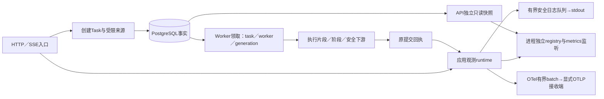

# ADR-004：应用可观测性与追踪上下文实施方案

| 字段 | 内容 |
| --- | --- |
| 编号 | ADR-004 |
| 状态 | **已实施**：应用代码、迁移、契约及独立开发验证已交付；不代表005监控组件已实施 |
| 版本／日期 | 1.1／2026-11-14（America/New_York）；同步实施结果和真实验证证据，原数值门槛不变 |
| 对应项目版本 | 当前`main`、包版本`0.3.0`为演进基线；004不自动表示v0.4，不修改产品／API版本号 |
| 代码核对基点 | `1779e968332285bd524275270838bdec2b845d66`及当前工作区；实施时重新记录相关源码dirty指纹，保留用户已有暂存与未暂存修改 |
| 适用范围 | Python3.12 API／Worker、四类Task、v1/v2/v3仍受支持链路、应用内网指标、安全日志与OTLP traces |
| 依据 | [PRD-004](../prd/004-SesRAG-应用可观测性与追踪上下文-PRD.md)、[统一术语](../../CONTEXT.md)、[通用执行规范](../项目开发和修改的通用执行规范.md) |
| 后续依赖方 | [ADR-005本地监控部署](005-sesrag-local-observability-deployment-plan.md)，只消费本轮交付；本轮不实施`docker/monitoring/` |
| 正式接口真源 | [docs/接口文档.md](../接口文档.md)及其引用的版本化`contracts/observability/`；本ADR定义设计，不另立README接口表 |
| 实施结果 | [PR-004](../pr/004-SesRAG-应用可观测性与追踪上下文-PR.md)及[开发验证记录](../../tests/sesrag-observability-test/开发实施验证记录.md)；最终`impl-final-05`全部13条结果通过、三对开销均通过、自有资源清理完成 |

## 决策摘要

采用**独立Prometheus registry＋独立内网指标监听、安全JSON stdout、OTel手动插桩与OTLP HTTP/protobuf**。API监听`0.0.0.0:9101/metrics`，Worker监听`0.0.0.0:9102/metrics`，都不发布宿主端口，也不由前端代理。指标和安全日志默认启用；traces默认关闭，显式启用及配置受控接收地址后，本地默认100%采样。

每个新Task仅增加一个可空、受限的`trace_origin_json`来源列。API请求产生可信根及短入队producer span，Task保存该producer的最小上下文；各attempt/generation是同一来源下的**独立兄弟consumer span**，来源不因重试、正常让出或重启覆盖。旧／坏来源按缺失处理。RunSnapshot、Message、Event Journal及既有业务响应不增加遥测字段。

任务结算从**原业务事务的提交回执**进入旁路，不从日志`success`、ORM旧值或额外业务写入推断。队列快照由API的独立有界只读查询生成，Worker只暴露本进程数据。所有观测失败可丢遥测，不改变业务事实、租约、取消、重试预算或readiness。005的仪表盘、存储与告警部署保持后续范围。

## 1. 目标、边界和当前基线

### 1.1 实施目标

1. 冻结并实现PRD-004的30项功能、12项非功能需求，达到A01～A16独立验收要求。
2. 向005提供真实指标名、字段Schema、传播拓扑、配置、服务身份、网络描述及安全协议证据；005不再临时补业务能力。
3. 观测是可采样、可丢失的旁路；PostgreSQL中的Run／Task／Event及不可变索引批次仍为事实，不引入精准审计账本。

### 1.2 范围与非目标

本轮实施API／Worker观测模块、一个Task来源迁移、既有创建／执行／结算及下游边界接线、根应用Compose配置、版本化契约和本轮独立开发验证。保留现有健康接口与HTTP/Event契约，业务模式、模型和解析路线不变。

不部署Grafana／Prometheus／Loki／Tempo／Alloy、windows_exporter、Node Exporter、数据库Exporter；不做浏览器SDK、OTLP logs／metrics、exemplar、tail sampling、服务图、持久发送队列、生产SLO或第三方内部span。不修改前轮正式验收目录`tests/sesrag-rag-mineru-test/`和`tests/sesrag-persistent-session-workspace-test/`。以下保留确认的设计与实施路线；实施后的真实文件、差异和验证结果见PR-004，不以方案存在替代测试。

### 1.3 核对后的实现起点

| 当前文件／对象 | 已有行为及具体差距 | 本轮决定 |
| --- | --- | --- |
| `backend/app.py::create_app/lifespan`、`backend/workers/main.py::main`、`pyproject.toml` | 无OTel／Prometheus依赖、指标监听和统一初始化；API单Uvicorn、Worker单异步循环 | 生命周期内创建独立runtime，不在import时注册全局provider／registry |
| `backend/db/models.py::TaskModel`、`backend/domain/ports/__init__.py::TaskLease` | 已有四类Task及attempt／generation，无传播上下文 | 来源列可空，DTO添加默认None字段，领域不依赖SDK |
| `backend/application/{threads,session_runs,documents,index_builds,retrieval}.py` | 六个Task构造位置，重放／复用可能提前返回；`start_build`由上传及重建调用 | 只在真实创建分支附来源，不在重放／领取阶段修写来源 |
| `backend/workers/runtime.py::run_once`、`backend/application/rag_task_execution.py::yield_task` | handler正常return可能只是waiting_external，旧日志仍记success | 原提交点产生旁路回执；每次领取只结束一次观测分类 |
| `backend/infrastructure/queue/postgres_queue.py` | 领取、回排、失败／释放各自有原事务；释放当前复用重试逻辑并可能消耗既有预算 | 不改预算；观测把停机释放单列，即使持久状态最终为retry_waiting／failed |
| `backend/api/routes/health.py::ready`、`backend/infrastructure/events/redis_notifier.py` | PG失败503，Redis降级200；心跳不可见unknown，公开count合并None／0 | 指标另保留known／valid与时间；不改health契约、不按200判全部正常 |
| `backend/application/stage_observation.py::observe_stage`、`session_execution.py::_bounded_stream` | 已有计时旁路，生成流的anext跨多个asyncio Task | 扩展旁路适配；span对象可跨流存活，current-context的attach／detach不可跨Task／yield配对 |
| `backend/infrastructure/rag/download_safety.py::SafeHTTP`及Provider | 有敏感URL、重定向限制和错误映射；无插桩 | 只加安全手动调用span，禁用全局httpx／DB自动插桩 |
| `migrations/versions/0011_rag_source_integrity.py` | 当前迁移head为0011，非0010 | 新迁移接0011，不改历史迁移内容 |
| `backend/tools/upgrade_rag_schema.py::upgrade` | current为0011就提前返回；其它未知版本可能进入catalog分段流程 | 必须同步更新目标识别，否则根Compose不会应用0012；已完成catalog的0010／0011只前进到head |

## 2. 架构与技术选型



### 2.1 库与版本

设计阶段只读核实PyPI固定版本元数据及官方源码；实施P0已锁定本表和传递依赖hash，并完成容器兼容与实际协议回归。换版本仍须修订本表及锁文件，不直接改成latest。

| 依赖／工具 | 采用版本 | 用途与约束 |
| --- | --- | --- |
| `opentelemetry-api`、`opentelemetry-sdk` | `1.45.2` | Span、Context、ParentBased采样、资源及BatchSpanProcessor；PyPI要求Python≥3.10，适配项目3.12 |
| `opentelemetry-exporter-otlp-proto-http`、`opentelemetry-proto` | `1.45.2` | OTLP HTTP/protobuf导出及独立捕获器解码；不是JSON演示替代协议 |
| SDK派生语义／HTTP transport依赖 | SDK要求`opentelemetry-semantic-conventions==0.66b2`，HTTP exporter的transport／common也有独立版本 | 由兼容resolver完整锁定；不能把所有包写同一个版本号 |
| `prometheus-client` | `0.23.1` | 独立CollectorRegistry、counter／gauge／经典histogram及文本编码；不依赖多进程文件目录 |
| 指标HTTP、JSON日志、入口插桩 | Python3.12标准库＋显式ASGI适配代码 | 小型只读监听、queue／线程及手动HTTP边界；本轮不安装FastAPI／httpx／SQLAlchemy自动插桩包 |
| 现有FastAPI、httpx、SQLAlchemy、psycopg | 保留项目现有范围，应用镜像构建回归 | 新组件不替换业务HTTP／数据库驱动，不另搭collector |
| 验证工具 | 现有pytest／pytest-asyncio、jsonschema、ruff、mypy、Docker Compose v2 | 开发检查使用项目环境；完整PG／多进程测试在本轮独立Compose进行，不复用前轮正式入口 |

新增`docker/observability-requirements.lock`仅锁本轮观测依赖及其传递集合；`pyproject.toml`声明上述直接依赖；Dockerfile依赖安装阶段读取该锁作为constraints，避免相同镜像中SDK版本漂移。此锁不冒称全项目供应链锁，原业务依赖约束仍保留。

锁文件保存带hash的安装条目，安装观测集合使用`pip install --require-hashes -r`；为其余业务依赖派生只含相同精确版本的临时constraints，再安装业务集合，避免把仅部分包带hash的文件误当全项目hash锁。resolver冲突时失败报告并修订兼容矩阵，不用`--no-deps`绕开新依赖校验。

### 2.2 自动化与手动插桩的取舍

选择自有纯ASGI中间件自动覆盖HTTP边界，再对Task、阶段及实际Provider方法手动插桩。不是必须安装厂商自动插桩包才算满足OTel需求。原因是全局HTTP／SQL插桩可能在清洗前记录签名query、SQL或异常，还可能把trace头注入MinerU／CDN；本轮不承担这类默认行为的兼容风险。

不调用全局`trace.set_tracer_provider`，每个`ObservabilityRuntime`拥有provider和registry，tracer显式传递／经ContextVar适配；不启用OTel自动配置CLI。导出器显式使用NoOpMeterProvider，不启动OTLP metrics，禁采SDK默认资源探测中的宿主路径、命令行和不受控属性。

resource使用显式`Resource(attributes=白名单)`，不调用会合并环境探测属性的自动配置路径；所有span上下文管理显式`record_exception=False,set_status_on_exception=False`，避免默认异常status description重新携带敏感异常文本。

TracerProvider显式`shutdown_on_exit=False`，只由runtime按deadline关闭；否则SDK默认atexit还会再次无界shutdown，绕过本方案3s关闭预算。scope退出即停止接收新span，超时的后台清理仍由同一个受控daemon线程承担，不重复派生关闭线程。

## 3. 文件与目录实施清单

阶段含义：P0契约与锁定、P1生命周期／日志、P2指标／快照、P3传播／迁移、P4业务边界、P5独立验证／交付。所有新增README说明用途、配置及限制；不为目录齐全创建空模块。

### 3.1 新增文件

| 新增路径 | 主要职责 | 使用阶段 |
| --- | --- | --- |
| `backend/domain/observability.py` | 标准库frozen DTO：TraceOrigin、ExecutionIdentity、AttemptOutcome、CommitReceipt；无SDK／ORM依赖 | P0、P3～P4 |
| `backend/application/observation.py` | ContextVar中的ObservationPort、无异常旁路facade、阶段／执行作用域、提交回执桥接 | P1、P3～P4 |
| `backend/infrastructure/observability/{README.md,__init__.py}` | 模块职责、唯一初始化／关闭入口、单进程及缺失语义 | P1起 |
| `backend/infrastructure/observability/config.py` | 独立观测配置校验、服务身份、受限接收地址及数值预算 | P0～P1 |
| `backend/infrastructure/observability/runtime.py` | ObservabilityRuntime装配、关闭、实例隔离；不访问业务数据写入 | P1起 |
| `backend/infrastructure/observability/metrics.py`、`metrics_http.py` | 指标注册／更新、快照编码缓存、只读9101／9102监听与并发限制 | P2起 |
| `backend/infrastructure/observability/snapshots.py` | API独立只读engine、队列及依赖快照、有效性与刷新 | P2起 |
| `backend/infrastructure/observability/tracing.py`、`exporter.py` | provider／采样／安全span、OTLP安全Session及导出结果包装、有界关闭 | P1、P3～P4 |
| `backend/infrastructure/observability/logging.py`、`sanitization.py` | 白名单JSON编码、非阻塞日志队列、库输出抑制、限频安全诊断 | P1起 |
| `backend/infrastructure/observability/http.py` | 纯ASGI请求／SSE观测，入站上下文重置、有限路由映射 | P2～P4 |
| `backend/infrastructure/observability/transactions.py` | 仅对指定Session实例安装commit／rollback回调；无SQL地确认旁路回执及producer结果 | P3～P4 |
| `backend/tools/export_observability_contract.py` | 只读导出能力字典／脱敏部署样例，校验契约漂移，不自动发现／外发Secret | P0、P5 |
| `migrations/versions/0012_task_trace_origin.py` | 接0011，添加可空来源列及PG来源不可修改触发器；无历史回填 | P3 |
| `contracts/observability/{capabilities_v1.json,log_v1.json,trace_origin_v1.json,report_v1.json}` | 能力字典结构、日志、内部来源及本轮验证报告的严格JSON Schema | P0起 |
| `contracts/observability/{metrics_v1.json,application_v1.example.json}` | 真实指标字典／条件初始化表及安全能力／部署映射样例；引用上述Schema | P0、P2、P5 |
| `docker/observability-requirements.lock` | 固定本轮SDK及指标库依赖版本／hash，供容器与本轮工具一致解析 | P0起 |
| `docs/runbooks/application-observability.md` | 应用侧启用／关闭、端点验证、采样／故障、迁移／回退和005交接操作；不复制正式接口表 | P5 |
| `docs/pr/004-SesRAG-应用可观测性与追踪上下文-PR.md` | 实施结果、实际差异、命令／证据与剩余风险，完成后新增 | P5 |
| `tests/unit/test_observability_{config,metrics,logging,context,transactions}.py` | 配置拒绝、字典／计数、脱敏、上下文隔离及提交回执单元回归 | P0～P4 |
| `tests/api/test_observability_http.py`、`tests/integration/test_observability_migration.py` | HTTP／SSE行为和迁移兼容的底层回归 | P2～P4 |
| `tests/sesrag-observability-test/{README.md,test-plan.md,run-observability-tests.ps1}` | 本轮独立开发验证说明、接入计划、启动至清理主入口；不是前轮验收脚本续写 | P5 |
| `tests/sesrag-observability-test/compose/{compose.yaml,.env.example}` | 专用PG／Redis／API／Worker／捕获器／工具容器、无宿主数据卷复用；显式测试配置 | P5 |
| `tests/sesrag-observability-test/fixtures/{collector.py,provider.py,seed.sql}` | 受控OTLP protobuf捕获、模型／MinerU安全替身、最小固定身份；动态业务数据由用例独立创建 | P4～P5 |
| `tests/sesrag-observability-test/tooling/{runner.py,evidence.py}` | Python唯一编排、中文结果／资源账本、脱敏证据及finally清理；PS仅包装 | P5 |
| `tests/sesrag-observability-test/specific_test_script/{README.md,test_http.py,test_metrics.py,test_trace.py,test_recovery.py,test_security.py,test_budget.py,test_handoff.py}` | 分组实现A01～A16，逐类独立准备条件／数据；细分命令由README说明 | P5 |
| 本轮测试`runtime/`、`artifacts/<run-id>/` | 临时凭据／地址与不可覆盖脱敏证据，Git忽略；清理runtime、保留必要报告 | P5运行时 |

花括号表示逐个明确命名的文件，不是新增同名字面目录。`capabilities_v1.json`是能力文档的Schema，`metrics_v1.json`是实际数据字典；两者用途不可颠倒。

### 3.2 修改已有文件

| 修改路径 | 主要内容及目的 | 阶段 |
| --- | --- | --- |
| `backend/config.py`、`.env.example` | 接受OBS配置、说明默认／必填／安全边界；业务Settings不因观测地址错误崩溃，观测模块给出降级 | P1 |
| `backend/app.py`、`backend/workers/main.py` | lifespan／main创建runtime、按序关闭；去除import时日志配置，API中间件仅接线 | P1～P2 |
| `backend/domain/ports/__init__.py` | TaskLease末尾增加可空TraceOrigin；已有参数保持兼容 | P3 |
| `backend/db/models.py`、`backend/infrastructure/queue/adapter.py` | Task来源映射、只读校验／投影到DTO，不改队列方法返回业务含义 | P3 |
| `backend/tools/upgrade_rag_schema.py` | 识别实际head，0010／0011直接向head升级，head重复执行无操作；不把较新／未知revision当旧库向0007回退 | P3 |
| `backend/application/{threads,session_runs,documents,index_builds,retrieval}.py` | 六处新Task构造附来源／producer；重放不改来源；retrieval增加阶段适配 | P3～P4 |
| `backend/infrastructure/queue/postgres_queue.py` | 原授权提交点登记结算回执及claim／release操作来源；不改状态／预算／锁序 | P4 |
| `backend/application/{task_execution,rag_task_execution}.py` | 成功、yield与RAG结算在原事务登记回执；保留原flush／租约检查 | P4 |
| `backend/workers/runtime.py`、`backend/workers/handlers/{run_handler,index_handler,index_build_handler,retrieval_diagnostic_handler}.py` | 执行作用域、互斥结果、原提交回执、有限阶段；停止旧“正常return就是success”的观测判定 | P4 |
| `backend/application/{stage_observation,session_execution,parse_jobs}.py` | 复用计时边界、分代上下文、流式安全span／阶段、解析分步观测 | P4 |
| `backend/infrastructure/providers/{openai_compatible,bailian_embedding,bailian_rerank,mock}.py`、`backend/infrastructure/rag/mineru_client.py` | 在实际适配边界安全计时／span，不采正文／URL、不外发trace头；Mock明确受控身份 | P4 |
| `backend/infrastructure/rag/download_safety.py` | 保留网络安全行为；审计插桩／库日志抑制，必要时只补观测抑制接线 | P4 |
| `backend/api/routes/{runs,v2/runs,v3/sessions}.py` | SSE固定分类及disconnect／终态补放关闭理由的安全标记，不改游标／Event协议 | P4 |
| `pyproject.toml`、`docker/api/Dockerfile`、`docker-compose.yml` | 直接依赖、constraints、把`contracts/observability/`复制进应用镜像、禁用原始访问日志、内网监听配置、关闭宽限与采集标签预留 | P0～P2 |
| `.gitignore`、根`README.md`、`backend/README.md` | 本轮runtime／artifact忽略、配置与运行入口、已有模块目录职责说明 | P1、P5 |
| `docs/接口文档.md`、`CONTEXT.md`、PRD-004、本ADR、ADR-005 | 正式契约链接、术语及状态、两轮衔接；不提前写已实施 | P0、P5 |

不修改业务health响应、旧Event／API JSON Schema、模型／检索快照字段、前端调用方或前轮正式测试目录。前端无接口变化不需新增观测页面；若底层回归发现真正业务缺陷，单列差异，不用观测工程顺便改业务行为。

## 4. 核心对象与持久化设计

### 4.1 普通DTO和运行对象

| 核心对象 | 主要字段／接口 | 职责与约束 |
| --- | --- | --- |
| `TraceOrigin` | `schema_version=1, trace_id:str, span_id:str, sampled:bool` | trace_id为32位非全0小写hex、span_id为16位非全0小写hex；没有tracestate／baggage／任意属性；内部来源不是API输入 |
| `ExecutionIdentity` | `task_id, task_kind, worker_id, generation, attempt`及可选run／document／build／retrieval身份 | generation／attempt为正整数；一个本次执行作用域只绑定这一身份；业务ID只进日志／span |
| `AttemptOutcome` | `succeeded, failed, yielded, cancelled, lease_lost, released, unknown` | 一次已领取片段只结束一次；`retry_scheduled:bool`仅附加属性，不另记第二条failed |
| `CommitReceipt` | `identity, result, retry_scheduled, error_code, reason` | 原结算事务已通过授权检查后构造；只有该事务commit成功才确认；不授权任何业务写入 |
| `ObservationPort` | `stage(name)`, `attempt(identity,origin)`, `register_receipt(session,receipt)`, `enqueue(session,task)` | facade默认NoOp，记录器异常被隔离；阶段接口不暴露SDK到领域 |
| `AttemptObservation` | 当前span、单调start、结束锁／标记、已确认receipt、最多128个子span预算 | 第一条对应本代的确认回执决定结束分类；没有确认回执时保守unknown／本地停止，不能二次查库“补成功” |
| `ObservationSnapshot` | `source, initialized, valid, observed_at, last_success_at, values, error_class` | 不可变数据包，API读取固定快照编码；以monotonic判本进程age，公开UTC timestamp便于采集方guard |
| `SnapshotStore` | source→ObservationSnapshot的固定四项映射；`fail(source,error_class)`、`initialized(source)`、`valid(source)`、`business_samples(source)` | snapshots.py内存容器，失败保留旧成功值、初始无样本；原子替换，不增长任意source集合 |
| `ObservabilityRuntime` | config、独立registry／provider、日志队列、指标监听、API快照任务、`close(deadline)` | 实例生命周期内唯一；无全局provider或全局默认registry；关闭不能触发业务提交 |

来源存入Task时即固定；TaskLease仅把受限普通DTO带到Worker。一个来源producer可有多个consumer子span，分别带attempt／generation；不会引入独立Run Attempt业务实体。RAG Trace仍是RetrievalExecution的业务投影，OTel span中可带其安全身份，但两者不共用ID。

### 4.2 迁移0012

`tasks.trace_origin_json`采用SQLAlchemy通用`JSON(none_as_null=True)`、nullable、无server default；SQL NULL表示来源缺失，不使用JSON `null`混淆。来源序列化后≤256 bytes，键严格为上述四项。校验在普通DTO解码和写入入口执行；坏值／未知版本读取时按missing处理，输出安全`TRACE_ORIGIN_INVALID`，不把整个内容写日志。

PG新增`task_trace_origin_immutable`触发器：UPDATE时对新旧JSON转jsonb后使用`IS DISTINCT FROM`比较，任何改变（包括NULL变对象）都拒绝；不能直接对PG json列使用不存在的等值操作符。新增数据由创建分支一次写入，旧NULL不回填。SQLite底层测试使用等价应用校验及SQLite触发器，不能以SQLite通过证明PG触发器／并发行为。

迁移只新增列与触发器，不改RunSnapshot、Event、progress_json或既有业务唯一键。升级不长事务重写全部Task；维护窗口暂停领取／写入后执行，PG lock_timeout=1s、statement_timeout=30s，拿不到DDL锁就失败报告，不长期占锁。允许旧代码继续写NULL，但回退旧应用前必须处理旧迁移工具的head识别限制。

`upgrade_rag_schema.py`以Alembic ScriptDirectory读取唯一head；current=head时直接返回，current=0010／0011时只执行向head升级，不重新导入Profile／默认知识库。旧catalog阶段沿用原流程；revision不在已知迁移图或数据库比本代码新时明确报版本不兼容，禁止尝试回到0007。必须覆盖空库、0011已有业务库、0012重复启动及未来／未知revision负例。

降级先停止API／Worker并备份，通过Alembic `-x allow_observability_loss=true downgrade 0011_rag_source_integrity`显式授权丢来源后撤触发器／删列；业务字段不删。未带该参数拒绝降级，不能在新代码仍在线时回退Schema。仅回退镜像但保留0012时必须使用支持该head的迁移入口／跳过旧migrate服务，不能让原0011工具误判数据库。

## 5. 配置、监听与资源身份

### 5.1 冻结的配置

以下均由服务端部署输入，不接受HTTP参数。观测配置单独解析；类型／组合错误只使对应观测子功能停用并限频诊断，不吞掉原数据库／模型配置错误。部署预检和验收须报失败，不能把降级当完整交付。

`Settings`只承接OBS原始字符串（可缺省），不在业务BaseSettings启动校验中强制float／bool解析；`observability/config.py`再生成类型化有效配置与分功能诊断。这样非法采样比例不会在业务Settings构造时提前使整个服务退出。身份错误使用本进程角色的安全固定身份记录错误，并停用有问题的观测接线，不接受任意名称作为临时label。

| 环境变量 | 默认／合法范围 | 说明与安全边界 |
| --- | --- | --- |
| `OBS_METRICS_ENABLED` | `true` | false时无指标监听且不启动API快照；安全JSON日志仍启用 |
| `OBS_METRICS_HOST` | 容器`0.0.0.0`；宿主直接运行须显式`127.0.0.1` | 内网监听不等于公网发布；不得自动探测后换到其它可用端口 |
| `OBS_METRICS_PORT` | API9101、Worker9102，1～65535 | 进程角色提供默认；端口冲突仅观测降级，原业务继续，验收失败 |
| `OBS_ENVIRONMENT` | `local`；`[a-z0-9-]{1,32}` | 与005 environment_id及采集标签相同；不从请求头读取 |
| `OBS_SERVICE_NAME` | API`sesrag-api`、Worker`sesrag-worker` | 只允许这两个角色匹配值；OTel `service.name`与日志service一致 |
| `OBS_TRACES_ENABLED` | `false` | true还需合法endpoint／allowed-hosts；不因已设置endpoint自动启用 |
| `OBS_OTLP_TRACES_ENDPOINT` | 无默认；绝对HTTP(S) URL，path固定`/v1/traces` | 无user/password/query/fragment；只接受显式受信本地／内网接收端，无默认localhost外发 |
| `OBS_OTLP_ALLOWED_HOSTS` | 空；显式精确主机集合 | endpoint hostname必须在集合；本轮禁止公网IP／公网接收域，禁止`*`、任意URL和环境代理；005填唯一Alloy别名，本轮测试填collector |
| `OBS_TRACE_SAMPLE_RATIO` | `1.0`；0～1有限数字 | 仅启用traces时生效；ParentBased保持来源采样，不随每代重抽 |

其余本节和§6／§9／§11的数值是版本化常量，首轮不做几十个可任意覆盖的环境开关。调整常量必须改契约和预算、重跑对应验证，不因SDK的`OTEL_*`环境默认值悄悄覆盖。传入显式provider／limits／采样／exporter参数及空headers；traces启用前如发现非本模块支持的OTEL自动配置环境，诊断冲突并停用traces，要求部署方移除冲突，不修改进程全局环境或读取自动credential provider。记录实际安全有效配置hash，不打印完整env。

### 5.2 指标HTTP与生命周期

自有`metrics_http.py`仅支持GET `/metrics`，HEAD同路径只返回长度；其它路径404，其它method405，无管理／查询／重置端点、无CORS、无业务认证令牌复用。最多4个并发请求，超过503；读取header总预算1s、header≤8KiB、完整响应deadline2s；一条请求后关闭连接，避免慢连接无界占线程。

指标编码由独立定时任务／线程最多每1s更新一次缓存，业务counter更新只操作内存；GET只返回已编码bytes，不查询DB。最大响应2MiB；单目标静态序列预算12000，编码超限保留上次合格缓存并报告观测错误，不能截断半份exposition冒充成功。监听不进入业务health，不占用Worker事件循环做阻塞HTTP。

API在lifespan创建runtime，再启动快照；Worker在main创建并在run_forever外接线。Uvicorn关闭原始access log，安全请求日志由中间件产生。Worker停止领取后，在原`worker_shutdown_grace`执行／释放阶段之后进行观测flush，总附加预算3s；Compose设`stop_grace_period=30s`，不改原任务关闭预算20s及lease逻辑。

默认单API／单Worker；若部署多个Worker，交接描述须逐实例列出已核验的唯一内网DNS别名，采集目标分别为`别名:9102`，Prometheus instance不同，counter才可分别rate再sum。不得只抓共享`worker`服务别名并期待DNS轮询形成可靠进程计数；005接入Schema需容纳worker targets列表，首轮样例仍为一个worker目标。容器替换后保持服务身份、按部署描述刷新目标，不把随机worker_id放进业务label。

指标／SDK关闭分别有deadline，重复close返回先前结果。接收端卡住时调用方不无限join；SDK关闭在受控daemon清理线程执行，超过预算标`flush_timeout`，进程退出丢弃未送数据；不为每次导出新增线程。正常故障夹具须证明线程／监听可回收，OS级异常DNS／socket卡死不能靠SDK timeout宣称绝对硬实时退出。

## 6. 指标契约与初始化

### 6.1 冻结的字典

所有业务指标使用`sesrag_`前缀，`service`／`environment`由runtime固定提供；005抓取配置不再覆盖这两个label。Prometheus自身的`job`／`instance`是目标身份；不额外把container_id／worker_id或业务ID做label。下表省略每行都有的service／environment。

| 逻辑绑定／类别 | 真实名称及类型 | 附加label | 更新者与判定 |
| --- | --- | --- | --- |
| HTTP_REQUESTS | `sesrag_http_requests_total` counter | `method,route,status_class,request_kind` | API；response.start时按实际状态记一次；发头前未处理异常由最外层适配记5xx；SSE仅握手 |
| HTTP_DURATION | `sesrag_http_request_duration_seconds` histogram | `method,route` | API；普通短请求从入口到最后body／异常结束；不包括SSE及probe |
| SSE连接 | `sesrag_sse_active_connections` gauge、`sesrag_sse_connections_total` counter | `route` | API；仅实际发SSE头后增加；退出finally减active，不会减成负数 |
| HTTP未发头停止 | `sesrag_http_aborted_total` counter | `method,route,reason` | reason=`disconnected,cancelled`；客户端取消且未产生响应时不伪造HTTP5xx；发头后的异常保持原状态计数 |
| SSE关闭／持续 | `sesrag_sse_closed_total` counter、`sesrag_sse_connection_duration_seconds` histogram | `route,reason` | reason=`completed,disconnected,error,cancelled,unknown`；终态后缀补放完为completed，不等于Run成功 |
| WORKER_READY | `sesrag_worker_ready` gauge | 无 | 仅API；最近可信Redis探测成功且心跳count>0为1，成功且0个为0；未知由valid表示，初始不伪造值 |
| 心跳与依赖 | `sesrag_ready_workers` gauge、`sesrag_dependency_ready` gauge | 后者dependency取`postgres,redis` | 仅API快照；已知count保留0；未知不冒充“0个在线” |
| 快照控制 | `sesrag_snapshot_initialized`、`sesrag_snapshot_valid`、`sesrag_snapshot_last_success_timestamp_seconds` gauge | source取`queue,worker_presence,postgres,redis` | 固定来源全初始化；失败valid=0，保留已存在的旧值和last_success；另有`sesrag_snapshot_refresh_total{source,result}`及`sesrag_snapshot_refresh_duration_seconds{source}`，result=`ok,error,timeout` |
| QUEUE_LENGTH | `sesrag_queue_ready_tasks` gauge | `task_kind` | 仅API；有效到时queued数量，按§7谓词；全局快照不是Worker本进程计数 |
| QUEUE_OLDEST_WAIT | `sesrag_queue_oldest_wait_seconds` gauge | `task_kind` | 仅API；同范围`max(0, now - min(available_at))`，可信空集0 |
| 队列分组 | `sesrag_queue_tasks` gauge | `task_kind,group` | 仅API；§7互斥分组，同一任务不同时占两组 |
| TASK_ATTEMPTS | `sesrag_task_attempts_total` counter | `task_kind,result` | 仅Worker；本次执行作用域第一次结束时增加，result为§4七值；硬杀可无结束计数 |
| 执行耗时／运行中 | `sesrag_task_attempt_duration_seconds` histogram、`sesrag_task_attempts_in_progress` gauge | 前者`task_kind,result`，后者`task_kind` | 仅Worker；作用域单调时钟，等待外部期间不保留active；不是整个Run耗时 |
| STAGE_DURATION | `sesrag_stage_duration_seconds` histogram | `task_kind,stage,outcome` | Worker阶段；outcome=`ok,error,cancelled,stopped,empty,degraded`，使用固定有效stage／kind组合 |
| Worker自身 | `sesrag_worker_accepting_tasks` gauge、`sesrag_worker_control_total` counter | counter有`operation,result` | accepting仅表示未进入停机流程；operation=`claim,renew,reclaim,release`，result=`ok,empty,rejected,error`，不把alive说成业务健康 |
| 下游调用 | `sesrag_downstream_calls_total` counter、`sesrag_downstream_duration_seconds` histogram | `operation,outcome` | 固定operation见§8，outcome=`ok,error,timeout,cancelled,unknown`；本地Mock有单独安全backend属性，不改变operation |
| 观测自身 | `sesrag_observation_events_total` counter | `component,reason` | component固定`config,metrics,snapshot,logs,traces,context`；reason来自契约有限白名单，不以动态错误码做label |
| 导出结果 | `sesrag_trace_export_spans_total` counter | result取`success,failure` | exporter包装器根据实际SpanExportResult计本批数量；不等于后端持久化数量；不声称能精确看到SDK内部队列drop |

时间桶：短HTTP使用`0.005,0.01,0.025,0.05,0.1,0.25,0.5,1,2.5,5,10,30`秒；阶段／下游使用`0.001,0.005,0.01,0.025,0.05,0.1,0.25,0.5,1,2.5,5,10,30,60,120`；尝试／SSE使用`0.01,0.05,0.1,0.5,1,2.5,5,10,30,60,120,300,600,1800`。均有标准+Inf、count、sum，不启用native histogram或exemplar；关闭prometheus_client默认`_created`系列以控制序列数。

路由仅接受应用路由表中的模板与合法method组合；404为`__unmatched__`，未知method为`OTHER`。status_class固定`1xx,2xx,3xx,4xx,5xx`；request_kind=`short,sse,probe`。SSE在握手前按匹配路由归sse，即使握手404也不混入短请求样本。`/health/*`及指标探测属probe，不进短延迟；独立指标监听不递归计自身HTTP流量。

### 6.2 固定序列、有效性和guard

初始化只创建**有效元组列表**，不能对route×method×kind盲目笛卡尔积。固定counter与histogram的有效tuple在启动时初始化0；四类task_kind、七类attempt result、有限stage／kind／outcome也登记允许组合。真实路由变化由能力字典生成器核对，超预算拒绝启用对应指标并报配置缺口，不能无限动态labels。

快照控制四source始终有`initialized=0,valid=0,last_success=0`。业务快照值在首次成功前不暴露样本；首次成功后，包括可信空值在内持久保留最后一份样本，失败仅将valid置0；业务数值不能填假0，也不能用-1冒充标准计数。读取source超过30s无成功时valid=0；005以valid、last_success和采集时刻共同guard。30s覆盖5s刷新、1s编码、005默认15s抓取及有限延迟，不能把有效期简单设为一个抓取间隔，造成正常快照间歇性失效。

实现上先注册带service／environment等labels的Gauge父对象，但首次成功前不调用其业务tuple的`.labels(...)`创建默认0子样本；编码器也要校验未初始化source没有业务样本，避免库默认初值破坏缺失语义。

`metrics_v1.json`逐项声明`required_always`或`required_after_first_success(source)`。005的METRIC-MISSING只直接检测always序列；条件序列仅在对应initialized=1后检查。来源尚未初始化／未知／过期由OBSERVATION-INVALID处理，不能在启动空窗把“还没得到业务样本”伪装成健康或编造所有0。

队列guard示例（service／environment筛选由005固定，PromQL只展示单环境）：

```promql
(sesrag_queue_ready_tasks > bool 0)
* on(service,environment) group_left
  ((sesrag_snapshot_valid{source="queue"} == bool 1)
   * (time() - sesrag_snapshot_last_success_timestamp_seconds{source="queue"} < bool 30))
```

完整QUEUE-WAIT还需在**同task_kind**判断oldest>120，并按同一source guard；guard为0只是业务阈值暂不可判，必须同时由独立来源失效规则告警，不是所有信号恢复OK。Worker聚合ready使用worker_presence guard。HTTP／attempt counter不依赖快照guard，进程重启reset交Prometheus `rate/increase`处理。

## 7. 只读快照和健康语义

### 7.1 隔离查询与预算

API专用snapshot engine独立于业务连接池：`pool_size=1,max_overflow=0,pool_timeout=0.2s`，独立事务只读；PG `statement_timeout=500ms,lock_timeout=100ms`。每5s启动一次不重叠刷新，队列一条条件聚合查询，postgres探测一次简单查询；队列观测包含连接等待、设置与查询的总预算1s。快照事务不调用QueuePort，不加`FOR UPDATE`，不读取Prompt／文档内容、不逐Task加载ORM，不阻塞业务池。

Redis观测使用专用RedisNotifier实例、timeout500ms；每5s独立worker_presence／redis source刷新。ready_worker_count的scan保持既有心跳语义，时间或数量预算不足时valid=0，不把扫描一半count当完整值。source独立记录失败，Redis错误不抹掉成功queue快照。停机取消刷新并关闭两种专用连接，不把观测依赖写入`/health/ready`。

### 7.2 有效任务与互斥分组

共用一次DB侧UTC now：有效待领取任务需`deadline_at>now`、Task未取消、关联目标存在且未终态／未取消；`run`目标为Run，`index_build`为IndexBuild，`retrieval_diagnostic`为RetrievalExecution，`index_document`为Document存在且仍满足旧文本入口（txt/md）。**待领取／等待状态**的剩余预算为：新两类`failure_count<max_attempts`，旧两类`attempt<max_attempts`。已经leased／running且lease有效的执行可正处于最后一次合法attempt，不因`attempt==max_attempts`被错归invalid；活动代以现有授权／有效lease判断。不加入“当前容量可用”条件，容量满仍显示积压。

QUEUE_LENGTH只取有效且`state=queued AND available_at<=now`；oldest从这些任务的available_at取最小。现有回排把available_at重置为now，此处测本次等待，不伪称端到端文档耗时。本轮不为指标改调度器的重置逻辑或增加新的排队事实列。

所有非终态Task按以下先后顺序进入一个group：

1. `cancel_pending`：Task或适用目标已有取消请求。
2. `expired`：deadline到期，或leased/running的lease到期；不把尚未回收写回的旧代记成有效running。
3. `invalid`：缺目标、不合法状态／格式、预算用尽且未终态等不再可执行条件。
4. `queued_ready`／`queued_future`：上述有效queued，按available_at区分。
5. `retry_backoff`／`retry_due`：retry_waiting，按available_at区分。
6. `external_wait`／`external_due`：waiting_external，按available_at区分。
7. `leased`／`running`：有效活动状态；只读投影不续租。

已终态不进入该状态存量表。目标异常只描述观测差异，不自行清理孤儿／取消／回排。counter与状态存量不是同一个统计，不能用状态差分猜所有历史attempt。

### 7.3 Worker已知性

现有API health的`worker=unknown,count=0`保留；新指标使用专用探测的实际`None`／`0`区别。Redis成功且完整count=0时worker_ready=0、worker_presence valid=1；Redis失败／扫描未完成则valid=0并保留最后成功值。Worker的accepting_tasks来自本进程停止标志，不能替代Redis聚合心跳，也不能证明调度DB可用。

## 8. 追踪传播和原事务回执

### 8.1 同trace的短span拓扑

```text
HTTP server span（服务端可信根，请求结束即结束）
└─ task.enqueue（producer，创建事务成功／回滚后结束）
   ├─ task.attempt（consumer，generation=1）
   │  └─ stage / downstream spans（有界）
   ├─ task.attempt（consumer，generation=2，正常让出继续）
   └─ task.attempt（consumer，generation=3，自动重试／恢复）
```

保存producer的trace_id／span_id／sampled。所有新代以其为remote parent，使用ParentBased(TraceIdRatioBased(ratio))，不在每代重新抽样。父span已结束不阻止合法子span稍后开始，等待期间无开放span；此拓扑冻结为`task_sibling_spans_v1`，本轮不另做span link路线。

无HTTP上下文的内部显式创建允许本地可信producer根；traces关闭则不创建来源。旧／坏／关闭时来源缺失的Task：当Worker启用traces后创建本地root attempt，`origin_state=missing|invalid`，不回填来源列、不伪称恢复原trace。同一旧Task多次执行可能是不同trace，通过业务ID关联，且明确该限制。

API入口一律以空OTel context启动server根，不extract任何入站traceparent／tracestate／baggage。手动Provider不注入第三方请求头，OTLP Session也不复制当前W3C头。service.name只允许角色固定值；resource仅`service.name,service.version,deployment.environment.name`，不加载命令行／主机path属性。

### 8.2 入队的提交边界

六个Task构造位置在真实新建分支调用`observation.enqueue(session,task)`：创建producer、校验最小来源、给Task赋值并在该Session实例登记待提交producer。适配器用`session.sync_session`的after_commit／after_rollback／after_soft_rollback事件结束producer，只做内存span结束，不执行SQL或网络。当前代码均为顶层事务，若未来有nested事务，必须只在最外层commit确认；内部flush／savepoint不得算入队成功。

事件hook的异常全部隔离；登记失败则来源NULL／producer缺口，业务照原事务执行。DB错误仍向原调用方传播。commit返回未知时producer标`commit_unknown`、不能宣称已入队；即使DB可能已提交，Worker后续读到Task仍可消费有效来源。幂等命中不再次调用enqueue，当前请求可记录replayed，不改旧producer来源。主动retry／regenerate按既有新Task规则产生新producer。

hook捕获登记时的producer／AttemptObservation对象和ExecutionIdentity，不在回调执行时查找可能已变更的“当前Task”。每Session最多16个待确认观测项；transaction结束／session关闭及请求finally均回收未结束项，未得到确认则结束为unknown／rolled_back，不留无限开放producer。监听器每Session只安装一组，事务后清空session.info中的待确认条目，Session关闭后随实例回收；不在SQLAlchemy事件dispatch内部remove监听器，也不向全局Session类反复注册回调。

### 8.3 结算回执及一次计数

`register_receipt(session, CommitReceipt(...))`只在原结算事务完成原有锁／租约／取消检查后登记。after_commit回调将已确认的receipt交当前AttemptObservation；after_rollback清除。hook无业务状态写回，不依赖清空lease后的ORM状态，也不增加“查库确认再commit”的事务。数据库commit异常／网络未知时不确认成功，当前片段为unknown；之后恢复仍以DB事实为准。

| 原代码提交点 | 登记result | 身份及特别约束 |
| --- | --- | --- |
| `task_execution.complete_run`、index／index_build／diagnostic handler最终发布事务 | succeeded | 登记前保存task／worker／generation，业务最终Message／Event／active索引仍同原事务 |
| `rag_task_execution.yield_task`及parse_jobs正常阶段让出 | yielded | 正常推进chunk／embed也会让出；不是仅远端pending，不记success或failed |
| `schedule_retry`及`settle_failure`原授权提交 | failed，retry_scheduled按实际策略 | 失败一次只计一次，不把retry另算第二次；取消优先时为cancelled |
| `_ack_cancel`／原acknowledge及RAG取消结算提交 | cancelled | 必须是本代有权确认的取消；仅看到取消请求不能冒充已确认 |
| `_release`调用的原release_task→schedule_retry | released | 调用域显式reason=shutdown；即使既有预算结算为failed也只表达停机释放尝试，不改变预算或伪称最终业务成功 |
| 失租／旧代拒绝且无本代确认回执 | lease_lost | 标本地执行停止，不能覆盖其它代日志／事实；租约探测错误但无法确认失租用unknown |
| Handler异常且未能提交失败结算／硬停止前未确认 | unknown | 原始异常仍沿既有机制处理；无后验成功查询，不强行制造failed提交 |

AttemptObservation以`task_id+worker_id+generation`核对receipt，结束标记幂等；原return／日志`success`不再决定结果。`claim`成功到开始dispatch前也在本次attempt作用域内，停机释放不会漏掉计数。系统回收器／API取消在没有当前尝试scope时仅产生控制诊断，不给已硬杀Worker补造counter／结束span。

### 8.4 阶段、调用和并发上下文

阶段目录固定：`parse,chunk,embed,retrieval,query_embedding,dense_search,rerank,enhancement,context,generation,publish`；task_kind采用已有四值，按实际有效组合初始化。`retrieval`是总体阶段，query_embedding等子阶段不可与总体求和。`attempt`整体单独histogram，不再用`_observed_dispatch`把当前stage重记一次相同STAGE_DURATION。

安全operation目录：`model.generate,embedding.document,embedding.query,rerank.rank,mineru.submit,mineru.upload,mineru.poll,mineru.download,parser.local`。legacy逐chunk Embedding在同一`embed`阶段聚合计时，调用counter可累计实际调用，但每attempt最多128个子span、每子span最多24个属性，总属性UTF-8≤4KiB、单值≤256字符；超span预算后只累计有界指标和一次truncated诊断，不逐chunk无限保留span。

`observe_stage`扩展为`observe_stage(stage, outcome=None)`，yield一个仅有`set_outcome(mode)`的受限StageOutcomeHandle；旧调用忽略yield值仍兼容。检索调用方取得结果后显式设置empty／degraded，不能在尚未完成时猜结果。原`observer`回调仍为异步`callback(stage,duration_ms,error_code)`三参并保留异常隔离；新facade在同一个计时出口记录metrics／span一次，旧callback只承担既有安全日志适配，不再第二次更新同一histogram。通用Exception记安全error类别，不自动record_exception。

上下文通过ContextVar和`asyncio.create_task`继承，`asyncio.to_thread`使用其copy_context语义；异步流的span用`start_span`显式开始／结束，只在每个实际执行anext的Task内短作用域attach／detach，禁止跨yield保存token后由另一Task detach。

SSE匹配路由标记connection scope，最多一个server／connection span，不为事件／token建span；receive包装器观察disconnect，原generator在终态补放完时设置completed理由，异常／task cancel分别分类。span持续到连接结束允许是长连接，但不代表后台Run span；不持DB事务或无界Event缓存。

## 9. 安全日志、OTLP导出及降级

### 9.1 统一日志Schema

`log_v1`要求`schema_version=1,timestamp(UTC RFC3339),level,service,environment,action,message,trace_id,span_id,trace_sampled,origin_state`。trace字段可null；另有安全关联`thread_id,run_id,task_id,worker_id,generation,attempt,document_id,index_batch_id,parse_job_id,retrieval_execution_id,stage,duration_ms,error_code`，不适用时null。额外键禁止；message来自action→固定中文摘要映射，不接受任意异常字符串。

日志先在业务线程同步做白名单投影／截断和JSON编码，单行≤4096bytes，再非阻塞put到容量1024的单消费者队列，由一个daemon线程写stdout；队列满丢当前行并增加logs／queue_full计数。不得先把未经清洗LogRecord／异常／正文入队；stdout阻塞只影响日志线程，业务不等待。诊断同样有界，每个component/reason最多每30s一条，不记录“记录日志失败”的递归异常。

禁止`exc_info`、原始traceback／异常文本、完整URL／文件名／SQL／Prompt／DSN等。未知错误码只映射`UNKNOWN_ERROR`，非有限错误类不进入label。httpx／httpcore、OTel exporter和Uvicorn默认日志均禁用原文输出；已知库消息只转为固定安全action。禁止通过通用formatter的`record.getMessage()`重新带回敏感文本。

有效未采样span身份可记录且sampled=false；traces disabled时trace/span=null、sampled=null；来源缺失但当前新span存在时记录真实新身份和missing，不把run_id伪装成trace_id。日志presence不表示trace已发送成功。

### 9.2 导出预算与传输

OTel采用独立BatchSpanProcessor：`max_queue_size=1024,max_export_batch_size=128,schedule_delay_millis=500`，采样前有每scope子span预算；SpanLimits设attributes24、events0、links0、attribute_value_length256。禁用自动exception event和异常status description。内存排队不跨重启；队列溢出、过滤和网络故障可丢span。

SDK HTTP exporter显式`timeout=2s,max_request_size=1MiB`，NoOpMeterProvider；exporter包装器仅计已尝试导出的success／failure数量。SDK1.45.2的BatchSpanProcessor `export_timeout_millis`并不构成底层export硬超时，不能只设它就宣称有界网络。底层2s参数及总关闭deadline分别验证；不另加应用层重试环，SDK内重试受其剩余export预算约束。

观测reason白名单为`invalid_config,bind_failed,queue_full,encode_limit,source_error,stale,origin_missing,origin_invalid,context_error,span_limit,export_failure,export_overflow,flush_timeout,handler_error`；未知库诊断统一handler_error，不动态注册新label。SDK精确overflow数不可得时仅记一次观测事件，报告里的unknown不是一个伪造的精确drop counter。

`FixedEndpointSession`基于requests Session显式`trust_env=False`，禁止redirect，发送前复核精确endpoint、允许hostname和端口；只允许HTTP本地／内网或HTTPS受控内网，拒绝link-local／multicast／unspecified及公网解析，解析失败按有界导出失败等待下一batch。默认不带认证、Cookie、W3C头或环境注入的OTLP headers／credential provider；只发送protobuf所需安全头。OTLP响应体最多64KiB且不打印原文；需要认证公网接收端另开后续设计，不在本轮借用模型API Key。

Session发送以stream模式限量读取响应，不能先由requests完整缓冲再检查64KiB；在适配器边界把安全受限响应交exporter。禁用显式和隐式代理／重定向相关输入，不改变Provider的原SafeHTTP公网白名单。接收地址只由受信部署配置指定，不能由用户上传或HTTP参数覆盖；正常未解析到尚未启动的Alloy时保持有界失败，监控后续启动后可自然恢复导出。

只创建一个固定export worker及一个关闭控制线程；不因DNS卡住无限扩线程。对OS级长阻塞，关闭调用方3s后退出并报告未排空，不能保证永久阻塞的系统调用被Python强杀；进程重启才清其内存状态。库内队列精确drop若无公开接口不读取private字段：报告`queue_drop_count=null,queue_drop_count_state="unknown"`，结合SDK安全overflow诊断／故障夹具证明存在丢弃，不伪造准确值。

## 10. 新契约、旧契约及005交接

### 10.1 版本化资源

`capabilities_v1.json`严格校验：`schema_version,application_version,source_ref,source_fingerprint,services,metrics,logging,tracing,limits`。services固定api／worker角色，包含service_name、metrics路径／默认端口、支持配置名称；不含运行时密钥。metrics引用完整字典及条件初始化规则，logging引用log_v1及trace字段模式为`json`，tracing声明`protocol=http/protobuf,topology=task_sibling_spans_v1,origin_schema_version=1,third_party_propagation=false`。

`metrics_v1.json`每条记录包含`logical_id,name,type,unit,roles,labels,allowed_tuples,buckets,initialization,validity_source,aggregation,reset_semantics`；role仅决定哪个目标应有序列，不额外做metric label。辅助序列同样登记，不只列七个主绑定。`log_v1`、`trace_origin_v1`均additionalProperties=false，字段null／长度／枚举可执行校验。

四份Schema统一JSON Schema Draft2020-12；metrics数据字典由capabilities Schema的`$defs.metrics_catalog`校验。容器构建显式`COPY contracts/observability /app/contracts/observability`，运行只读消费同一真源；不能宿主校验通过但忘记把字典带入镜像，也不另手写第二份后端指标列表。

`application_v1.example.json`是无Secret的实例映射样例：环境、service、内网metrics host／port／path、快照逻辑来源、label绑定、source_ref与指纹范围、JSON日志字段、支持OTLP配置名称；不宣称目标网络已经存在。`export_observability_contract.py --check`比较实际注册字典与版本化文件；显式`--output`可导出脱敏实例输入，不读取`docs/secret`、不调用模型或Docker写操作。

静态能力与运行实例分开：静态字典的hash不含commit自身，source_ref／source_fingerprint在显式导出时填入运行描述／报告，排除runtime和Secret，避免“提交hash嵌回同一被提交文件”的自引用。worker实例目标列表由受信部署输入显式提供并在005核归属，不接受公网URL或动态用户参数。

正式接口文档新增“应用观测接口与交付契约”节，区分9101／9102运维端点与业务`/api/v1|v2|v3`；旧响应、health_v1及run_event_v1/v2/v3不变，不新增前端trace字段或API schema版本。README只导航及配置使用，字段真源仍在接口文档与contracts。

### 10.2 005需要同步的接入细节

| 005消费项 | 本轮冻结的交付 | 必须避免的误用 |
| --- | --- | --- |
| G1来源 | PRD／本ADR／接口真源、固定版本、源码commit及相关dirty指纹、A01～A16证据 | 排除runtime／artifacts／cache和Secret；文档已接受不等于功能已验证 |
| G2端点／label | `api:9101/metrics`、`worker:9102/metrics`，源端已有service／environment | 005应用scrape job使用`honor_labels: true`且校验源端值等于部署契约，目标静态同名label供up使用；不能默认false造成exported_service／exported_environment而破坏查询 |
| G2有效性 | initialized／valid／last_success四source与条件required_series，30s有效期 | 业务阈值仅在有效时判断；未初始化／过期单独告警，不用or vector(0)伪造健康 |
| G2聚合 | 队列／聚合readiness仅API，attempt／stage仅各Worker | 单API首轮范围；多个Worker逐目标可加counter，不sum多API全局快照 |
| G3日志 | JSON字段`timestamp,level,service,environment,trace_id`等，固定安全Schema | 日志关联不能按structured metadata假设；高基数身份不做Loki indexed label |
| G4追踪 | `OBS_*`支持配置、同trace兄弟attempt拓扑、HTTP/protobuf及受限来源 | 不把Run ID当trace_id，不要求父span跨等待保活；未采样或发送失败可能查不到trace |
| G5接线 | app原网络与api／worker别名、environment／collect标签支持说明 | 005 override由应用拥有者显式应用；004不依赖005已启动或偷偷创建外部网络 |

根Compose只增加应用已支持OBS变量、内部`expose`、日志轮转及30s关闭宽限。采集标签默认`io.sesrag.observability.collect=false`，005显式override才改true；environment标签使用OBS_ENVIRONMENT。OTLP默认disabled／空endpoint，不写死alloy连接；005将其唯一别名加入allowed-hosts并显式启用。没有host9101／9102 ports，没有Grafana服务、监控卷或socket挂载。

## 11. 数值预算与性能验收门槛

### 11.1 固定预算

| 项目 | 首轮预算 | 满足／超限行为 |
| --- | --- | --- |
| 日志队列／行 | 1024行×每行≤4096bytes；1消费者 | 非阻塞丢新行＋有限计数；不把原始大对象放队列 |
| span队列／batch | 1024个、每批128、间隔500ms；单span属性总量≤4KiB | SDK有界drop；每执行scope最多128子span，不保存events／links |
| HTTP导出 | 每export请求timeout2s、serialized≤1MiB、响应≤64KiB | 失败后由下一batch继续；无无限应用重试，无重定向 |
| 关闭 | 观测总额外3s，其中指标监听1s、日志／SDK共享剩余时间并行收尾 | 超时记录未排空；原Worker业务20s关闭预算不被替代 |
| 快照 | 每5s、有效30s、队列总1s／SQL500ms／lock100ms、池1无overflow | 不重叠，失效不伪造0；DB计数查询不因抓取加倍 |
| 指标监听 | 并发4、header8KiB／1s、response≤2MiB／2s、编码每1s | 忙503，不起无界线程，不阻塞业务event loop |
| 时序数量 | 每target≤12000，Prom抓取建议上限20000 | 静态字典计数守门；超额缺口不得通过删指标或忽略失败掩盖 |
| 观测内存增量 | API≤96MiB、Worker≤96MiB，二者合计≤192MiB | 本地预算而非当前实测；超额先分析队列／基数／泄漏，不事后改门槛 |
| 观测CPU增量 | 测量窗口均值API≤0.10核、Worker≤0.15核 | 对同条件基线比较，不按各容器显示百分比直接相加 |

若运行时调参，必须在允许范围内修改源常量／契约并记录；以上门槛在实施前冻结。功能不能为了满足性能门槛悄悄关闭默认日志、降低验收100%采样或删除必需序列。

### 11.2 可复现的负载和开销比较

对比镜像B为实施前源码基点`1779e968332285bd524275270838bdec2b845d66`，镜像C为本轮候选代码，二者使用相同业务依赖版本、Python基底digest、测试夹具和资源限制；C打开安全JSON／指标、traces100%。基线源码从只读Git归档构建到忽略的临时目录，不checkout／reset用户工作区。来源或依赖不等价时先报告不可比较，不把两种不同业务性能当观测开销。

每组轮流B→C和C→B共3对：暖机60s，测量300s；普通HTTP2 req/s、并发上限4，包含v1/v2/v3读取及受控写入，至少600个响应样本；至少200个四类Task（每类至少25，剩余按真实主链路分布），受控下游固定50ms响应、不访问付费服务。指标每5s抓取；SSE另有至少10连接的30s断连／补放测试，不混入短HTTP p95。

准入：短HTTP `p95_C ≤ p95_B + max(5ms, 10%×p95_B)`；已完成尝试耗时 `p95_C ≤ p95_B + max(20ms,10%×p95_B)`；同并发吞吐≥基线95%；同时满足上表RSS／CPU增量。每对记录分布、错误率、CPU秒／窗口、1s采样RSS及OS／Docker可见内存，3对均满足才通过。任何因环境抖动剔除须解释并保留原结果，再补完整一对，不挑最优轮次。

另做高频抓取每target10req/s、120s，queue刷新不得超过每5s一次（容许起始1次差异），普通业务继续；DB夹具含10000个历史终态与1000个混合非终态Task，聚合查询按500ms预算成功或如实失败，不允许为测试改成内存假队列。监控捕获器断开／慢响应持续120s、span队列饱和60s，测固定线程数和内存是否稳定，不要求遥测零丢失。

这些门槛是本地验收预算，非生产SLO。实施后已按最终候选运行三对并通过，原始数据及边界见PR-004；后续复验若本机资源无法完成规定测量，仍须报告blocked及真实条件，不能把未测写通过。

## 12. 实施路线、具体步骤与验证入口

P0～P5均已实施并有PR-004及独立开发验证证据。以下保留先失败测试、再最小实现及分阶段退出的路线；实际运行命令、结果和未执行项在PR-004逐项记录。按范围维护底层回归，不自动commit／push。

| 阶段 | 明确步骤与交付 | 消费／产出 | 退出标准 |
| --- | --- | --- | --- |
| P0 契约／依赖 | ①为字段／指标字典／非法配置写失败测试；②新增四Schema及两数据文件；③固定直接包与constraints；④更新接口文档规划节和导航 | 输入PRD；产出可执行字典、DTO接口、版本矩阵 | `test_observability_config`及契约负例通过，实际新旧代码行为不提前宣称完成 |
| P1 生命周期／安全 | ①先验证多次create_app／关闭、日志哨兵、非法地址；②实现runtime／config／安全日志／exporter；③main／lifespan接线及默认不开traces | 产出`ObservabilityRuntime`、NoOp facade及有界close | 默认零OTLP外发、JSON安全、重复初始化无串数据；故障不破业务配置错误语义 |
| P2 指标／快照 | ①先测字典初始化／HTTP与SSE／DB未知；②实现独立监听／cache／只读engine；③更新Compose内部配置及路由安全映射 | 产出9101／9102、真实序列及source guards | A01～A05底层检查，PG条件聚合与实际序列一致；不加载旧验收目录 |
| P3 来源／迁移 | ①先测0011旧数据升级、NULL兼容、来源不可变及坏数据读取；②实施0012、更新upgrade_rag_schema head识别、DTO与producer／session hooks；③六处创建入口接线 | 产出`trace_origin_json`及`task_sibling_spans_v1` | 创建commit／rollback／幂等／旧数据通过，根Compose迁移确实到0012，PG触发器与并发另有证据 |
| P4 执行／下游 | ①先测正常让出被误作成功、失租迟到、跨Task流上下文；②接原结算receipt与stage／provider；③SSE关闭原因及安全抑制；④补commit未知与停机释放负例 | 产出准确互斥尝试结果、安全span及日志关联 | A06～A13底层证据，真实适配边界无正文／W3C外泄，旧业务不变量回归通过 |
| P5 独立闭环／交付 | ①建立本轮隔离Compose／捕获器；②运行A01～A16及3对开销测试；③脱敏报告和清理核验；④导出005能力映射，整体校审与PR记录 | 输出协议捕获、指标／日志／恢复／资源证据、Runbook | 所有需求有结果，未通过／blocked明确；满足后才更新ADR“已实施”，005仍待另行实施 |

### 12.1 核心接口示例及失败测试

以下接口名是实施约定；同步／异步边界在文件清单中保持一致。`AttemptObservation.confirm`只操作内存，register_receipt安装在该session实例，生命周期由transactions.py持有。

实施接口：`register_receipt(session, receipt: CommitReceipt) -> None`归application facade；`confirm_after_commit(receipt: CommitReceipt) -> None`归transactions适配器，不含SQL和网络。`AttemptObservation.confirm(receipt) -> None`与`finish() -> AttemptOutcome`是同步内存操作；finish重复调用返回原结果，不重复计数。

Task来源DTO的实际字段形态如下，缺失由可空引用表达而非伪造全0值：

```python
from dataclasses import dataclass

@dataclass(frozen=True, slots=True)
class TraceOrigin:
    schema_version: int
    trace_id: str
    span_id: str
    sampled: bool
```

实施时先落地的有意义负例包括：

```python
def test_yielded_is_not_succeeded(attempt_observation, receipt_factory):
    attempt_observation.confirm(receipt_factory(result="yielded"))
    attempt_observation.finish()
    assert attempt_observation.result == "yielded"
    assert attempt_observation.metric_count("succeeded") == 0

@pytest.mark.asyncio
async def test_rollback_never_confirms_success(session, attempt_observation, receipt_factory):
    await session.begin()
    register_receipt(session, receipt_factory(result="succeeded"))
    await session.rollback()
    attempt_observation.finish()
    assert attempt_observation.result == "unknown"
    assert attempt_observation.metric_count("succeeded") == 0

def test_unknown_snapshot_is_not_empty(snapshot_cache):
    snapshot_cache.fail(source="queue", error_class="timeout")
    assert snapshot_cache.initialized("queue") is False
    assert snapshot_cache.valid("queue") is False
    assert snapshot_cache.business_samples("queue") == ()
```

这些fixture由本轮unit测试构建真实对象／内存registry：attempt_observation绑定固定ExecutionIdentity，receipt_factory只创建同身份CommitReceipt，snapshot_cache是实际SnapshotStore，session为真实SQLAlchemy AsyncSession；`metric_count(result)`读取测试registry对应计数。不能仅mock掉被测判断后断言mock被调用。事务回调必须另有PG commit／rollback／网络未知测试，不能用上面片段替代；未知提交仅模拟安全观测失确认，业务查询结果另核对。

### 12.2 未来命令与结果要求

```powershell
python -m pytest tests/unit -k observability -q
python -m pytest tests/api/test_observability_http.py tests/integration/test_observability_migration.py -q
python -m backend.tools.export_observability_contract --check
python -m ruff check backend tests/unit tests/api tests/integration
python -m mypy backend
pwsh -NoProfile -File ./tests/sesrag-observability-test/run-observability-tests.ps1 -Group All
```

主入口固定参数`-Group Environment|Http|Metrics|Trace|Recovery|Security|Budget|Handoff|All`、可选`-RunId`；All对应A01～A16，Environment只证明工程启动／清理，不计产品通过。每组用独立数据身份，单个失败不阻断其它可独立组；中文输出带验收组／脚本／目标身份及passed／failed／blocked／not_run，不能只输出“执行完毕”。

先preflight→创建run-id和资源账本→专用Compose启动／迁移→固定身份seed→受控业务与实际OTLP解码→内存中扫描敏感哨兵→只归档脱敏证据→finally down本测试project并删自有卷／网络／runtime。只有显式127.0.0.1临时测试端口可发布；监控9101／9102仍只在测试网访问。主进程硬杀后下一次Environment／All先依据账本和labels恢复清理，禁止全机prune；镜像／cache及报告列为保留项，不当作业务卷残留。

报告至少含source_ref／配置／契约hash、group、case说明、实际序列差值／脱敏日志行／span父子身份、耗时与资源采样、脚本／产品错误分类及cleanup清单；test artifacts不存正文、Secret或原始异常。P5完成后更新结果文档及本ADR，不把本方案里的计划命令填为通过。

## 13. PRD需求覆盖与验收对应

以下每个需求定义只映射一次；详述均在相应章节和文件清单，验收A编号沿用PRD，不能以某组通过代表未测项也通过。

| PRD需求 | 本方案主要落点／实施阶段 | 验收证据 |
| --- | --- | --- |
| OBS4-001 | §2／§4／§5实例runtime；P1 | A01重复初始化／有界关闭 |
| OBS4-002 | §5原始配置分离／默认开关；P1 | A01零默认外发、错误配置降级 |
| OBS4-003 | §5.2监听／并发及内网Compose；P2 | A01真实双进程端点 |
| OBS4-004 | §6字典／ASGI短HTTP；P2 | A02路由／状态／低基数 |
| OBS4-005 | §6.1／§8.4 SSE；P4 | A03握手／流异常／断连 |
| OBS4-006 | §7.3聚合已知性与本进程状态；P2 | A04 PG／Redis／Worker差异 |
| OBS4-007 | §7.2有效queued及available_at；P2 | A05固定时间及预算夹具 |
| OBS4-008 | §7.2互斥分组；P2 | A05等待／回排前后数量 |
| OBS4-009 | §5.2缓存／§7独立只读源；P2 | A04／A05／A14高频抓取不增查询 |
| OBS4-010 | §8.3提交回执及互斥结果；P4 | A06正常让出／失租／释放 |
| OBS4-011 | §6／§8.4阶段与下游；P4 | A07秒单位及有限阶段 |
| OBS4-012 | §6字典／条件初始化；P0、P2 | A02／A04／A15机器可校验 |
| OBS4-013 | §2／§9.2固定SDK及真实编码；P1、P5 | A08实际HTTP/protobuf解码 |
| OBS4-014 | §8各层有限span边界；P4 | A07四类适用链路 |
| OBS4-015 | §4.2迁移／§8.2六处创建；P3 | A08／A09 rollback及旧库升级 |
| OBS4-016 | §8.1同trace兄弟span；P3～P4 | A09等待／重试／重启关联 |
| OBS4-017 | §8.2幂等／主动新Task；P3 | A10来源不覆盖与新来源 |
| OBS4-018 | §4.2／§8.1旧坏来源；P3 | A10 missing／invalid兼容 |
| OBS4-019 | §8.3结算／硬杀边界；P4 | A06／A09旧代拒绝及未知结束 |
| OBS4-020 | §8.4流／Task上下文；P4 | A03／A11交错执行不串身份 |
| OBS4-021 | §5／§8.1 ParentBased；P3 | A11零／部分／全采样 |
| OBS4-022 | §2.2／§8.1／§9.2信任边界；P1、P4 | A12恶意头／出站／递归抑制 |
| OBS4-023 | §9.1日志Schema／队列；P1 | A08／A12可解析与安全身份 |
| OBS4-024 | §8.4／§9.1当前真实身份；P4 | A08／A11同一span／sampled核对 |
| OBS4-025 | §9.1白名单和默认库日志；P1、P4 | A12各出口敏感哨兵 |
| OBS4-026 | §5／§9／§11故障隔离；P1～P5 | A13断端／满队列／监听失败 |
| OBS4-027 | §5.2／§11关闭预算；P1、P4 | A01／A09／A13有界退出 |
| OBS4-028 | §10正式接口／Schema；P0、P5 | A15漂移与字段校验 |
| OBS4-029 | §10.2 005接线交付；P5 | A15无需补业务实现 |
| OBS4-030 | §12独立测试工程；P5 | A16部署至资源释放 |
| O4-NFR-001 | §1／§4／§8原事务不变量；P3～P4 | A03／A05／A06／A07／A10／A13业务事实对比 |
| O4-NFR-002 | §6／§8.4／§9限额白名单；P1～P4 | A02／A07／A12／A14低基数／无泄漏 |
| O4-NFR-003 | §5／§9.2配置／出站／网络；P1～P2 | A01／A12默认不暴露 |
| O4-NFR-004 | §5／§7／§9／§11固定预算；P1～P5 | A03／A11／A13／A14无无限增长 |
| O4-NFR-005 | §11.2三对基线比较；P5 | A14按固定数字判断 |
| O4-NFR-006 | §6.2／§7有效性；P2 | A04／A05／A13失效不伪0 |
| O4-NFR-007 | §4.2／§8恢复及迁移；P3～P4 | A06／A09／A10兼容／重启 |
| O4-NFR-008 | §12真实可替换fixture／独立工程；P0～P5 | A08／A11／A16实际被测边界 |
| O4-NFR-009 | §2.1固定版本与约束；P0 | A01／A15 Python3.12容器与锁 |
| O4-NFR-010 | §10版本化契约／唯一定义；P0、P5 | A02／A15漂移检查 |
| O4-NFR-011 | §4.2回退／§5.2退出／§12清理；P3、P5 | A01／A09／A16归属保护 |
| O4-NFR-012 | §10证据边界／§12报告；P5 | A08／A15／A16未运行不写通过 |

## 14. 失败、回退与整体校审

### 14.1 失败与退出规则

| 场景 | 处理与退出要求 |
| --- | --- |
| 指标端口占用／配置无效 | 对应观测功能停用并安全诊断；业务继续，预检／验收失败；不抢端口或改默认值掩盖 |
| 来源序列化／读取坏值 | 写入时缺失、读取时invalid；无Secret原文、无自动回填；业务事务正常错误仍传播 |
| commit未知／旧代迟到 | 不确认成功，不补写业务；本次unknown／lease_lost；恢复读DB事实 |
| 观测receiver不可用／满队列 | 有界失败／drop、限频诊断；不关闭业务readiness、不阻塞心跳和停机 |
| 本地负载／基数超预算 | 记录失败及具体指标／资源差异；优化实现后重跑同门槛，不靠降低采样或删除覆盖通过 |
| Schema／能力字典漂移 | 导出工具`--check`非0；先更新契约及005映射，再适配实现，不静默换单位／label |
| 回退本轮 | 先停应用、备份并按§4.2处理来源列及migrate入口；监控005未部署，无监控卷可清理 |
| 旧轮测试历史与本轮冲突 | 旧正式目录保持原样；共用业务不变量在本轮底层及独立夹具复验，不修改历史结果充数 |

### 14.2 用户要求与设计一致性

| 校审项 | 结论及检查落点 |
| --- | --- |
| 方案字段、状态、版本／日期、实施结果 | 开头齐备；实施后更新为已实施并链接真实交付记录，不自动升级项目版本 |
| 边界和路线 | §1明确应用侧，§12顺序P0～P5；005、前端／Exporter和前轮验收目录均非本轮 |
| 新增／修改清单 | §3逐项给路径、职责和阶段；特别包含迁移入口与原结算提交点，未漏六个Task创建位置 |
| 核心对象和身份 | §4定义DTO／runtime／快照／receipt；来源固定、每代独立，业务ID和trace_id不混用 |
| 可预估接口与行为 | §5～§11冻结端口、指标、初始化、拓扑、日志Schema、出站、安全／资源限额及验收数字 |
| PRD覆盖 | §13逐项映射30功能／12非功能至A01～A16；本轮完整交付仍需全部结果，无P1隐含跳过 |
| 与005贯通 | §10.2明确labels、conditional required_series、guard及唯一统计源；005不创造应用遥测 |
| 证据与未执行项 | 实施后已有底层、实际协议、PG迁移、恢复、持续故障及三对开销证据；未部署005、未调用付费服务、未额外运行前端检查，边界见PR-004 |

设计阶段重点校审并在实施中修正：原迁移head为0011且迁移工具会提前返回（现已推进0012）；PG json来源比较需转jsonb；正常让出不能计成功；最后一次合法活动attempt不能因预算等于上限被归invalid；停机释放不暗改原重试预算；初始未知快照不能填0，有效期须容纳刷新／编码／抓取延迟；导出器超时不能仅依赖BatchSpanProcessor参数，禁用默认atexit绕过关闭预算；source labels需与005 honor_labels策略对齐；多个Worker不能仅抓共享DNS别名；原始库日志和跨Task生成流不能因插桩再次泄漏或串上下文。

方案设计阶段只做文档与版本元数据核验；实施阶段已交付应用观测模块、Schema、0012迁移、独立测试工程及Runbook，实际新增/修改差异和审批修复见PR-004。规范/需求双轴复验发现的关联字段退化已修复，最终候选实际重跑通过；文档校审与运行证据分开记录。005监控栈仍未实施。

历史方案阶段文档核验：15个编号章节、P0～P5六阶段、30项功能及12项非功能映射完整且无重复；当时仅完成路径/链接/表格/代码块检查，应用模块、契约、测试工程与监控模块尚未创建。此处保留该阶段边界；当前应用模块、契约与测试已实施，最后15份关联文档链接和代码块检查通过，89个受影响Python文件格式通过；只有`docker/monitoring/`仍未创建。SDK、迁移、容器和运行结果以PR-004实测记录为准。

## 15. 版本核实和参考来源

- [PRD-004](../prd/004-SesRAG-应用可观测性与追踪上下文-PRD.md)、[ADR-005](005-sesrag-local-observability-deployment-plan.md)、[前期调研](../runbooks/local-observability-compose-research.md)。
- 2026-11-14只读核实：[OTel SDK1.45.2 PyPI](https://pypi.org/pypi/opentelemetry-sdk/1.45.2/json)、[API1.45.2](https://pypi.org/pypi/opentelemetry-api/1.45.2/json)、[HTTP exporter1.45.2](https://pypi.org/pypi/opentelemetry-exporter-otlp-proto-http/1.45.2/json)、[prometheus-client0.23.1](https://pypi.org/pypi/prometheus-client/0.23.1/json)；不是最新版声明或部署兼容实测。
- [固定SDK exporter源码](https://github.com/open-telemetry/opentelemetry-python/blob/v1.45.2/exporter/opentelemetry-exporter-otlp-proto-http/src/opentelemetry/exporter/otlp/proto/http/trace_exporter/__init__.py)、[固定BatchSpanProcessor源码](https://github.com/open-telemetry/opentelemetry-python/blob/v1.45.2/opentelemetry-sdk/src/opentelemetry/sdk/trace/export/__init__.py)，用于核实公开参数及超时限制。
- [OTel传播](https://opentelemetry.io/docs/concepts/context-propagation/)、[敏感数据](https://opentelemetry.io/docs/security/handling-sensitive-data/)、[Prometheus Python](https://github.com/prometheus/client_python)、[SQLAlchemy Session事件](https://docs.sqlalchemy.org/en/20/orm/session_events.html)、[Compose网络](https://docs.docker.com/compose/how-tos/networking/)。


