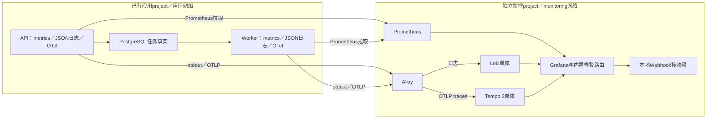

# ADR-005：Grafana监控体系本地搭建与部署方案

| 字段 | 内容 |
| --- | --- |
| 编号 | ADR-005 |
| 状态 | **已接受：方案确认，等待前置应用可观测接入完成；尚未实施** |
| 版本／日期 | 1.2／2026-11-14（America/New_York）；同步ADR-004接入设计、指标label及条件初始化规则，尚未实施 |
| 对应项目版本 | 以当前v0.3代码为调研基线；005是工作编号，不表示项目已经升级为v0.5 |
| 适用范围 | 仓库独立模块`docker/monitoring/`，Windows Docker Desktop Linux容器为首要使用环境，兼顾原生Linux Docker Engine |
| 依据 | 本次用户明确的部署要求；[本地可观测体系调研](../runbooks/local-observability-compose-research.md)；现有[应用Compose](../../docker-compose.yml)、[通用执行规范](../项目开发和修改的通用执行规范.md) |
| 前置依赖 | [PRD-004：应用可观测性与追踪上下文](../prd/004-SesRAG-应用可观测性与追踪上下文-PRD.md)与[ADR-004](004-sesrag-observability-implementation-plan.md)的应用实施/开发验证已完成，证据见[PR-004](../pr/004-SesRAG-应用可观测性与追踪上下文-PR.md)；005实施时仍须对实际部署重新核准G1～G5，不把独立测试网络当部署接线；应用开发不在本方案内 |
| 关联PRD | 本次为独立运维部署方案，未新建PRD-005；不扩展PRD-003的产品承诺，不把部署方案当成应用插桩实施方案 |
| 实施结果 | 尚未实施；实际文件、镜像digest、验证命令、结果和限制在实施完成后另记于`docs/pr/005-SesRAG-本地监控部署-PR.md` |

## 决策摘要

采用**Grafana＋Prometheus＋Loki＋Tempo＋Alloy独立Compose**，代码和配置集中在`docker/monitoring/`。Prometheus主动抓取前置工作提供的指标端点；Alloy读取获准容器的标准输出并转发Loki，接收应用OTLP traces并转发Tempo。Loki、Tempo采用单体、本地持久卷，不引入Kafka、MinIO、Mimir或额外OTel Collector。

监控使用独立Compose project和独立数据卷。只有Prometheus、Alloy连接已存在且归属核验通过的应用网络，其余监控组件留在监控网络。Grafana统一拥有告警规则，通过内置Alertmanager路由；本轮通知目的端为本地Webhook验证接收器，外部通知集成留待后续独立实施。

本次只交付方案与导航。后续正式实施必须先通过第3节准入；即使能启动空监控栈，也不能跳过应用接入前提，更不能用合成遥测冒充真实业务验收。**本方案不安装windows_exporter，不修改业务代码、数据库Schema、Task传播或应用指标语义。**

## 1. 目标、边界和可预估结果

### 1.1 目标

| ID | 目标 | 完成判定 |
| --- | --- | --- |
| OBS-01 | 独立、可重复的部署 | 固定镜像及配置，可预检、启动、查询状态、停止和重新启动，不依赖手动点击重建配置 |
| OBS-02 | 三类信号实际可查询 | 真实应用指标进入Prometheus、获准日志进入Loki、应用追踪进入Tempo，Grafana可查询并按真实trace_id关联 |
| OBS-03 | 可版本化仪表盘与告警 | 数据源、仪表盘和告警由provisioning恢复，UID稳定；告警实际经历触发、通知与恢复 |
| OBS-04 | 数据与资源有边界 | 明确内存上限、队列、保留期和磁盘预警预算；报告降级、采集错误和丢弃情况，不宣称零丢失 |
| OBS-05 | 保留／销毁可区分 | 停止后可恢复遥测历史；明确销毁仅删除监控资源，应用数据库、上传、索引和其它项目不变 |
| OBS-06 | 失败可诊断且可恢复 | 配置、端口、权限、网络、依赖及镜像错误有中文诊断；启动失败只清理本次创建资源，不破坏已有部署 |

预期交付是**本地开发与排障监控模块**。应用与监控同机、电脑休眠或Docker Desktop停止时，监控也停止；不提供高可用、生产SLO或24小时独立监测保证。

### 1.2 实施范围

- 五个核心组件的版本、配置、持久卷、私有网络、权限、健康预检和运行限制。
- 应用部署连接适配：只使用已有端点／OTLP开关／日志字段，增加采集标签及已支持的部署环境值；不新增应用行为。
- 数据源、三信号关联、固定仪表盘、Grafana-managed告警及本地Webhook闭环。
- 模块主入口、配置渲染、凭据输入、验证夹具、报告、停止／销毁、监控数据备份和恢复。
- Windows Docker Desktop上的容器及应用观测；原生Linux的实际主机指标作为独立可选profile。

### 1.3 不实施

- `backend/`／`frontend/`的OTel SDK、自动或手动插桩、`/metrics`实现、Worker指标HTTP服务、W3C上下文持久化、业务Schema／迁移与契约变更。
- windows_exporter、Windows物理CPU／内存／磁盘监测；也不把Linux容器／VM指标伪装成Windows指标。
- cAdvisor、PostgreSQL／Redis Exporter的新增部署，除非前置交付已经包含它们且契约明确；本方案可抓取已有端点，不为面板临时补产品能力。
- Tempo metrics-generator／service graph、profiling／Pyroscope、eBPF／OBI、tail sampling、OTLP logs、OTLP metrics和Prometheus remote-write接收。
- 独立Alertmanager、Prometheus／Loki重复告警规则、外部SMTP／Webhook集成及账号开通、云托管监控、云资源采购和CI工作流。
- 旧PRD验收目录、应用业务数据销毁、全机Docker prune、全量Desktop reset或宿主VHDX手工清理。

## 2. 当前实现基线及分工

| 文件／模块 | 当前事实 | 对本方案的影响 |
| --- | --- | --- |
| `docker-compose.yml` | PostgreSQL、Redis、API、Worker、前端常驻；迁移完成后退出；存在业务named volumes | 监控独立运行，不把这些卷加入监控Compose；不对应用project执行`down --volumes` |
| `pyproject.toml`、`backend/app.py`、`backend/workers/main.py` | 当前调研基线没有Prometheus端点及OTel接入 | 作为准入缺口记录，由前置工作完成；005不补依赖、不改应用入口 |
| `backend/workers/runtime.py::_write_log`、`backend/application/stage_observation.py` | 已有安全身份与阶段耗时日志及观测旁路 | 可以消费前置交付最终确认的stdout结构；既有日志不是完整trace或metrics的替代 |
| `backend/domain/ports/__init__.py::TaskLease`、`backend/db/models.py::TaskModel` | PostgreSQL任务、租约、attempt／generation为事实，当前未有显式W3C传播接口 | API→Task→Worker追踪关联由前置工作验收，005不修改这些核心对象 |
| `backend/api/routes/health.py::ready` | DB失败503，Redis降级／Worker未知可能仍200并有不同payload | 告警消费明确的readiness指标，不能只按HTTP200判Worker正常 |
| 调研文档 | 已区分Desktop／宿主、Tempo3、Alloy职责和清理边界，未运行监控栈 | 本ADR确定具体路线；旧调研中的候选项以本ADR范围为准 |

前置工作负责“产生正确且安全的数据”，005负责“接收、存储、关联、展示与告警”。采集失败不能写回Run终态、修改Task租约或重试业务；所有遥测继续作为事实的投影。

## 3. 正式实施准入及接入契约

### 3.1 准入门槛

正式实施从P0开始，以下项目均需有可追溯交付证据，不以修改配置或假数据替代：

| 门槛 | 前置工作应提供 | 005核对方式 |
| --- | --- | --- |
| G1 接口与来源冻结 | 前置文档路径、源码commit＋dirty指纹、应用部署project／环境、指标和日志字段真源 | 比对文档、实际容器和下面的部署契约；版本不符即停止实施接线 |
| G2 指标可用 | API和Worker长驻指标端点、类型／单位／label、队列与readiness等语义；必需序列的初始化及无流量语义；受控请求后能读取变化 | 只读拉取，检查exposition格式、预期序列及低基数，不启动新的指标实现 |
| G3 日志可用 | 安全stdout字段、统一service身份；实际日志中的trace_id／span_id及安全业务关联字段 | 用受控应用操作验证；Secret、Prompt、文档原文和签名URL没有进入遥测 |
| G4 追踪可用 | SDK与OTLP HTTP/protobuf配置接口、`service.name`，API→持久任务→Worker的传播／link约定；重试代际可区分 | 读取前置验证报告；正式接入后再验到达Tempo，005不重设计队列传播 |
| G5 应用实例可管理 | 已运行的专用开发应用及真实网络归属，允许添加已知部署环境值／采集标签的方式 | P0确认允许修改的部署值及操作步骤；P4再由应用拥有者应用已交付的override，005入口不自动重建／停止应用 |

准备方案不要求现在满足这些门槛。**未满足时本ADR保持“已接受／等待前置”，不能标“已实施”。** 前置契约出现应用实现问题时，输出差异报告并退回对应工作处理；允许修本模块渲染或采集错误，不跨范围改应用。

### 3.2 部署接入描述

模块提供`integration/application-contract.schema.json`与无Secret的`application-contract.example.json`。前置交付完成后，在`runtime/<environment-id>/inputs/application-contract.json`放入实际部署描述，并引用正式接口／指标文档。它是部署适配输入，不另立一套产品接口真源。

| 字段组 | 主要字段及约束 |
| --- | --- |
| 身份 | `schema_version=1`、`environment_id`、`source_ref`、`source_fingerprint`、`contract_reference`；environment_id仅小写字母／数字／短横线，1～32字符 |
| 应用资源 | `application_project`、`application_network`、`services.api`、`services.worker`；worker提供targets列表，默认单项，每项为已核验的唯一实例网络别名；网络必须由该应用project拥有，不能只凭名字就连接 |
| 指标端点 | 各服务`metrics.host/port/path`及有限静态labels；host必须对应已核验网络别名，端口1～65535，path以`/`开头；禁止任意公网URL及含口令的URL |
| 指标绑定 | 每个`logical_id`的实际`metric_name`、`type`、`unit`、`label_map`及有限值集合；`required_series`逐项注明always或after_first_success(source)及有限selector；模板只接受合法指标／label标识符，不执行外部输入提供的任意PromQL |
| 日志 | `service_names`、允许服务清单、`timestamp_field`、`level_field`、`trace_id_field`、JSON字段／metadata模式；不含正文样本或密钥 |
| traces | `protocol=http/protobuf`、已有OTLP配置变量名、`service_names`、安全resource属性及传播约定引用；只使用前置支持的配置，不通过新增变量假装完成插桩 |
| 平台 | `docker-desktop`或`linux-host`；后者可选Node Exporter，前者明确不提供物理宿主指标 |

005使用以下**逻辑指标绑定**，实际指标名和维度以G2冻结结果填写。未取得真实名称前不生成会误报正常的告警文件，也不把本表当成已存在的metric API：

| logical_id | 必需语义 |
| --- | --- |
| `HTTP_REQUESTS` | counter，API响应次数，有限status_class及路由模板；成功／失败和取消口径已说明 |
| `HTTP_DURATION` | 秒单位经典histogram，API短请求耗时；明确排除或单列长SSE连接 |
| `WORKER_READY` | gauge，可信readiness的0／1投影；未知与缺序列不能伪造为1 |
| `QUEUE_LENGTH`、`QUEUE_OLDEST_WAIT` | gauge，等待任务数量、最老等待秒数，定义无等待任务时的0值 |
| `TASK_ATTEMPTS` | counter，按有限task_kind／result区分尝试结果；不是完整Run成功次数 |
| `STAGE_DURATION` | 秒单位经典histogram，有限stage及task_kind；定义与既有阶段观测一致 |

Prometheus目标还会有标准`up`；本模块添加有限environment／service目标标签。ADR-004的应用源端也带同名固定身份，应用job必须设`honor_labels: true`，并在G2校验源端值等于实例契约；不允许默认冲突产生exported_service／exported_environment或静默改写身份。监控自身job按组件实际标签单独配置。若前置选择native histogram等不同语义，先修订绑定和面板／告警模板并校审，不静默换统计口径。

PRD-004同时要求快照已知性／新鲜度及唯一统计来源。G2必须交付对应辅助序列、有效期及聚合规则；七类逻辑绑定不够表达来源有效性时不能省掉辅助绑定。QUEUE_LENGTH／QUEUE_OLDEST_WAIT消费到时有效queued口径，运行／退避／waiting_external分别展示，不把外部等待当Worker堵塞；全局队列／聚合readiness不因多个抓取目标被重复sum。阈值规则使用前置冻结的有效性guard，来源失效单独告警，不能把旧值或伪造0当成当前健康值。

ADR-004设计采用API9101／Worker9102的独立内网`/metrics`、JSON字段关联与`task_sibling_spans_v1`；真实实施后仍须按G1～G5核验。快照首次成功前没有业务数值样本，initialized／valid／last_success控制序列始终存在；业务required_series只在initialized=1后检查，初始来源未知由OBSERVATION-INVALID报告，不能为满足缺失规则填假0。005只消费，不替004生成遥测。

来源指纹覆盖约定的相关源码、正式接口说明和模块只读模板，排除`runtime/`、`artifacts/`、`.cache/`及Secret。生成运行文件不能使自己的来源指纹反复变化；指纹范围随接入描述记录，不能用整个工作区含运行产物的hash代替。

## 4. 架构、网络和端口



### 4.1 明确采用的网络方式

- 监控project名为`sesrag-observe-<environment-id>`；默认environment-id为`local`。
- Compose自有`monitoring`网络用于五组件与验证工具之间通信，由监控project管理、down时删除。
- **不另建全局桥接网络**：Prometheus、Alloy作为双网服务，将G5的应用既有网络以external network引用。它仍由应用project拥有，005不创建、删除或接管。这是对调研中“专用外部桥接”候选的具体收敛，减少一个需共同清理的资源。
- Alloy在应用网络使用唯一别名`sesrag-obs-<environment-id>-alloy`；应用OTLP endpoint指向此别名，端口4318。不同环境不能共享相同采集标签和别名。
- Grafana、Loki、Tempo、通知接收器不加入应用网络，不访问应用数据库。Prometheus只能抓契约中的已核验目标；Alloy日志发现仍按project和显式opt-in标签过滤。
- 监控网络采用普通bridge并关闭不必要宿主端口。禁用Grafana匿名使用统计、自动更新检查和启动时插件下载；本轮没有配置外部遥测或通知目的端。普通bridge本身不是互联网访问隔离保证，严格出站限制需另由主机防火墙实施。
- 不跨project写`depends_on`；入口按实际readiness轮询。应用不启动时Start报告准入失败，不替用户启动或重建应用。

监控拥有的容器、网络和卷同时标记模块`obs005`、environment及Compose project，资源ID入账；应用既有external网络只读核验其应用project归属，不追加监控所有权标签。清理按归属和账本判断，不能只按名称前缀搜索后删除。

| 服务 | 容器端口／用途 | 默认宿主映射 |
| --- | --- | --- |
| Grafana | 3000，UI／查询／告警 | `127.0.0.1:3000`，冲突则要求在本模块环境中明确更换，不抢占已有端口 |
| Prometheus | 9090，查询／抓取状态 | 不映射 |
| Loki | 3100，push／查询／ready | 不映射 |
| Tempo | 3200查询／ready；4317、4318 OTLP | 不映射；只让Alloy使用内部4317 |
| Alloy | 4318 OTLP HTTP、4317 OTLP gRPC、12345管理 | 默认都不映射；host-otlp可选profile仅将4318绑定127.0.0.1 |
| webhook-sink | 8080，测试接收与读取计数 | 不映射，验证工具在内网查询 |
| Node Exporter | 9100 | 仅linux-host profile内网抓取，不映射 |

OTLP接收器显式绑定`0.0.0.0`的**容器接口**；不等于发布到宿主公网。API／前端原有宿主端口与认证方式属于应用部署前提，005不宣称替现有应用解决公网安全。

### 4.2 Docker日志权限

默认本地路线为Alloy挂Docker VM的Unix socket，通过`discovery.docker`与`loki.source.docker`读取stdout。挂载`:ro`不限制Docker API写权限，按label过滤也不是权限隔离；因此该采集器属于可信本地高权限模块，只用于受控开发daemon，不允许不可信任务向其中提交配置。

不开放TCP2375、不默认privileged、不挂Windows整个磁盘。未来若需要严格Docker API代理，应另评估接口白名单与新依赖，本轮不把未经验证的代理当作安全保证。Alloy与存储卷权限在P2验证；不能假设镜像创建了普通用户就默认以该用户运行。

## 5. 目录、文件与职责

以下为**将来实施时**新增的模块；本次只写ADR和文档导航，不创建空目录或可执行脚本。

```text
docker/monitoring/
├─ README.md
├─ compose.yaml
├─ application.override.yaml
├─ .env.example
├─ images.lock.json
├─ requirements-host.lock
├─ run-monitoring.ps1
├─ integration/
│  ├─ application-contract.schema.json
│  └─ application-contract.example.json
├─ prometheus/prometheus.yml.tmpl
├─ alloy/config.alloy.tmpl
├─ loki/config.yaml
├─ tempo/config.yaml
├─ grafana/
│  ├─ grafana.ini
│  ├─ provisioning/
│  │  ├─ datasources/datasources.yaml
│  │  ├─ dashboards/provider.yaml
│  │  └─ alerting/{rules.yaml.tmpl,contact-points.yaml,policies.yaml}
│  └─ dashboards/{overview.json,application.json,pipeline.json,linux-host.json}
├─ platform/compose.linux-host.yaml
├─ helpers/
│  ├─ cli.py
│  ├─ preflight.py
│  ├─ render.py
│  ├─ lifecycle.py
│  └─ verify.py
├─ tools/
│  ├─ Dockerfile
│  ├─ telemetry_fixture.py
│  └─ volume_inspector.py
├─ validation/
│  ├─ test_configuration.py
│  ├─ test_lifecycle.py
│  └─ fixtures/{metrics.prom,log.json,trace.json}
├─ runtime/<environment-id>/
│  ├─ inputs/application-contract.json
│  ├─ monitoring.env
│  ├─ secrets/grafana-admin-password
│  └─ generated/{prometheus.yml,config.alloy,rules.yaml}
├─ artifacts/<run-id>/
│  ├─ inventory.json
│  ├─ verification.json
│  └─ cleanup.json
├─ backups/<environment-id>/<backup-id>/ # 显式备份，含Secret，受限且Git忽略
└─ .cache/                       # 专用宿主工具环境，不存业务事实
```

| 文件／目录 | 主要职责 | 使用阶段 |
| --- | --- | --- |
| `compose.yaml` | 五核心组件、webhook-sink、按需验证工具、明确named volumes／限制／网络；环境变量必填检查 | P1～P6运行与清理 |
| `application.override.yaml` | 仅给既有api／worker添加采集opt-in和environment标签、前置支持的OTLP值及Docker日志轮转；无新业务代码／卷；由应用拥有者显式合并应用部署 | P1准备模板、P4应用；005不自动应用 |
| `.env.example` | 本模块无Secret的版本／环境／资源／端口／保留期模板，各字段注明用途、必填及默认值 | P1生成运行配置 |
| `images.lock.json` | image、tag、digest、架构、核验日期及官方来源；锁定实际镜像，不含凭据 | P1下载、P6升级／回滚 |
| `requirements-host.lock` | 专属Python工具依赖，仅jsonschema等校验工具及其传递依赖，锁定版本与hash；不改变项目venv | P1工具准备 |
| `run-monitoring.ps1` | Windows薄包装，向Python唯一生命周期实现传递参数和退出码 | P1～P6主入口 |
| `integration/` | 严格校验部署描述，样例明确非真实接口；不复制应用正式契约 | P0、P1、P4 |
| `prometheus/`、`alloy/`模板 | 从冻结部署描述生成抓取／日志过滤／OTLP路由；禁止任意表达式注入 | P2、P4 |
| `loki/`、`tempo/`配置 | 与锁定版本匹配的单体路径、保留与执行限制 | P2起运行 |
| Grafana datasource／dashboard provider | 固定UID、私网URL、logs↔traces关联和dashboard加载规则 | P3、P4 |
| Grafana alerting | 有限模板生成规则组，管理联系点与完整通知policy树 | P3、P5 |
| 四份dashboard JSON | overview监控栈、application业务指标、pipeline日志／追踪关联；linux-host仅相应profile加载 | P3、P4、可选Linux扩展 |
| `platform/compose.linux-host.yaml` | 原生Linux Node Exporter的受限主机挂载及CPU／内存／文件系统采集；禁用无法保证主机视图的网络collector，Docker Desktop禁止选择 | P2可选配置、P6分平台验证 |
| `helpers/cli.py` | 参数、动作分派、中文诊断与结构化退出；调用下列内部职责 | P1起 |
| `preflight.py` | 按动作校验契约、版本、端口、镜像、平台、资源和项目／网络／路径归属；清理不依赖应用在线 | 每次动作前，具体门槛见§10.2 |
| `render.py` | 原子生成无Secret配置与指纹，检测手工漂移；不修改源码模板 | Prepare／Validate |
| `lifecycle.py` | Docker子进程有界执行、资源账本、健康等待、失败回收、停止／销毁、备份／恢复 | P2～P6 |
| `verify.py` | 按范围探测端点、信号、关联、告警和资源；归档证据，不写业务成功事实 | P2～P6 |
| `tools/Dockerfile` | 小型Python验证镜像，带标准库夹具和受控卷工具；按动作限定挂载权限，不带Docker socket | P1构建、P2／P5／P6按需 |
| `telemetry_fixture.py` | 仅验证用的metrics、Loki push日志、OTLP/HTTP JSON数据和本地Webhook捕获；合成服务身份独立于应用 | P2／P5；webhook捕获常驻 |
| `volume_inspector.py` | Status／Verify／Backup只读挂载选定监控源卷，统计大小／余量、制作及校验备份；Restore仅向核验为空的监控目标卷读写挂载；不读业务卷或输出正文 | Status／Verify／Backup／Restore |
| `validation/` | 配置负例及生命周期故障验证；fixture身份固定，不计入真实应用通过率 | 各阶段回归 |
| `runtime/` | 当前运行输入、无Secret环境文件、Secret文件及生成配置；停止可保留，销毁后删除本环境临时副本 | Prepare～Destroy；Git忽略 |
| `artifacts/` | 不可覆盖run-id的资源清单、脱敏测试／清理／备份索引；不是遥测数据库 | 各阶段保留证据；Git忽略 |
| `backups/` | 同版本卷归档、私有Secret／配置及完整性manifest，权限受限；Destroy默认保留，按使用者的保留计划另行清理 | Backup／Restore；Git忽略 |
| `.cache/`、`README.md` | 专属依赖缓存；完整目录职责、前提、操作、诊断和升级说明 | P1～P6 |

### 5.1 已有文件的修改边界

| 已有文件 | 正式实施时修改 | 目的 |
| --- | --- | --- |
| `.gitignore` | 忽略`docker/monitoring/`下的`runtime/`、`artifacts/`、`.cache/`、`backups/`，保留配置模板／面板／测试 | 凭据与运行数据不进Git |
| 根`README.md` | 说明独立模块入口、前置条件、常用操作和平台不支持项；只链接接口真源 | 仓库导航与用户操作 |
| `docs/runbooks/local-observability-compose-research.md` | 链接本ADR和将来模块README；历史研究保留时间边界 | 区分调研候选与已接受方案 |
| 本ADR | 记录实际实施差异／镜像锁和证据；满足退出标准后才改“已实施” | 决策与执行一致 |

根应用Compose、根`.env.example`、`backend/`、`frontend/`、`contracts/`、`migrations/`和旧测试套件不在005修改清单。若前置接入需要这些变动，应在其独立任务完成，不能以本部署模块为名悄悄加入。

正式实施完成后另新增`docs/pr/005-SesRAG-本地监控部署-PR.md`，登记实际文件、差异、版本、命令、验收证据及未完成项，由P6交付；本次不预填实施结果。本次实际文档变动仅为新增本ADR、在根README增加入口、在原调研开头标明已接受方案的范围与链接。

## 6. 技术选型、版本与工具准备

以下是2026-11-13研究核实的正式版本基线，并非声称2026-11-14或未来始终最新版；实施P1在官方release与registry复核可用性／安全通告后固定digest。若必须换主版本，先修订本方案与相应配置，不用`latest`绕过检查。

| 依赖／工具 | 基线／下限 | 安装与用途 |
| --- | --- | --- |
| Grafana | `grafana/grafana:13.3.1` | UI、查询、provisioning及告警 |
| Prometheus | `prom/prometheus:v3.16.0` | 唯一metrics存储；相同镜像promtool用于配置校验 |
| Loki | `grafana/loki:3.7.10` | 单体TSDB日志；同版本verify-config校验 |
| Tempo | `grafana/tempo:3.1.1` | `target=all`、本地WAL／blocks；按3.x配置 |
| Alloy | `grafana/alloy:v1.21.3` | 日志／OTLP traces；同版本validate |
| Node Exporter | `quay.io/prometheus/node-exporter:v1.12.1` | 仅原生Linux可选，不是Windows宿主替代 |
| 验证镜像基底 | `python:3.12.12-slim-bookworm`候选，P1核manifest并锁digest | 标准库HTTP夹具、规范OTLP/HTTP JSON夹具及受控卷工具；真实应用HTTP/protobuf由前置SDK产生，在P4另验，不声称标准库实现protobuf编码；缺tag时选已核实3.12补丁并记录，不无声回落latest |
| Docker／Compose | Docker Engine26+，Compose2.27+；Desktop使用Linux容器模式 | 当前环境已具备；不为此任务升级或重置Docker；不依赖Swarm的deploy-only限制 |
| 宿主Python | 3.11+；模块专属venv，`jsonschema==4.25.1` | 统一编排／Schema校验；宿主不安装五组件二进制，不改系统Python和项目依赖 |
| PowerShell | Windows7.4+；Linux可直接调用Python入口 | 包装主入口；不将PowerShell加入业务镜像 |

SDK依赖属于前置应用工作，005不下载或替换OTel应用包。webhook-sink复用模块小工具镜像，不增加SMTP账号；Grafana服务器端所需插件仅用内置数据源，不在启动时联网拉未知插件。

下载仅在显式Pull／准备工具阶段执行：记录tag→digest、目标架构、耗时及退出；网络超时有界，失败保留安全码；可显式使用本机已锁定镜像离线启动，但digest不符即拒绝。一次镜像存在或配置解析成功不算部署验收。

宿主工具先按README在`.cache/venv`完成一次显式依赖准备，再执行Prepare；PowerShell包装器随后使用该venv，Linux入口使用同目录`bin/python`。镜像顺序为Prepare冻结配置→Pull下载／构建→Validate运行同版本检查器→Start；Validate、Start使用已有锁定镜像，不自动拉取，避免验证命令隐含下载。

## 7. 存储与信号处理的具体设计

### 7.1 数据卷与保留

所有卷使用Compose自动前缀，不写全局固定`name`、不声明external volume，不使用anonymous volume存遥测。主键为`监控project＋逻辑卷名`；数据卷只属于一个environment，不能跨实例共享TSDB或SQLite。

| 卷／路径 | 持久内容 | 默认保留／规划预算 |
| --- | --- | --- |
| `grafana_data:/var/lib/grafana` | SQLite、告警状态及必要运行配置 | 0.5GiB规划预算；配置provisioning另只读挂载 |
| `prometheus_data:/prometheus` | TSDB、head／WAL | 7天且blocks大小上限2GB；逻辑卷规划3GiB，WAL／head另占，2GB不是卷硬配额 |
| `loki_data:/loki` | chunks、TSDB索引／cache、WAL、compactor marker | 72小时，卷规划3GiB；不承诺达到预算自动删除 |
| `tempo_data:/var/tempo` | WAL、blocks和所选本地运行状态 | 24小时，卷规划3GiB；retention异步，不能当磁盘硬上限 |
| `alloy_data:/var/lib/alloy/data` | 读取positions、组件状态 | 0.5GiB规划预算；本轮不启用实验日志WAL |

五卷预算合计约10GiB；模块报告／备份、Docker镜像、容器日志、应用数据和Docker虚拟磁盘余量另计。Status／Verify用只读检查器报告实际卷逻辑大小和所在Docker文件系统余量，不把Windows D盘剩余量直接当named volume容量。任一卷达到预算70%给出提示、85%给出警告并建议缩短保留／备份清理；这是工具检查阈值，不冒充已有连续Windows磁盘指标告警。

备份不计入10GiB，应预留至少一份当前监控数据体积；长期保留备份需显式目标路径及容量检查，默认不无限累积。首次镜像／依赖下载与长期遥测分开统计；建议Docker数据所在分区初始至少30GiB可用，再根据应用数据评估。

### 7.2 Prometheus

全局抓取间隔15s，抓取timeout5s；Grafana规则组评估间隔30s。抓API／Worker及Grafana、Prometheus、Loki、Tempo、Alloy自身端点，目标清单由契约与锁定组件配置生成。Grafana在`grafana.ini`显式设置`[metrics] enabled=true`，其端点仅在监控内网使用。scrape标签包含固定`environment`、`service`、`job`；不把run/task/trace身份放进label。

每个目标设置有限sample／label上限，P2根据实际基数确定并记录；建议起点每target≤20000 samples／scrape，单label值≤256字符，禁止任意路径／用户输入维度。上限导致抓取失败时保留错误，不能删除告警把它伪装成正常。

默认不开OTLP receiver／remote-write receiver、不同时经Alloy抓同一metrics。Alloy接收器若收到未接线的metrics／logs，应明确拒绝或在模块验证中报错，前置应用已关闭这些重复exporter，不能默默丢弃后称全信号支持。

原生Linux可选profile中的Node Exporter仍放监控bridge，不用`network_mode: host`，9100不发布到宿主。使用`pid: host`及`/:/host:ro,rslave`，设置`--path.rootfs=/host`、`--path.procfs=/host/proc`、`--path.sysfs=/host/sys`；采用`--collector.disable-defaults`后只启用cpu、meminfo、filesystem、loadavg、stat。P6与主机只读结果核对CPU／内存／文件系统；不因绑定主机目录就宣称网络namespace一致，netdev／netstat等本轮不开，真实主机网络指标另行扩展。此profile需要显式选择和主机挂载权限，不能在Desktop自动开启。

### 7.3 Alloy与日志

日志发现必须同时匹配`com.docker.compose.project=<application_project>`、`io.sesrag.observability.environment=<environment_id>`和`io.sesrag.observability.collect=true`。默认只纳入API／Worker。监控自身错误另用直接组件指标与控制台诊断，避免采集Alloy自己的发送失败日志造成反馈洪流。

按契约解析timestamp／level／trace_id；允许明确的非JSON日志解析路径，不以解析失败就静默丢弃。Loki indexed labels仅使用环境、service和有限level；安全业务身份及trace_id放JSON字段或structured metadata。文本中发现敏感值的脱敏规则为防御补充，源头安全由G3保证。

positions持久化，`loki.write`以内存buffer和有界发送重试运行；1.21.3的日志WAL仍实验，本轮不启用。Loki不可用或Alloy崩溃时可能丢失超过buffer／源日志轮转窗口的数据，报告明确该边界，不声称重启不丢或exactly-once。Docker日志轮转初始`json-file`、`max-size=10m`、`max-file=3`，由应用拥有者显式部署override；轮转会导致无法补采，需压力验证并适当放大而不无限增长。

Loki单体`target=all`、replication_factor1、in-memory ring、filesystem对象存储、TSDB schema v13、24h index period。所有写入路径归入`/loki`；`compactor.retention_enabled=true`、`delete_request_store=filesystem`、marker工作目录持久化。保留删除有延迟，不以72h配置启动成功等同已测删除。

P2合成日志由工具向Loki push接口写入，只证明后端存取；合成metrics target只加入隔离验证配置，身份清楚标记fixture，不留在默认应用目标清单。Alloy的Docker发现／解析／转发必须在P4以获准应用stdout另外验收。不能为让fixture通过而扩大默认日志采集project白名单。

### 7.4 OTLP traces与Tempo

Alloy仅从本地受控网络接收OTLP；HTTP端点`0.0.0.0:4318`，gRPC`0.0.0.0:4317`。应用默认使用HTTP/protobuf的`/v1/traces`。流向为receiver→memory_limiter→脱敏／有限属性过滤→batch→OTLP gRPC exporter→`tempo:4317`。

初始memory_limiter限384MiB、spike96MiB；batch每1s、期望128 spans／batch、最大256；发送timeout5s、最多2并发、最多256个待发请求、总重试elapsed60s。各字段须由P2在Alloy1.21.3实际组件配置校验，数值改变必须保留预算记录。队列是内存队列，不承诺Alloy重启保留；memory_limiter拒绝时应观察拒绝／丢弃而非压垮应用。

Tempo使用3.1.1的单体与本地`storage.trace.backend=local`，WAL和blocks在`/var/tempo`；24h保留采用`overrides.defaults.compaction.block_retention=24h`，不套2.x的`compactor`字段。关闭演示MCP、metrics-generator和测试流量常驻服务，无Kafka／MinIO。配置与receiver就绪后发送合成trace并按ID查询，再接真实应用。

前置工作决定采样策略并关闭敏感span属性；005不重设采样或补队列传播。Grafana trace缺少某段时分别判断采样、源端未产生、传输丢弃、查询窗口和过期，不把缺span直接当业务执行失败。

## 8. Grafana展示、关联与告警

### 8.1 Provisioning与面板

固定UID：`sesrag-prometheus`、`sesrag-loki`、`sesrag-tempo`。datasource URL为相应容器DNS；provisioning只读，禁止匿名Admin，Grafana admin初始密码从secret文件读取，UI只绑定127.0.0.1。密码文件只在首次Prepare生成，已有Grafana卷重启不能通过覆盖初始密码文件假装重置数据库密码。

面板provider采用`allowUiUpdates=false`，版本化文件为更新入口；需要探索时另存临时副本，避免UI修改与源码互相覆盖。面板删除允许同步；已撤销的datasource／rule UID要通过相应版本支持的显式删除／prune声明移除，不能只删本地YAML就假定Grafana数据库里的旧告警消失。联系点／policy更新按完整配置校验，P3验证重建和删除两条路径。

| 面板 | 默认内容 | 前提 |
| --- | --- | --- |
| overview | 抓取状态、监控组件写入／导出错误、丢弃、进程资源和数据路径状态 | 固定版本自指标；缺指标时明确不支持，不写常数0 |
| application | API短请求量／5xx／耗时，Worker readiness、队列长度／最老等待、Task尝试结果、阶段耗时 | G2绑定完整；SSE和后台Run的不同计时不混算 |
| pipeline | 当前环境service过滤、Loki日志检索、trace查询及互相跳转 | G3／G4真实trace_id存在 |
| linux-host | 原生Linux CPU、内存、文件系统及负载；本轮不显示未采集的主机网络面板 | 只在linux-host profile加载；Desktop不加载，也不显示假的0值 |

Loki中的trace_id是JSON字段时，trace-to-logs查询须先`| json`，derived field按真实行结构提取；采用structured metadata时按其模式匹配。两种模式由契约固定，不能一端按JSON、一端按metadata而声称关联已通。映射`service.name`到日志`service`／`service_name`依实际配置统一。

本轮不承诺exemplar／service map；如前置已产exemplar，可记录为扩展观察，正式启用需另补存储及关联验收。页面“有数据”只证明查询，不能代替source身份、单位和范围核对。

### 8.2 告警规则清单

仅Grafana-managed Alerting拥有告警规则；Prometheus无重复alert rules，Loki ruler不启用，内置Alertmanager只处理Grafana管理的告警。规则UID为`obs005-<rule-id>`，folder UID为`sesrag-observe`，按environment／service分组，severity仅warning／critical。

下面`BIND(logical_id)`表示渲染时替换为G2真实指标名及label映射的**有限模板**，不是可以直接执行的PromQL；没有绑定就拒绝生成该规则，不能把名称未确定的问题掩盖为NoData。

| 规则ID | 判定／窗口 | 等待与级别 | NoData／Error处理 |
| --- | --- | --- | --- |
| TARGET-DOWN | 预期API／Worker或监控目标`up=0`，或该固定job预期序列absent | 2分钟，critical | 按目标逐条生成，缺序列视为异常；查询错误另发DatasourceError |
| METRIC-MISSING | 目标`up=1`，但G2承诺的always序列缺失，或已首次成功的source条件必需序列缺失 | 2分钟，critical | 按契约required_series／initialized生成；初始无业务快照或非必需动态组合不误报，来源尚不可判断由OBSERVATION-INVALID处理 |
| OBSERVATION-INVALID | 目标可抓取，但前置契约中的队列／聚合readiness来源未知或快照超过有效期 | 2分钟，warning | 与up=0及序列缺失区分；来源有效时才判断对应业务阈值，不能按旧值宣告健康 |
| WORKER-NOT-READY | 来源已知／新鲜且`BIND(WORKER_READY) != 1`，目标仍可抓取 | 2分钟，critical | 缺序列由METRIC-MISSING、来源未知由OBSERVATION-INVALID、up失败由TARGET-DOWN分别报告 |
| QUEUE-WAIT | 来源有效／新鲜，队列长度>0且`BIND(QUEUE_OLDEST_WAIT)>120秒` | 5分钟，warning | 可信空队列显式0不报警；序列缺失、来源失效及查询错误分别报告 |
| API-ERROR | 最近5分钟普通短请求数≥20且5xx比例>5%，使用ADR-004 request_kind=short，排除SSE／probe及非服务错误 | 2分钟，warning | 无请求不报警；不能因无请求把up失败静默恢复 |
| TASK-FAILURES | 最近10分钟失败attempt增量≥3；取消／失租不混作失败 | 2分钟，warning | 零新增为正常；up=1时必需指标缺失交METRIC-MISSING，up=0交TARGET-DOWN，查询错误单列 |
| PIPELINE-ERROR | 固定版本Alloy导出失败／拒绝或Loki／Tempo写入错误counter在5分钟内有增量 | 1分钟，warning | 模板在P2绑定实际组件指标；没有对应指标时不能部署伪规则，先定位版本配置 |

规则查询必须产出带固定环境／服务身份的数值0或1，随后由Grafana阈值判断；不能用过滤比较把所有正常序列删空，造成idle也被判NoData。API零请求／Task零新增在对应初始化序列确实存在且目标正常时才归0；不使用无条件`or vector(0)`掩盖采集缺口。必需序列缺失、目标失联分别由上述规则承担；依赖目标失联时不额外把业务阈值判为失败。必需规则统一使用`noDataState=NoData`、`execErrState=Error`，异常查询由Grafana生成DatasourceNoData／DatasourceError并路由通知，不能设为OK或无限KeepLastState。PIPELINE-ERROR所依赖的组件自指标也须在P2登记初始化／缺失语义。

队列120秒、5xx5%、3次失败是**本地默认诊断阈值**，不是产品SLO；在模块环境文件中有界调整并进配置指纹。业务正常“无知识命中”不作为基础设施错误。API耗时先展示，尚未定义SLO前不为所有长生成／SSE套2秒告警。

linux-host可选追加内存可用<15%持续5分钟、文件系统余量<15%持续5分钟告警；采集目标清楚标记真实Linux。Windows物理内存／磁盘告警、Desktop容器资源告警不伪造，本轮不作为默认验收项。卷70／85%规划预算由Status／Verify报告，不把人工运行检查冒充Grafana连续告警。

### 8.3 路由和通知

单一provisioning policy树归模块拥有，默认路由到`obs005-local-webhook`；按environment／service分组，`group_wait=30s`、`group_interval=1m`、`repeat_interval=4h`，发送Resolved。配置文件更新可能替换整棵策略树，禁止与未导出的手工规则混用。

webhook-sink为本地验证目的端，以内存ring仅保留最近100条经过字段白名单的通知、最长24h；Verify将本次所需的脱敏收发证据归档到artifacts，sink重建不保留通知历史，不新增第六个数据卷。不得回显完整query响应、凭据或日志正文。Grafana的DatasourceNoData／DatasourceError按专门policy送同一测试端，保留原故障身份。

本轮验收必须实际记录Pending→Firing→Webhook接收→恢复→Resolved；额外提供“始终触发”的合成规则只用于验证，不进入默认应用告警组。本轮不提供外部SMTP／Webhook的半成品开关或真实目的地址；后续扩展须另外定义认证、受限Secret输入及真实通知验收。Grafana／Alloy／配置render不得打印secret。

Grafana宕机、电脑休眠或Docker停止后无法靠同一Grafana继续发通知；这是明确的本地单点限制，不以不断重启或虚假健康状态掩盖。

## 9. 内存、CPU与磁盘资源预算

以下为小流量本地环境的工程估算，**不是官方最低配置、部署实测或性能承诺**。实际取决于日志量、trace大小、时序基数与查询并发，P6必须记录实测峰值及拒绝／OOM。

| 组件 | 预计常态内存 | 初始容器内存上限 | 初始CPU上限 |
| --- | ---: | ---: | ---: |
| Grafana | 200～500MiB | 768MiB | 0.5核 |
| Prometheus | 512～1024MiB | 1536MiB | 0.75核 |
| Loki | 400～1000MiB | 1536MiB | 1核 |
| Tempo | 400～1000MiB | 1536MiB | 1核 |
| Alloy | 150～400MiB | 768MiB | 0.5核 |
| **五核心合计** | **约1.6～3.8GiB** | **6144MiB＝6GiB** | **3.75核** |
| webhook-sink | 20～80MiB | 128MiB | 0.1核 |
| 临时验证工具 | 50～150MiB | 384MiB | 0.5核 |
| 可选Node Exporter | 20～80MiB | 128MiB | 0.1核 |

默认五核心＋sink上限6.125GiB；验证期间6.5GiB；Linux可选profile再加0.125GiB。使用Compose非Swarm也生效的`mem_limit`／`cpus`；CPU配额不是预留专用核，memory上限不能保证程序刚好够用。不能把6GiB“上限合计”写成启动时就实际占用6GiB。

上述验证预算要求临时工具同时最多一个容器，配置检查／卷操作按序执行；信号夹具在同一工具进程中承担受控生成与查询。需要并发增加工具容器时，必须先把其内存上限加入准入合计并记录，不能沿用6.5GiB总额。

应用另预留约2～4GiB，Docker VM／操作系统另留约1～2GiB，整套小流量通常按8～12GiB容器环境容量规划并监测，而非把每个上限全部顶满。首要Windows环境建议宿主24GiB及以上、Docker可用约10～12GiB；低于8GiB Docker容量时完整栈预检拒绝，以免勉强通过后swap／OOM，需先调资源或另行修订降配路线。

调研时本机约23.7GiB内存、20逻辑处理器，Docker约11.5GiB可见，具备尝试条件但上限竞争仍需实测。2026-11-13观察到C盘约42.6GiB、D盘约56.1GiB可用，Docker已有大量镜像／缓存；磁盘物理位置与实时余量在实施前重新核对。不删除旧缓存作为准入“自动修复”。

首次下载五镜像和工具镜像，压缩下载量及解包占用在P1由实际manifest／pull结果记录，不能凭tag编造准确GB。首次下载、配置检查和正式运行分开统计；保留期不是磁盘硬配额，满盘仍可能导致写入失败，应实报并按监控数据维护流程处理。

## 10. 运行配置、主入口和生命周期

### 10.1 配置输入

本模块`.env.example`至少说明以下字段。Prepare只在`runtime/<environment-id>/monitoring.env`生成本地非Secret值，环境文件独立于根`.env`；调用Compose均显式传`--env-file`。不得扫描或复制`docs/secret`，不得改已有业务`.env`。

| 字段组 | 默认／要求 |
| --- | --- |
| 环境／资源身份 | `OBS_ENVIRONMENT_ID=local`；project按固定规则派生；`OBS_APPLICATION_CONTRACT`为显式输入文件；APP网络名只从契约生成，不接受shell覆盖 |
| UI | `OBS_GRAFANA_PORT=3000`，仅127.0.0.1；`OBS_HOST_OTLP=false` |
| 版本 | 各组件镜像引用来自`images.lock.json`的digest；不从外部shell悄悄覆盖 |
| 保留 | Prometheus7d／2GB blocks、Loki72h、Tempo24h，修改后重新渲染并记录指纹 |
| limits | 第9节内存／CPU、Alloy队列限制；显式调整必须通过合计资源检查 |
| 平台 | `OBS_PLATFORM=docker-desktop`或`linux-host`；Windows不加载Node Exporter／linux-host面板 |
| 通知 | 固定使用本地sink；不提供外部通知开关，后续独立扩展时再增加相应字段 |

Grafana密码以`GF_SECURITY_ADMIN_PASSWORD__FILE`注入。已有secret／卷不得被Prepare覆盖；发现状态不一致给出恢复说明。Docker Compose本地secret是受限文件挂载，不等于宿主磁盘自动加密；Windows文件ACL／Linux权限要检查。

### 10.2 动作和状态

PowerShell只包装Python：统一动作`Prepare`、`Validate`、`Pull`、`Start`、`Status`、`Verify`、`Stop`、`Destroy`、`Backup`、`Restore`。Linux使用同一`helpers/cli.py`，不复制另一套清理逻辑。

| 动作 | 必须行为 |
| --- | --- |
| Prepare | 核准入／Schema，冻结应用描述和模块配置指纹，创建本环境secret及生成配置；重复执行不覆盖已有凭据和数据 |
| Validate | 检查env优先级、项目／路径／网络、固定版本配置与provisioning引用；可运行一次性纯解析工具，不启动应用或存储服务 |
| Pull | 仅下载／构建锁定镜像和工具依赖，记录digest；不触发模型调用 |
| Start | 单环境互斥锁，核应用已就绪及网络归属，记录既有资源，再启动存储／Alloy／Prometheus／Grafana／sink，等待ready；幂等复用健康实例 |
| Status | 输出容器、signal targets、limits、配置漂移、卷逻辑大小及保留状态；不打印完整inspect／环境／正文 |
| Verify | 验证数据和关联／告警，产出报告；实际应用操作使用前置提供的安全夹具，不默认真实模型／MinerU外发 |
| Stop | 只对本监控project执行down，删除容器／自有网络，保留监控卷、secret、配置；应用继续运行 |
| Destroy | 明确选择EraseMonitoringData后删除本监控容器／卷和本环境runtime；报告保留；应用网络／业务卷与共享镜像不删 |
| Backup | 停写／停止监控组件后备份五卷、secret及配置版本索引；secret归私有受限备份，公共报告仅hash；完成后恢复原先运行状态 |
| Restore | 仅向空白、匹配归属的环境恢复相同版本备份，校验hash／权限；拒绝绝对路径、路径逃逸、越界链接及超展开预算的归档，已有数据拒绝覆盖；启动后重新查询三信号和告警配置 |

资源状态以`absent→prepared→starting→running→stopped→destroyed`记录；异常为`failed`并保留失败阶段与资源清单。它只描述监控生命周期，不作为应用Run状态机。每次命令有新的run-id，报告不覆盖，环境身份在Stop／Start之间不变。

Stop／Destroy不自动移除应用已接受的OTLP配置。监控停止后源端可能出现有界导出失败，前置SDK必须保证业务继续运行；重新启动同环境后恢复原DNS别名接收。若要停用应用发送，由应用拥有者按前置文档撤销override，005不静默重建应用。

准入按动作区分：Prepare／Start／应用接入Verify必须核G1～G5；Status报告前置缺失但仍可读取本模块状态。Stop／Destroy只依赖daemon、资源归属和受控路径，不因应用离线、接口漂移或网络已被应用拥有者移除而拒绝清理。Backup可以在应用离线时执行；Restore写空卷不要求应用在线，后续Start及真实接线验收仍须过准入。端口占用检查排除本环境已经登记且健康的Grafana，保证重复Start不误报冲突。

入口最长等待：单次常规Docker命令默认60s；拉镜像显式最长20分钟；正常启动总截止180s，停机宽限30s。Verify基础探测预算300s，完整验证总截止3600s，单个告警场景最多1200s，必须覆盖实际统计窗口、pending、评估及分组通知等待；不可用300s总截止验证等待5分钟的规则。4h重复通知窗口用隔离验证配置缩短后测试，验证后恢复默认值并记差异。V13保留期物理删除另作长时验证，或采用满足固定版本时间约束的隔离夹具；没有实证就标not_run，不能算在短时smoke通过项内。所有长操作至少每30s输出中文进度；Docker命令未按时退出就终止本次子进程并记录，不无限重试。批量备份另按数据量设显式截止、取消后不把半份备份标完整。

启动失败／Ctrl+C：只回收账本中本次创建的容器和自有网络，保留既有卷及诊断；原来健康的环境不被另一次失败Prepare／Start拆掉。主进程被硬杀后，下一次Status／Stop／Destroy读取持久账本并复查实际labels，不能凭缺少锁就假设资源不存在。

### 10.3 未来操作示例

下面文件和命令是实施结果应提供的接口，**当前不执行**：

```powershell
# 首次工具准备：依赖锁与脚本均由未来P1交付，当前不执行。
python -m venv ./docker/monitoring/.cache/venv
& ./docker/monitoring/.cache/venv/Scripts/python.exe -m pip install --require-hashes -r ./docker/monitoring/requirements-host.lock
# 由前置接入交付放置实际部署描述；文件内容须符合本模块Schema。
$contractPath = Join-Path $PWD 'docker/monitoring/runtime/local/inputs/application-contract.json'
pwsh -NoProfile -File ./docker/monitoring/run-monitoring.ps1 -Action Prepare -EnvironmentId local -ApplicationContract $contractPath
pwsh -NoProfile -File ./docker/monitoring/run-monitoring.ps1 -Action Pull -EnvironmentId local
pwsh -NoProfile -File ./docker/monitoring/run-monitoring.ps1 -Action Validate -EnvironmentId local
pwsh -NoProfile -File ./docker/monitoring/run-monitoring.ps1 -Action Start -EnvironmentId local
pwsh -NoProfile -File ./docker/monitoring/run-monitoring.ps1 -Action Verify -EnvironmentId local
pwsh -NoProfile -File ./docker/monitoring/run-monitoring.ps1 -Action Stop -EnvironmentId local
# 仅明确丢弃监控历史时；业务数据库、文档和索引保留。
pwsh -NoProfile -File ./docker/monitoring/run-monitoring.ps1 -Action Destroy -EnvironmentId local -EraseMonitoringData
```

内部Compose参数始终显式指定本环境`--env-file`、project名、模块Compose绝对路径和project directory。入口核对Docker daemon身份并记录；关键OBS值若受父进程shell变量冲突覆盖则拒绝执行，不能认为传了env-file就优先于shell。子进程使用参数数组，不拼接shell命令。Validate使用`config --quiet`不输出展开后的凭据；下列简写假定在仓库根目录且无冲突shell变量：

```powershell
docker compose --env-file ./docker/monitoring/runtime/local/monitoring.env -p sesrag-observe-local -f ./docker/monitoring/compose.yaml config --quiet
```

多文件合并的路径以第一个`-f`为基准。`application.override.yaml`必须在应用拥有者审核完整merge结果后显式部署；P0提供合并检查说明，005主入口绝不自动对应用做up／down。

### 10.4 清理“无残留”的精确定义

Destroy核验本project的container／named volume／自有network和本环境runtime为空；项目label、environment、资源ID三者一致才操作。应用既有external网络仍存在是预期保留项，不算监控残留；它不是005拥有的网络，不能为了“空列表”删掉。

Docker镜像、BuildKit cache、其它environment、外部网络、只读源码、验证报告及显式备份均列出保留原因／大小，不做全机prune。named volume删除可释放虚拟磁盘内部空间，不保证Windows VHDX文件立即缩小。应用仍运行时不执行任何会影响其容器／卷／网络的清理；本模块也不提供DestroyApplication快捷动作。

## 11. 实施路线与阶段退出条件

所有阶段当前均未执行。每阶段先验证实际缺口／负例，再最小实现与回归，不自动提交、推送或要求用户在开发中逐步确认。应用前置不足时必须停在P0，不能把005变成前置实施任务。

| 阶段 | 输入与工作顺序 | 文件交付 | 独立退出条件 |
| --- | --- | --- | --- |
| P0 接口准入 | 逐项核G1～G5；登记真实metrics／logs／OTLP及应用网络；生成绑定差异表；明确应用拥有者应用部署override的步骤 | integration Schema／样例、README前置说明、实际契约归档 | 所有必需绑定有真源、前置验证及允许接线实例；不满足则无服务启动 |
| P1 工具／身份 | 先构造缺env／坏digest／跨project输入拒绝验证，再实现独立配置、专用venv、镜像锁和主入口 | 模板、images.lock、requirements、cli／preflight／render、.gitignore与导航 | 不读根.env；漂移／端口冲突／错误平台被明确拒绝；不创建业务资源 |
| P2 基础组件 | 固定工具检查配置，再启动五组件和sink；验证私网／回环、卷权限、候选limits及合成三信号 | Compose、Loki／Tempo／Alloy／Prom配置、tool镜像、overview | ready检查和真实写入／查询通过；未授权日志与未接线signals拒绝；不拿合成结果计应用通过 |
| P3 Grafana配置 | 建三数据源、固定UID、dashboard provider和通知树；验证重建可恢复 | grafana.ini、provisioning、dashboard JSON | UI登录有效、来源UID一致；不启匿名Admin或额外Alertmanager |
| P4 应用接线 | 应用拥有者部署已核准override；Prometheus抓真实指标、Alloy采真实日志／traces；核基数、脱敏及trace关联 | application.override、渲染绑定、application／pipeline面板、verify报告 | API／Worker真实信号均可查，采样／丢弃与业务事实区分；前置缺陷退回，不修业务代码 |
| P5 告警闭环 | 先验证idle／无流量不误报，再受控故障和恢复；检查NoData／Error、路由／重复及sink上限 | 有限规则模板、联系点／policy、通知报告 | Firing和Resolved被实际捕获，默认零外部通知；长SSE／取消不误作基础设施失败 |
| P6 生命周期／交付 | Stop／Start保留、Destroy清理、硬杀恢复、磁盘／导出故障、受限备份恢复；测资源并整体校审 | validation、inventory／verification／cleanup、README及PR-005 | 本模块资源归属和数据保护验证通过，实际占用及未测项记录；满足后才改ADR为已实施 |

### 11.1 阶段验证入口要求

后续实现应提供如下离线／容器验证入口，不额外借用旧PRD脚本：

```powershell
# 宿主专用venv中，配置Schema和拒绝路径；没有Docker副作用。
& ./docker/monitoring/.cache/venv/Scripts/python.exe -m unittest discover -s docker/monitoring/validation -p "test_configuration.py"
# 固定镜像工具做配置解析；由Validate封装，不在宿主装同名二进制。
pwsh -NoProfile -File docker/monitoring/run-monitoring.ps1 -Action Validate -EnvironmentId local
# 真正的数据／告警验证及生命周期演练由Verify与validation驱动，均有独立run-id和finally。
& ./docker/monitoring/.cache/venv/Scripts/python.exe -m unittest discover -s docker/monitoring/validation -p "test_lifecycle.py"
```

Validate应实际调用同版本`promtool check config`、`alloy validate`及Loki配置校验；不凭YAML能读就断言产品配置有效。P1核实Tempo3.1.1是否有纯配置解析入口：有则加入Validate，无则明确记录检查能力边界，放在P2独立临时卷／网络中做受限启动验证并finally清理，不塞进声称“不启动存储”的Validate。Loki3.7.10是distroless，不带通用shell／curl，健康探测由工具容器完成；不能写无效`CMD-SHELL curl`后忽略unhealthy。

生命周期验证默认创建独立验证environment、只接受前置的隔离应用实例；若未提供隔离应用，就只做合成基础验证并把应用保护／实际接线验收标未运行，不能对日常开发实例制造断连或删数据。

## 12. 详细验收矩阵

| 验收ID | 对应目标／阶段 | 必需证据与判定 |
| --- | --- | --- |
| V01 | OBS-01／P0 | 缺指标绑定／未交付trace传播／错误应用身份时拒绝实施接线；不创建监控业务假数据 |
| V02 | OBS-01／P1 | 坏Schema、超范围host、端口冲突、shell覆盖关键值、坏digest均失败；输入／输出无Secret |
| V03 | OBS-01／P2 | 五组件ready、固定版本／UID权限和配置自检；Grafana仅回环可访问，摄入端口不误发布 |
| V04 | OBS-02／P2 | 合成metrics、直接push的Loki日志、经Alloy的OTLP JSON trace可查询，明确标fixture；不把直接push计作Docker日志链路通过 |
| V05 | OBS-02／P4 | API与Worker真实metrics按期更新，类型／单位／路由模板正确；无高基数业务ID标签 |
| V06 | OBS-02／P4 | 获准应用的正常、非JSON与受控异常stdout经Alloy进入Loki，按契约处理且日志身份与源一致；其它project／无opt-in服务日志不进入Loki |
| V07 | OBS-02／P4 | API→Task→Worker真实trace／span link与前置报告一致，重试／generation可区分；本模块不改事实 |
| V08 | OBS-03／P3～P4 | datasource UID、dashboard与alert引用一致，Loki↔Tempo双向跳转用同一真实trace_id |
| V09 | OBS-03／P5 | idle／0请求不误报，up失联、up=1但必需序列缺失、来源未知／快照过期、可信readiness不就绪、queue等待及受控错误符合规则；NoData和Error未默认为健康 |
| V10 | OBS-03／P5 | sink实际收到Firing及Resolved；用隔离缩短窗口验证去重／重复并确认恢复4h默认；零邮件／外部Webhook请求 |
| V11 | OBS-04／P6 | 记录CPU、内存／OOM、逻辑卷大小、时间窗口、采样间隔及丢弃；不把离散采样最大值叫连续峰值 |
| V12 | OBS-04／P6 | 断Loki／Tempo／Alloy后可见有限重试和丢弃，业务不因观测失败被改终态；恢复结果不夸称零丢失 |
| V13 | OBS-04／P6 | 保留删除在足够观察时间或受控旧时间夹具中验证；trace／log过期有证据，不以配置值当删除结果 |
| V14 | OBS-05／P6 | Stop后Start仍有历史；Destroy后监控历史不可查且资源清单为空，应用DB／文档／索引指纹及其它project不变 |
| V15 | OBS-06／P6 | 启动失败／Ctrl+C／主进程硬杀恢复清理，账本／labels匹配；不因旧锁误删另一环境 |
| V16 | OBS-06／P6 | 同版本监控备份恢复后配置／历史可查；半份备份拒绝；既有数据Restore拒绝覆盖 |
| V17 | OBS-01／P6平台 | Docker Desktop不安装windows_exporter、不加载Linux物理宿主面板；Linux profile另测或明确未运行 |

验证报告逐项使用passed／failed／blocked／not_run；blocked／未运行说明前置、平台或观测限制，产品缺陷和脚本错误分别记录。报告关联run-id、源码／配置／镜像／接入契约hash和脱敏证据，不包含完整Prompt、文档或通知凭据。

## 13. 故障、升级与边界场景

| 场景 | 决策与处理 |
| --- | --- |
| 前置文档未交付／指标名改变 | 停止渲染／接线，输出具体绑定差异；不生成零值面板或005内补业务实现 |
| 应用网络同名但属于别的project | 以实际labels和资源ID拒绝连接；不靠手改network name绕过归属 |
| Grafana端口已有服务 | 拒绝启动并提示仅修改OBS_GRAFANA_PORT；不杀进程或占用其它环境端口 |
| Loki／Tempo磁盘满 | 保留错误和数据，Status给出卷及空间诊断；先备份并按保留／明确Destroy处理，不清应用数据 |
| 配置／镜像升级 | 停止本监控写入、备份卷和secret、核新版本兼容与新digest，再启动和完整验证；只重启单容器不算升级验收 |
| 升级失败／降级 | 使用原镜像＋一致备份恢复到空环境；不保证旧版读取新版TSDB／SQLite／trace数据 |
| UI探索面板／告警 | 版本化对象禁止绕开provisioning修改；探索另存临时副本，需要保留则导出、审核并纳入源码，验收后清理临时UID；不承诺UI更改自动持久化为源码 |
| 删除容器但空间未还给Windows | 区分Docker内部可用空间、镜像／缓存保留和VHDX物理体积；采用官方维护流程，不在本模块自动压缩或删盘 |
| 同机监控整体停止 | 无法自发可靠宕机通知；持续运行／独立外部探测属于后续扩展 |

## 14. 后续扩展及非目标记录

下列能力明确列为后续独立范围，当前不提供半成品入口：windows_exporter；经验证的Docker Desktop容器资源源／cAdvisor；原生Linux的真实主机网络namespace采集；新部署的数据库Exporter；持久发送队列／tail sampling；Tempo生成指标和exemplar全链；外部SMTP／Webhook／企业通知集成；多机／对象存储／高可用；完整外部可用性探测。

后续启用时应补需求／配置／资源预算、权限和验收，不把本ADR的“后续”理解成默认已批准下载部署。特别是windows_exporter不在任何本轮默认profile、依赖或验收通过数内。

## 15. 方案整体校审

### 15.1 用户要求覆盖

| 用户要求 | 本文落点 | 本次校审结论 |
| --- | --- | --- |
| 编号005、先确认后实施 | 开头状态、§3、§11 | 本次不生成模块／部署；前置未完成不得实施 |
| 独立`docker/monitoring/`、独立Compose | §4～§5 | project、网络、卷和清理所有权一致 |
| windows_exporter排除 | §1.3、§9、V17、§14 | Windows物理指标不伪造，Linux可选profile边界独立 |
| 不负责应用插桩／指标暴露 | §1～§3、§5.1、§11 P0／P4 | 只消费前置契约；没有修改业务代码／Schema的任务 |
| 文件新增／修改与职责／阶段 | §5、§11 | 每组配置、工具、临时数据、报告均有职责与使用阶段 |
| 技术选型与合适版本 | §6、§7 | 版本基线来自研究；实施时锁digest并校验配置，非未测全通过 |
| 架构、流程、告警明确 | §4、§7～§8、§10 | 指标pull唯一、Alloy职责唯一、告警规则归Grafana、通知先本地闭环 |
| 内存与资源预估 | §7.1、§9 | 常态／硬上限／宿主预留与磁盘预算分别说明，合计可复算 |
| 实施路线与完成判定 | §11～§12 | 准入、各阶段交付、失败路径及最终退出标准可追溯 |

### 15.2 一致性检查与确认状态

本方案按“前置事实→接入描述→配置渲染→三信号→面板／告警→保留／销毁”整体核对。核对重点包括：独立Compose不声明业务卷；共享应用网络只引用不删除；Stop保留、Destroy清监控；Grafana内置告警路由不承担Prometheus原生告警；Alloy positions不等于持久发送队列；Windows不隐含windows_exporter；版本／资源估算不冒充实测；后续扩展不混入本轮交付。

校审发现并已修正的具体问题如下：

| 问题及原因 | 本次处理 |
| --- | --- |
| 原验证300s总截止短于部分规则统计／等待／通知时序，会误判超时 | 基础检查、告警单场景、完整验证分别设预算；保留删除独立长测 |
| 目标up=1仍可能缺必需指标，仅TARGET-DOWN无法发现 | 增加METRIC-MISSING与初始化契约；idle用明确数值、查询异常独立通知 |
| Restore要写目标卷，与所有卷工具“只读”表述矛盾 | 按动作区分源卷只读／空目标卷可写，并核归属、归档路径与预算 |
| 部分检查器需要镜像或实际启动，原准备顺序及Validate边界不清 | 先准备工具，再Prepare→Pull→Validate→Start；Tempo受限启动放P2隔离环境 |
| P0要求应用尚未交付的override、外部通知与后续范围混用 | P0只确认接线许可，P4才应用override；本轮仅本地通知，外部集成明确后续 |
| Node Exporter的主机目录挂载不能保证网络namespace正确 | Linux可选profile限定已核实CPU／内存／文件系统，网络collector不启用；Desktop仍排除 |

本次已执行文档级机械检查：16个编号章节、6个目标、5项准入、7个阶段、17项验收编号完整；本文、根README和原调研的本地链接均存在；Markdown表格列数、代码块闭合及空白检查通过。资源表复算为五核心6144MiB／3.75核、五卷规划10GiB；`git diff --check`通过，并确认`docker/monitoring/`尚未创建。这些结果只证明文档检查，不代表镜像兼容、Compose部署或端到端运行已经通过。

代码基线中缺少应用指标／插桩是已记录的实施前置，不是本ADR的遗漏实现。本次只完成方案设计与文档检查，不运行监控镜像、解析器、Compose、业务／遥测／通知验证，所有P0～P6执行和V01～V17结果均未产生。ADR保持“已接受／等待前置”，实施结果栏不填通过。

## 16. 官方资料和关联文档

- [本地调研及固定版本依据](../runbooks/local-observability-compose-research.md)，保留2026-11-13的证据时间与尚未部署的边界。
- [Grafana Docker](https://grafana.com/docs/grafana/latest/setup-grafana/configure-docker/)、[provisioning](https://grafana.com/docs/grafana/latest/administration/provisioning/)、[告警文件provisioning](https://grafana.com/docs/grafana/latest/alerting/set-up/provision-alerting-resources/file-provisioning/)。
- [Prometheus存储](https://prometheus.io/docs/prometheus/latest/storage/)、[Node Exporter](https://github.com/prometheus/node_exporter)。
- [Loki保留](https://grafana.com/docs/loki/latest/operations/storage/retention/)、[Alloy Docker source](https://grafana.com/docs/alloy/latest/reference/components/loki/loki.source.docker/)、[Alloy write](https://grafana.com/docs/alloy/latest/reference/components/loki/loki.write/)。latest页面可能超前，配置以§6固定版本核验。
- [Tempo3.1.1单体](https://github.com/grafana/tempo/blob/v3.1.1/example/docker-compose/single-binary/tempo.yaml)、[配置manifest](https://github.com/grafana/tempo/blob/v3.1.1/docs/sources/tempo/configuration/manifest.md)、[3.x迁移](https://github.com/grafana/tempo/blob/v3.1.1/docs/sources/tempo/set-up-for-tracing/setup-tempo/migrate-to-3.md)。
- [Compose down](https://docs.docker.com/reference/cli/docker/compose/down/)、[网络](https://docs.docker.com/compose/how-tos/networking/)、[配置合并](https://docs.docker.com/compose/how-tos/multiple-compose-files/merge/)。
- [OTel上下文传播](https://opentelemetry.io/docs/concepts/context-propagation/)、[敏感数据](https://opentelemetry.io/docs/security/handling-sensitive-data/)，仅作为接入依赖核对，005不实施插桩。
