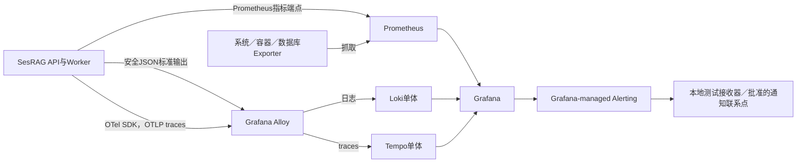

# 本地Compose部署：SesRAG与Grafana可观测体系调研及建议

> 2026-11-14已形成[ADR-005部署方案](../adr/005-sesrag-local-observability-deployment-plan.md)：独立`docker/monitoring/`与独立Compose；等待应用可观测接入完成后再实施。本调研保留候选和历史，实际范围以ADR-005为准，windows_exporter及应用插桩不属于005实施内容。

| 字段 | 内容 |
| --- | --- |
| 日期／状态 | 2026-11-13（America/New_York）；调研与设计建议，尚未实施或运行监控栈 |
| 范围 | 本机容器化SesRAG＋Grafana、Prometheus、Loki、Tempo、Alloy／OpenTelemetry及告警；CI仍使用GitHub提供的Runner |
| 依据 | 用户提供的参考架构；当前[Compose](../../docker-compose.yml)、[依赖](../../pyproject.toml)、[v0.3部署说明](rag-v3-development.md)，以及第14节官方资料 |
| 交付边界 | 核对部署路线、当前代码缺口、平台限制、生命周期和后续实施步骤；不新建可执行监控Compose、不安装组件、不修改业务或旧PRD验收工程、不发送外部通知 |

## 1. 可行性与推荐路线

**可以本地容器化部署，用户提供的信号流向总体正确。** 该方式适合开发调试、学习监控及隔离验证，配置归档后可以重建；停止、删除容器、删除遥测历史和删除业务数据是不同操作，不能用一个不加区分的`down -v`覆盖所有目的。

建议以**独立容器、独立监控Compose、单体本地存储**为主要路线：

- Grafana：查询、仪表盘及Grafana-managed Alerting。
- Prometheus：主动抓取并存储指标，保留用户原本的pull路线。
- Loki：单体日志存储与查询。
- Tempo：3.x的`target=all`单体模式、本地WAL和block存储，无须为小规模本地部署加Kafka或MinIO。
- Alloy：采集Docker标准输出日志；作为OTel Collector接收OTLP traces并处理、转发。它已经承担Collector职责，不再无目的叠一份独立OTel Collector。
- Exporter与应用插桩：补上实际数据源；安装Grafana不能自动生成业务指标和端到端trace。

本地只发布必要的回环端口。指标、日志、追踪和告警都是观测投影，PostgreSQL中的Task／Run／Event仍是业务事实来源；遥测失败不能替业务宣布终态。

## 2. 对参考架构逐项分析

| 用户参考部分 | 结论 | 需要补充或修正 |
| --- | --- | --- |
| Node Exporter→Prometheus | Linux真实主机上合理 | Docker Desktop里的Linux环境不等于Windows宿主；Windows需windows_exporter，具体采集对象要标清 |
| 应用`/metrics`→Prometheus | 推荐保留 | 当前SesRAG还没有这些端点；API与Worker分别提供有界指标，不能只抓API后假设覆盖Worker |
| stdout／文件→Alloy→Loki | 合理 | 本项目优先stdout单一路线，限定项目及opt-in服务，持久化读取偏移；不同时重复读取同一份文件和Docker logs |
| OTel SDK→Alloy→Tempo | 合理 | SDK／插桩才产生span；API进入数据库任务队列后的异步执行需显式上下文传播，单靠HTTP自动插桩不够 |
| Grafana查询三类存储 | 合理 | 数据源URL用容器DNS，设置固定UID和实际日志／trace关联，不能填容器内`localhost`或只建三个孤立面板 |
| Grafana Alerting→联系点 | 合理 | 第一阶段只让Grafana拥有告警规则；不同时在Prometheus、Loki ruler重复定义同一条规则 |
| 配置全放专门目录 | 合理 | 增加版本锁、持久卷、平台差异配置、Secret输入、启停／销毁说明和闭环验证 |

建议流向：



图中Exporter和应用指标由Prometheus拉取。Alloy的OTLP接收器第一阶段只处理traces，日志使用Docker来源；不重复抓取／双写业务指标。OpenTelemetry是一套标准、SDK和协议，不是一定要额外部署一个名为“OpenTelemetry”的服务器。

## 3. 两种官方支持的本地路线

| 路线 | 适用情形 | 优点 | 边界 |
| --- | --- | --- | --- |
| `grafana/otel-lgtm`开发镜像 | 快速体验、检查应用能否发送OTLP | 一个容器内带完整后端，配置入口少 | 官方明确dev／demo／testing；内置上游OTel Collector，并非本方案的Alloy配置；不能把演示默认值直接当长期部署 |
| Grafana＋Prometheus＋Loki＋Tempo＋Alloy独立Compose | 当前项目后续正式本地监控方案 | 独立配置、保留期、升级、故障注入、资源限制及清理更清楚 | 文件较多，仍需完成应用接入与实际验证 |

本次查得`otel-lgtm:0.41.0`还包含Pyroscope，OBI可选，不是只有LGTM四个进程。它支持把`/data`挂到持久卷；“一个容器”不等于低内存，也不等于不能持久化。当前需求没有profiling／eBPF，不建议为此开启特权OBI或把它作为跨数据库队列trace的替代。

**建议把独立Compose作为最终本地路线；一体镜像仅作为可选短期体验。** 不需要先上Kubernetes、Mimir、分布式Loki或多副本Tempo。本地单机不承诺高可用。

## 4. 当前版本与配置兼容性

以下为本次GitHub官方最新正式release核对结果，属于**候选版本，不是已共同验收的版本矩阵**。实施时先选定tag、核实镜像manifest并记录digest，再用相应tag的文档和配置验证；不要全部写`latest`。

| 组件 | 本次release | 推荐镜像候选 | 注意事项 |
| --- | --- | --- | --- |
| Grafana | 13.3.1 | `grafana/grafana:13.3.1` | 保存数据源／dashboard／alert UID和provisioning，不能只靠手点配置 |
| Prometheus | 3.16.0 | `prom/prometheus:v3.16.0` | 明确时间及大小保留限制；remote-write／OTLP接收不是默认必开 |
| Loki | 3.7.10 | `grafana/loki:3.7.10` | 本地单体、TSDB v13、24h索引周期与compactor保留配置匹配 |
| Tempo | 3.1.1 | `grafana/tempo:3.1.1` | 3.x配置与2.x有破坏性变化，不能沿用旧ingester／compactor字段 |
| Alloy | 1.21.3 | `grafana/alloy:v1.21.3` | 当前latest文档可能已显示后续版本，组件和稳定性以选定tag为准 |
| OTel Python | 1.45.2稳定API／SDK | 安装在API／Worker镜像，不单独起SDK容器 | contrib instrumentation与稳定包独立版本，按约束锁定；不能统一随意填相同版本号 |

Tempo固定tag官方`single-binary`示例已确认只需一个Tempo数据卷，使用`-target=all`和`storage.trace.backend=local`。但该示例仍把Tempo默认tag写3.0.0、Prometheus写latest，另启用了匿名Grafana管理员、测试流量、metrics-generator和MCP。应借鉴结构并裁剪，**不要整份不审查照搬**。

默认先不启用Tempo metrics-generator、span-metrics和service-graph。若后续要服务图／trace生成指标，需显式接通生成器到Prometheus remote-write，配置接收开关及容量，才有真实数据；只在Grafana打开服务图面板不会自动产生服务图。

## 5. 建议目录和职责

用户给出的`monitoring/`树可直接理解为一个独立模块。本仓库已有`docker/`职责目录，建议实施时集中到**`docker/monitoring/`**，不创建新的产品顶级目录：

```text
docker/monitoring/
├─ compose.yaml                    # 只定义监控组件、监控卷及网络引用
├─ app.override.yaml               # 给现有应用附加采集标签、私有连接、OTel配置及必要Exporter
├─ versions.env.example            # 无Secret的固定tag／digest与端口、保留期模板
├─ prometheus/
│  └─ prometheus.yml                # 唯一指标抓取清单；第一阶段不存重复告警规则
├─ alloy/
│  └─ config.alloy                  # Docker日志过滤、OTLP traces、过滤／限流／batch／转发
├─ loki/
│  └─ config.yaml                   # 单体TSDB、本地持久路径、retention与限额
├─ tempo/
│  └─ config.yaml                   # 当前3.x单体、OTLP接收、本地WAL／blocks、retention
├─ grafana/
│  ├─ grafana.ini                   # 登录、服务地址和告警行为，不写真实密码
│  ├─ provisioning/
│  │  ├─ datasources/               # 固定UID及logs↔traces／metrics关联
│  │  ├─ dashboards/                # 面板加载规则
│  │  └─ alerting/                  # 规则组、联系点、通知策略
│  └─ dashboards/                   # 可版本化JSON；注明所需Exporter／指标
├─ platform/
│  ├─ linux-host.yaml               # 真实Linux Node Exporter与可选容器指标
│  └─ docker-desktop.yaml           # 桌面环境明确降级项，不伪造Windows宿主指标
├─ runtime/                        # 本地Secret／生成配置；必须Git忽略
├─ artifacts/                      # 本轮验证报告；按run-id保存，按约定忽略
├─ README.md                       # 启停、验证、保留／销毁、升级、备份／回滚
└─ run-monitoring.ps1               # 后续实施的Windows主入口；Linux可用等价入口
```

这些都是**拟新增文件**，本任务没有创建或接入。Exporter应按需要加配置，不为了目录齐全而先引入所有依赖。`runtime/`只存监控所需凭据，不复制`docs/secret`或开发`.env`。新增配置项应在模板及README说明默认值、安全边界和是否必填。

Compose合并时，override相对路径以**第一个`-f`的基础文件**为基准；独立监控Compose自己的路径则以它自己为基准。不能同一段相对路径既按仓库根又按monitoring目录解释。`depends_on`只适用于同一Compose模型，不能跨两个project等待健康。

## 6. 网络、端口和应用衔接

建议应用与监控使用不同Compose项目名，例如`sesrag-dev`与`sesrag-observe`；业务卷属于应用，监控卷属于监控。用专用的外部bridge网络连接需要接入的服务，由启停入口创建并标记归属，不能复用其它项目任意网络。

- 应用API／Worker经override加入观测网络；仍保留原应用网络访问PostgreSQL／Redis。不为观测改变任务队列或业务数据源。
- PostgreSQL／Redis Exporter如启用，放在应用侧override，同时连接应用网和观测网；使用受限账号和安全连接，不把数据库口令写进Prometheus抓取URL。
- Grafana使用`http://prometheus:9090`、`http://loki:3100`、`http://tempo:3200`查询。不能使用Grafana容器内`localhost:9090`去指代另一容器。
- API／Worker把traces发到`alloy:4317`或`alloy:4318`；Tempo也可在自己容器监听4317／4318，没有宿主映射冲突。只让Alloy作为应用的入口。
- OTLP接收器需显式绑定`0.0.0.0`，避免默认只监听容器loopback；不等于把端口直接发布到公网。
- Grafana默认只映射`127.0.0.1:3000`；本机非容器程序需要OTLP时，再映射Alloy的4317／4318到127.0.0.1。Prometheus／Loki／Tempo管理端口默认只在私有网络开放。

private network不能无条件`internal:true`后又期望Grafana发邮件／Webhook成功；需要外部通知的组件单独评估出站网络，数据库和遥测存储不因此全部暴露。业务模型／MinerU请求也继续受原外发安全约束。

鉴于Windows当前的开发服务端口为8000／5173，还应在本地override明确回环绑定，避免根Compose默认发布到所有网卡。修改ports列表时先检查实际merge结果，不能以追加`127.0.0.1`条目就假设旧映射已删除。

拟议Compose核心服务约定如下；路径、UID权限及配置解析必须用固定版本实测：

| 服务 | 内部接口 | 数据挂载 | 本地就绪观察 |
| --- | --- | --- | --- |
| grafana | 3000 | `grafana_data:/var/lib/grafana`＋只读provisioning | `/api/health`，另验证数据源实际查询 |
| prometheus | 9090 | `prometheus_data:/prometheus`＋只读抓取配置 | `/-/ready`，另查targets和真实序列 |
| loki | 3100 | `loki_data:/loki`，配置中的所有路径归入此目录 | `/ready`，另写入并查询合成日志 |
| tempo | 3200查询／管理，4317与4318接收 | `tempo_data:/var/tempo`，WAL和blocks等在卷内 | `/ready`，另送合成span并按trace_id查询 |
| alloy | 4317／4318接收OTLP，管理接口另内网开放 | `alloy_data:/var/lib/alloy/data`，位置及已选持久状态 | 组件健康状态和自身导出指标，另验实际送达 |

不要默认所有镜像都有shell／curl。Loki3.7.10为distroless，不能照抄`CMD-SHELL curl`健康检查；可由明确的外部探针或确实存在的工具检查。Alloy1.21.3标准Dockerfile虽创建专用UID但未切默认USER，不能宣称天然以非root运行；是否显式降权、如何访问socket及写卷须一起验证，而不是为启动方便把所有容器设为root或privileged。

## 7. 三种信号的落地细节

### 7.1 指标：保持Prometheus主动抓取

抓取目标按层区分：

| 层 | 建议目标 | 不能据此推断的内容 |
| --- | --- | --- |
| 主机 | 真Linux的Node Exporter；Windows的windows_exporter另配 | 容器内Linux数字不是Windows物理宿主视图 |
| 容器 | Docker Desktop自身可提供的资源视图；真实Linux可单独验证cAdvisor或等价来源 | Node Exporter本身不会自动给出完整每容器CPU／内存／重启指标 |
| 数据库 | PostgreSQL／Redis Exporter，按需要启用 | 进程up不能代替业务事务／队列健康 |
| API | HTTP请求数、错误数、响应耗时及受控连接池指标 | 长SSE连接时长不能当作后台Run处理时长 |
| Worker／RAG | 正在执行任务、排队数／最老等待、尝试结果、阶段耗时、发布／失败／取消 | 一条业务Task重试多次不能误计为多次完整Run成功 |
| 监控自身 | Prometheus、Alloy、Loki、Tempo及Grafana自身指标 | 单个组件up不证明整条数据路径完整 |

第一阶段可用应用Prometheus指标库提供`/metrics`；也可用OTel Metrics SDK的Prometheus reader暴露端点，二选一形成清楚职责。API和长驻Worker分别提供端点，Worker不依赖等待下次任务才推送。不要为长驻Worker滥用Pushgateway掩盖已退出进程。

抓取建议从15～30秒开始；采集有界、聚合与缓存必要数据库查询，不让每次metrics读取扫描全库或阻塞业务。路径标签使用路由模板，指标label只保留service、环境、有限task_kind／stage／result等。run_id、task_id、trace_id、用户输入、完整URL不能作为高基数label。

此路线**不需要**打开Prometheus OTLP receiver或remote-write receiver；Alloy的`otelcol.exporter.prometheus`也不能直接等同上游Collector的`:9464 /metrics` exporter。若以后改OTLP metrics方案，应单独明确转换／抓取／remote-write路线，避免两条路径重复写相同序列。

### 7.2 日志：stdout→Alloy→Loki

当前Worker已输出安全JSON，可从`backend/workers/runtime.py::_write_log`采集action、task_id、run_id、document_id、parse_job_id、worker_id、generation、stage、duration_ms等。API的uvicorn访问日志和其它库日志不一定是同一JSON结构，需分别处理，不能只配置一个JSON解析器就丢掉所有非JSON日志。

建议Alloy使用Docker discovery＋`loki.source.docker`，同时按`com.docker.compose.project`及显式采集标签过滤。默认不收宿主所有容器、不读取Windows整个磁盘、不把Secret文件作为日志源。容器被替换后按服务身份重新发现，不依赖旧container_id硬编码。

Docker socket挂载即便写`:ro`也只是挂载只读，**不限制Docker API写操作权限**。本地直接socket方案必须明确其高权限；要加强隔离可用严格只允许必要发现／日志接口的代理，但额外代理也是待维护和验证的模块。不要通过开放无TLS的TCP2375解决Windows接入问题。

Loki label采用环境、服务、有限级别等；run_id、task_id、trace_id放JSON字段或structured metadata，不做索引label。字段名和timestamp策略统一，给日志添加真正的trace_id才可能和Tempo关联；run_id不能冒充trace_id。

Alloy的数据目录应持久化读取positions。**positions不等于持久化发送队列或零丢失承诺。** v1.21.3中`loki.write`的WAL仍是experimental，需显式启用及稳定性标志；初期不默默开启实验项。如果不启用，就承认发送buffer在崩溃／长时间Loki不可用时可能丢失；若需要更强保障，另行选择并验证队列、重试、磁盘上限和重复容忍。

Loki本地存储建议所有数据放进一个明确named volume内，包含chunks／TSDB／WAL／compactor marker。保留期需要配置compactor执行，不能只写`retention_period`期待自动删除。选定3.7.x时的关键约束：TSDB、schema v13、24h索引period；`compactor.retention_enabled=true`、`compactor.delete_request_store=filesystem`及可写持久working_directory。旧于保留期的日志删除有异步延迟，保留期不是磁盘硬配额。

Docker本地日志也要轮转，例如每容器10MB×3文件作为初始建议；否则Loki保留期再短，Docker原始stdout仍可能占满虚拟磁盘。采集可能晚于轮转，轮转量不能小到持续丢日志；需要实际验证。

### 7.3 追踪：SDK→Alloy→Tempo

API和Worker各初始化OTel Provider／Exporter；自动插桩可覆盖FastAPI、受控HTTPX、SQLAlchemy／psycopg的一部分，再手动补排队、领取、解析、切片、Embedding、DB召回、rerank、上下文、生成和发布阶段。

起步只开traces，避免与stdout日志和Prometheus pull产生重复管道。例如下面是**未来安装SDK后**的候选环境约定，当前设置环境变量本身不会给无SDK代码自动产生trace：

```dotenv
OTEL_SERVICE_NAME=sesrag-api
OTEL_TRACES_EXPORTER=otlp
OTEL_EXPORTER_OTLP_TRACES_PROTOCOL=http/protobuf
OTEL_EXPORTER_OTLP_TRACES_ENDPOINT=http://alloy:4318/v1/traces
OTEL_METRICS_EXPORTER=none
OTEL_LOGS_EXPORTER=none
```

Worker使用独立的`service.name=sesrag-worker`；不要给每条任务生成一个新service。Alloy receiver使用gRPC4317或HTTP4318→memory limit／过滤→batch→Tempo gRPC4317。容器私网中的明文OTLP是本地开发约定，不把跳过TLS校验当作远程部署方案。

最重要的应用缺口在**持久任务队列传播**：API的HTTP span结束后，Worker稍后从PostgreSQL领取Task，自动插桩不会自行把两者连接。需设计受限的W3C trace context持久元数据、入队与消费span／span link，覆盖重试、generation、重启恢复；不能把任意baggage塞进RunSnapshot或Event。字段／迁移和传播方案应在后续正式实施中明确；trace不改变租约和终态事务。

不要保持一个永不结束的span等待用户完成整个会话，也不要每个SSE delta产生span。将HTTP／SSE连接、一次Task attempt、外部请求和完整业务Run耗时分开，取消／失租与异常分类一致。

Tempo3.1.1保留可用`overrides.defaults.compaction.block_retention: 24h`配置；不要套旧`compactor.block_retention`。本地WAL／blocks及需要的处理状态持久化；24h只是建议起点，不是立即硬删除保证。初期关闭metrics-generator、MCP和非必需演示服务，保留最小数据路径。

采样从本地小流量100%或明确比例起步，量大再调整；head sampling不能保证保留全部错误，tail sampling会增加状态和内存成本，需要另验。指标exemplar只有在对应trace被采样、成功送达且未过期时才有可跳转对象。

### 7.4 脱敏和故障边界

HTTP客户端插桩可能采完整URL，数据库插桩可能采SQL；本项目MinerU有签名上传／下载URL，模型调用有Key与Prompt。应在SDK侧白名单／禁用敏感属性，并在Alloy做第二层过滤；不能只靠采集后删字段就宣称源头没泄漏。

默认不收请求／响应正文、Prompt、文档原文、Authorization、Cookie、DSN、SQL参数和签名query。原始run/task等安全身份只在受限日志／trace属性中使用，不进入高基数指标。发送重试、buffer、超时和磁盘均有界；Alloy／后端不可用时业务继续按原语义运行，观测错误不得覆盖任务结果。

## 8. Windows Docker Desktop与本机资源

本机实际只读观察：Windows约23.7GiB物理内存、20逻辑处理器；Docker Desktop运行Linux容器，Engine可见约11.5GiB内存；检查时6个既有容器均未运行。Docker已有约29.79GB镜像和25.06GB构建缓存的统计，分类间可能共享数据，**不能简单相加当作独立占用**；没有执行prune或删除。

| 观察对象 | 本地建议 |
| --- | --- |
| Windows物理主机CPU／内存／C盘D盘 | 另装或启用windows_exporter；经受限宿主地址供Prometheus抓取。它是Windows原生采集，不是把Linux Node Exporter映射目录就能代替 |
| Docker Desktop Linux环境 | 明确标记VM／WSL2／容器视图；Node Exporter能否得到所需namespace及挂载视图应单独验证，不声称等于物理宿主 |
| 每容器资源 | 真实Linux可选cAdvisor；Docker Desktop支持的cgroup／挂载范围不完全等价，不默认上privileged＋全盘挂载换取“看起来有数据” |
| PostgreSQL／Redis／应用 | 内网Exporter和应用指标不依赖物理宿主采集，可先完成 |

粗略容量规划建议：先给应用＋指标／日志阶段约4～6GiB运行预算；完整小流量traces栈以约8～12GiB容器可用空间作为试验起点，并观察实际内存、IO和丢弃计数。**这是工程预算，不是官方最低配置或本机已测峰值**；现有Docker内存范围具备尝试条件，不能一次把各组件上限全设满11.5GiB。

建议初期Prometheus保留3～7天、Loki24～72小时、Tempo24小时，所有日志和遥测队列有界。指标数量／trace大小／日志日增量决定真实容量；没有这些数据不能承诺固定GB够用。配置Prometheus时间＋大小上限，但WAL／head、Loki、Tempo和Docker仍需额外磁盘余量与监测。

磁盘当时C约42.6GiB、D约56.1GiB可用；Docker数据实际位于其虚拟磁盘，未确认Windows物理落点，不能把D盘余量直接当作Docker可用容量。named volume建议放遥测数据库，Windows bind mount只放小型配置／面板。删除volume后虚拟磁盘内部空间可复用，不保证Windows的VHDX文件立即缩小；物理回收需遵循Docker Desktop／WSL的相应维护方式，不手动删除活动虚拟磁盘。

## 9. Grafana数据源、告警与闭环

### 9.1 关联配置

provisioning中固定数据源UID，例如`sesrag-prometheus`、`sesrag-loki`、`sesrag-tempo`，仪表盘和告警引用同一UID。

- Loki记录真实trace_id后，derived field指向Tempo UID。
- Tempo trace-to-logs按相同服务属性、时间窗口及trace_id查询Loki；字段／标签映射实际一致后再验。
- Prometheus exemplar如开启，配置trace UID；没有SDK exemplar不能只配Grafana就造出跳转。
- dashboard JSON入库、provider规则固定；需要保留的手动修改先导出，避免重建后丢失或被provisioning覆盖。

### 9.2 规则归属

第一阶段只采用**Grafana-managed Alerting**，规则／联系点／通知策略放`grafana/provisioning/alerting/`，使用Grafana内置Alertmanager分组与路由，不额外起独立Alertmanager。Prometheus先只存指标；Loki先只存日志。

若以后改Prometheus recording／alert rules→独立Alertmanager，应明确迁移规则归属，不同时保留同一故障的两套通知。Recording rule与告警规则职责不同；可按需要单独加，不能为结构齐全先复制规则。

Grafana内置Alertmanager不应当作可随意统一接收Prometheus原生规则的通用独立Alertmanager。通知policy文件可能替换整棵策略树，须整体版本化；Webhook URL不放token或密码，按联系点支持的认证／Secret机制配置，防止非敏感URL字段泄露凭据。

候选告警按小规模开发用途设计，不宣称生产SLO：

| 告警对象 | 建议验证目标 |
| --- | --- |
| 抓取目标失联 | `up=0`并持续一定时间；目标从配置消失还要考虑absent，不把缺序列自动当正常 |
| Worker不可用／积压 | 可信心跳投影异常、队列最老等待增大或持续积压；不只看API ready返回200 |
| 错误／重试 | 区分客户端错误、取消、业务失败和基础设施故障；有请求量下再判断错误比例 |
| CPU／内存／磁盘 | 用正确主机／VM对象、持续窗口和可用空间告警，避免Desktop休眠造成大量噪声 |
| 遥测管道 | Alloy导出失败／丢弃、Loki／Tempo写入失败、Prometheus抓取异常；业务正常不代表遥测未丢 |
| 检索为空 | 作为业务质量观察，不能将无证据与依赖失败混成同一种基础设施告警 |

健康接口当前`/health/ready`在Redis降级／Worker未知时可能仍200，所以HTTP200不能代替payload或相应指标判断。告警需明确NoData、Error、Pending、Firing、Resolved策略，避免缺数据时静默恢复。

### 9.3 通知测试

先用**本地Webhook接收器**验证：制造受控故障→规则进入Pending／Firing→通知策略匹配→本地收到消息→恢复→Resolved。此接收器作为可选验证profile，不向外部邮箱或聊天群自动发消息。

邮件需要SMTP服务，按服务要求配置认证凭据；本地Mailpit等测试接收器可在受限网络中无认证捕获测试邮件。Webhook需要真实目的端、相应授权和网络；Compose配置本身不自动提供这些外部条件。Grafana管理员密码使用本地secret文件／`GF_SECURITY_ADMIN_PASSWORD__FILE`等受支持机制，不采用演示匿名Admin；联系点凭据不得提交。各provisioning文件的变量替换支持按固定版本分别验证，不能假设所有字段都支持同一套模板。

监控和应用同机时，Docker Desktop停止、电脑关机／休眠或Grafana自身宕机，不能指望这套Grafana继续发“我已宕机”通知。需要24小时监测时再加独立外部探测，或者迁移到持续运行主机。

## 10. “即删即用”的生命周期约定

以下命令是**拟议文件实施后的操作示例**，当前文件尚未生成，不能据此认为已经能直接启动。实施时从`versions.env.example`生成Git忽略的`runtime/monitoring.env`，只放版本／端口／保留期等非Secret值；凭据仍用独立Secret文件。显式`--env-file`防止从仓库根自动加载开发`.env`，已存在的同名shell变量优先级也应由入口检查：

手动执行启动示例前，还须由Start入口完成专用外部网络创建及权限／配置预检；独立Compose不会自动创建标记为external的网络。

```powershell
# 校验不会展示完整展开凭据的结果。
docker compose --env-file docker/monitoring/runtime/monitoring.env -p sesrag-observe -f docker/monitoring/compose.yaml config --quiet
# 启动／复用已保留的监控数据。
docker compose --env-file docker/monitoring/runtime/monitoring.env -p sesrag-observe -f docker/monitoring/compose.yaml up -d
# 删除监控容器，保留named volumes，之后up恢复历史。
docker compose --env-file docker/monitoring/runtime/monitoring.env -p sesrag-observe -f docker/monitoring/compose.yaml down
# 明确丢弃监控历史时才使用；该Compose不包含应用PostgreSQL／原件数据卷。
docker compose --env-file docker/monitoring/runtime/monitoring.env -p sesrag-observe -f docker/monitoring/compose.yaml down --volumes --remove-orphans
```

建议后续总入口区分：

| 操作 | 范围与结果 |
| --- | --- |
| Start | 核对project／端口／配置／版本，创建有归属标签的桥接网络，启动、等待真实ready并验证；不扫描秘密目录 |
| Stop | 停监控并删除其容器，保留遥测卷和应用卷，配置仍可重建 |
| DestroyMonitoring | 删除本监控project容器／遥测卷／本轮临时文件；保留应用会话、文档和索引 |
| DestroyLocalEnvironment | 若应用是本轮专属临时实例，先停止／移除其容器但默认保留业务卷，再销毁监控；最后仅在无端点且归属匹配时删除专用桥接网络 |

外部网络不会被Compose down自动删除。应用仍运行并连接它时，DestroyMonitoring应明确记录该共享网络仍为应用所用，不能宣称全环境无残留；完整销毁必须先解除应用端点再删本网络。若要连业务数据一起删，应是另一个明确的业务销毁动作，而不是监控默认行为。

所有数据目录都必须明确：Grafana数据库、Prometheus TSDB、Loki数据／WAL／marker、Tempo WAL／blocks、Alloy positions／已选择的持久queue。配置bind mount、external卷、镜像、BuildKit cache不会因为`down -v`全部消失。备份和artifacts按约定保留，不调用全机prune；不删除现有其它项目容器／卷。

“重新建一个空环境”和“重启后恢复历史”都应验证。备份时Grafana数据库和遥测存储采用停写／一致快照或组件支持方式，配置和版本锁也归档；降级不保证读取新格式数据，先做卷备份再升级，失败用匹配版本＋备份恢复。

## 11. 当前代码基线与后续需要改动的地方

| 当前文件／对象 | 现状 | 后续接入建议 |
| --- | --- | --- |
| `docker-compose.yml` | 应用已有独立容器和业务卷，无监控服务、无统一轮转配置；API／前端发布端口 | 通过本轮专用override附加观测配置；不直接删除或重置开发数据 |
| `pyproject.toml` | 没有OTel SDK／instrumentation和Prometheus指标依赖 | 选定一种metrics路线及兼容SDK依赖，固定版本并更新镜像；不只设置环境变量 |
| `backend/app.py::create_app/lifespan` | FastAPI应用生命周期，尚无统一遥测初始化／metrics端点 | 基础设施层集中初始化、关闭flush，适配层接入middleware；不向路由散布业务指标逻辑 |
| `backend/workers/main.py` | Worker长驻入口与正常退出 | 独立service资源、指标端点、Exporter关闭／flush，退出等待有界 |
| `backend/workers/runtime.py::_write_log/_observed_dispatch` | 已有安全身份和阶段duration，未有OTel trace_id | 接入统一日志关联和span，保持旧代／取消／停止语义；不为观测再派生无界DB任务 |
| `backend/application/stage_observation.py::observe_stage` | 可替换旁路callback，记录失败不覆盖业务结果 | 是阶段指标／span适配的已有切入点，不复制另一套计时规则 |
| `backend/domain/ports/__init__.py::TaskLease`、`backend/db/models.py::TaskModel`、队列适配器 | 任务持久化、领取与generation已实现；未有显式W3C传播字段 | 传播元数据、并发／恢复和迁移须正式设计及回归，不能偷偷改业务契约 |
| `backend/api/routes/health.py::ready` | DB失败503，Redis降级和Worker未知有独立payload | 保留现有健康语义，指标／告警明确解析，不把200都当健康 |

本任务仅核对这些路径，没有执行上述改动。后续功能实施应先明确对应需求／实施方案、契约和必要迁移，再开发；不把本调研文档当成已经批准全部新增业务契约的ADR。

## 12. 推荐实施顺序与验证门槛

1. **基础环境：** 固定版本、网络、回环端口、Secret模板、named volumes及Start／Stop／Destroy；先做Compose合并配置和对应版本promtool／Alloy／Loki等配置解析校验，再以合成遥测验证三类存储和Grafana数据源，不用真实模型请求增加成本。文件bind mount建议使用`create_host_path: false`的长语法，缺配置时直接失败，避免被自动建成空目录。
2. **指标和现有日志：** 接入API／Worker指标、Docker日志过滤及平台对应exporter；核对metrics维度和stdout脱敏，不能以“面板打开”当采集通过。
3. **追踪和异步传播：** OTel基础HTTP／DB插桩＋Task传播／attempt spans＋日志trace_id；验证API入队后Worker重试／重启仍能关联，模型与MinerU span不泄漏参数。
4. **仪表盘和告警：** 固定UID、logs↔traces／可选exemplar关联，本地通知接收器验证Firing→Resolved；实际外部通知另按用户授权配置。
5. **故障及资源复验：** 分别停Alloy、Loki、Tempo，观察有界重试／丢弃计数和业务不受污染；启动恢复／正常清理／强停后恢复清理；核对卷大小、CPU／内存、磁盘增长和保留删除延迟。

至少应取得以下证据再认为方案已跑通：

- Prometheus目标UP且能查询真实请求／Worker阶段指标，采集对象明确为Windows／LinuxVM／容器，不混称。
- 一次合成操作的日志到Loki，带预期安全身份；配置重建／容器替换后仍能采集；无Secret／原文外泄。
- 一次API→队列→Worker→受控下游操作的trace到Tempo，重试／代际可区分，Loki按trace_id跳转有效。
- 一条受控告警实际评估并由本地接收器收到，恢复通知也符合策略；NoData／错误路径没有静默变健康。
- Stop／Start历史保留，DestroyMonitoring监控历史消失而应用数据不变，完整环境清理时专用网络和临时凭据归属核验通过；不触碰其它项目。

## 13. 本次核验结果与未验证事项

已核验官方部署文档、当前release、Tempo3单体本地存储示例、Alloy日志／OTLP职责、Grafana provisioning／告警和Docker生命周期规则；结合本机Docker环境与代码确认了现有缺口。文档整体按信号流、配置版本、平台对象与数据生命周期校审。

独立事实核对发现并修正：监控命令补显式`--env-file`，避免误读开发`.env`；SMTP凭据改为按服务要求配置，避免排除无认证本地测试接收器。当前本地文档链接、命令范围与diff格式检查通过；这些是文档核验，不是部署验证。

**未执行：** 监控镜像下载、Compose启动、组件配置解析、应用插桩、真实trace／metrics／logs闭环、通知发送、备份恢复、长时间容量测试。当前版本表与保留／资源建议均待实施阶段验证，不能写为“本机已部署通过”。

## 14. 官方资料

1. [Grafana Docker配置](https://grafana.com/docs/grafana/latest/setup-grafana/configure-docker/)、[provisioning](https://grafana.com/docs/grafana/latest/administration/provisioning/)、[Alerting文件provisioning](https://grafana.com/docs/grafana/latest/alerting/set-up/provision-alerting-resources/file-provisioning/)。
2. [Grafana otel-lgtm固定版本README](https://github.com/grafana/docker-otel-lgtm/blob/v0.41.0/README.md)、[固定Dockerfile](https://github.com/grafana/docker-otel-lgtm/blob/v0.41.0/docker/Dockerfile)：开发用途、内置Collector／Pyroscope与`/data`持久化。
3. [Tempo3.1.1单体Compose](https://github.com/grafana/tempo/blob/v3.1.1/example/docker-compose/single-binary/docker-compose.yaml)、[同版本本地配置](https://github.com/grafana/tempo/blob/v3.1.1/example/docker-compose/single-binary/tempo.yaml)、[3.x迁移](https://github.com/grafana/tempo/blob/v3.1.1/docs/sources/tempo/set-up-for-tracing/setup-tempo/migrate-to-3.md)、[配置manifest](https://github.com/grafana/tempo/blob/v3.1.1/docs/sources/tempo/configuration/manifest.md)。
4. [Prometheus存储](https://prometheus.io/docs/prometheus/latest/storage/)、[node_exporter](https://github.com/prometheus/node_exporter)、[windows_exporter](https://github.com/prometheus-community/windows_exporter)。
5. [Alloy Docker日志source](https://grafana.com/docs/alloy/latest/reference/components/loki/loki.source.docker/)、[loki.write](https://grafana.com/docs/alloy/latest/reference/components/loki/loki.write/)、[OTLP receiver](https://grafana.com/docs/alloy/latest/reference/components/otelcol/otelcol.receiver.otlp/)。latest文档中的特性须对照1.21.3 tag，尤其实验性WAL。
6. [Loki保留](https://grafana.com/docs/loki/latest/operations/storage/retention/)、[本地配置示例](https://grafana.com/docs/loki/latest/configure/examples/configuration-examples/)、[Promtail EOL](https://grafana.com/docs/loki/latest/send-data/promtail/)。
7. [OpenTelemetry Python](https://opentelemetry.io/docs/languages/python/instrumentation/)、[上下文传播](https://opentelemetry.io/docs/concepts/context-propagation/)、[敏感数据处理](https://opentelemetry.io/docs/security/handling-sensitive-data/)、[FastAPI插桩](https://opentelemetry-python-contrib.readthedocs.io/en/latest/instrumentation/fastapi/fastapi.html)。
8. [Docker Compose down](https://docs.docker.com/reference/cli/docker/compose/down/)、[跨项目网络](https://docs.docker.com/compose/how-tos/networking/)、[多文件合并](https://docs.docker.com/compose/how-tos/multiple-compose-files/merge/)、[Docker日志轮转](https://docs.docker.com/engine/logging/drivers/json-file/)。
9. 官方Release：[Grafana](https://github.com/grafana/grafana/releases)、[Prometheus](https://github.com/prometheus/prometheus/releases)、[Loki](https://github.com/grafana/loki/releases)、[Tempo](https://github.com/grafana/tempo/releases)、[Alloy](https://github.com/grafana/alloy/releases)、[OTel Python](https://github.com/open-telemetry/opentelemetry-python/releases)。
